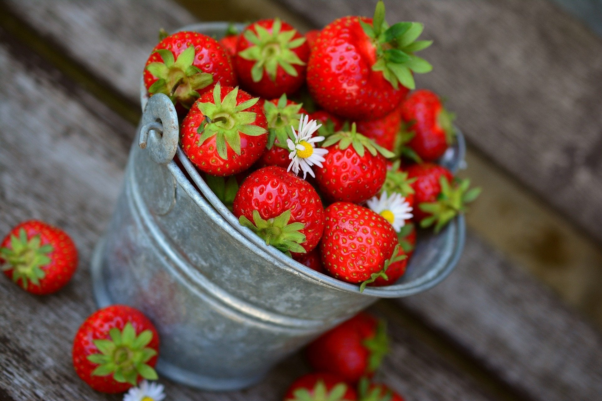
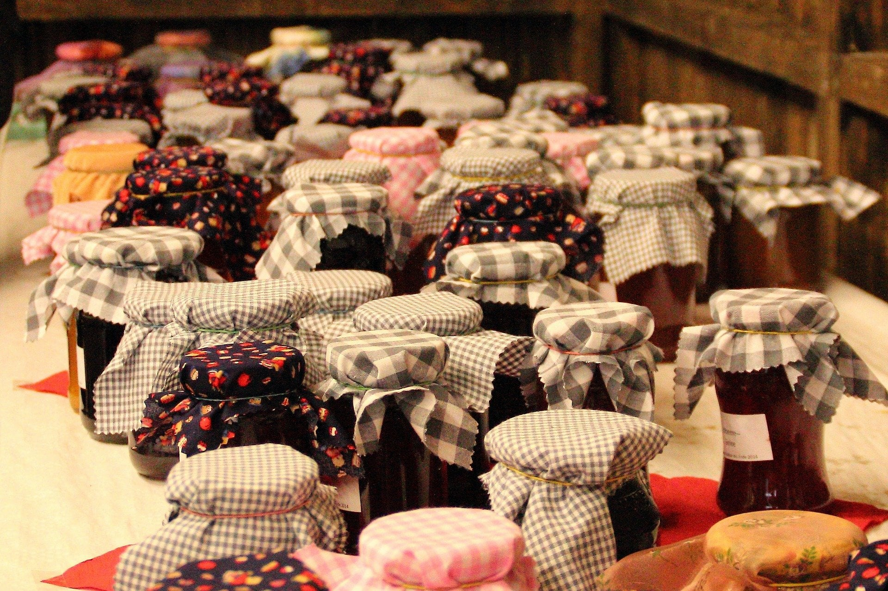

Strawberry fields forever. Okay, maybe not forever.

But definitely in the summer, and definitely all around 417 land. Oh, and blueberries, blackberries and raspberries too.

Here are 11 of the best farms to go berry picking in our area. Picking seasons depend on the weather, so call or check each farm's Facebook page for current hours before you drive out.

## Missouri Berries

[2097 S State Hwy PP, Republic, MO 65738](https://www.google.com/maps/dir/?api=1&destination=37.17832%2C-93.57641)

Missouri Berries is run by the Rogers family, who spent years learning the ropes before opening their farm to the community. Come pick ripe strawberries, then stay for fresh fruit donuts, slushies and plenty of outdoor fun on their 40-acre farm.

Keep up with their adventure on [their website](https://www.missouriberries.com/), and call or check Facebook for current picking hours.

## Peace Lane Berry Farm

[9262 E Peace Ln, Strafford, MO 65757](https://www.google.com/maps/place/Peace+Lane+Berry+Farm/@37.2034544,-93.0919155,15z/data=!4m5!3m4!1s0x0:0xc928711693816ccc!8m2!3d37.2034544!4d-93.0919155)

This farm puts its talents into growing blueberries. They are usually ready from mid June into July. The farm uses organic fertilizers and grows large, sweet berries for eating fresh or tossing in your favorite cobbler.

Hours and info are posted on their [Facebook page](https://www.facebook.com/peacelaneberry/). Call or check Facebook for current hours.

## Horton's Berry Farm

[2385 Hwy DD, Marshfield, MO 65706](https://www.google.com/maps/place/Horton's+Berry+Farm/@37.3385775,-92.8523545,17z/data=!3m1!4b1!4m5!3m4!1s0x87c56110320c1b8b:0xd5fde37d91452f71!8m2!3d37.3385775!4d-92.8501658)

Horton's is family owned and operated. It offers the trifecta of berries for picking: strawberries, blueberries and blackberries. We can already picture all three piled on a scoop of Andy's custard. The farm plants thousands of strawberry plants each year.

When the berries are ripe, hours are posted on their [Facebook page](https://www.facebook.com/Hortons-Berry-Farm-115042036917604/). Call or check Facebook for current hours.

## Brown's Berry Farm

[5935 State Hwy M, Miller, MO 65707](https://www.google.com/maps/place/Brown's+Berry+Farm/@37.1906332,-93.7347129,17z/data=!3m1!4b1!4m5!3m4!1s0x87cf54d9f6f9c5f3:0xfeb8682ae6bfe665!8m2!3d37.1906332!4d-93.7325242)

Strawberries are the primary crop, though the farm has been known to dabble in blackberries. Brown's Berry Farm supports its community and offers a good farm experience for all ages. Picking usually opens sometime between May and early June.

The farm also adds surprises during the season, like inviting local Mennonites to sell baked goods. Find details on their [Facebook page](https://www.facebook.com/brownsberryfarmmillermo/), and call or check Facebook for current hours.

## IronGate Berry Farm

[16225 Johnson Rd, Eldridge, MO 65463](https://www.google.com/maps/place/IronGate+Berry+Farm/@37.801117,-92.7408449,15z/data=!4m5!3m4!1s0x0:0xa97ba0c5d191f673!8m2!3d37.801117!4d-92.7408449)

Four different berries are on offer here: strawberries, blackberries, blueberries and raspberries. Picking typically starts in mid May and runs until the picking is done, usually July. You can also grab local honey and fresh seasonal produce.

Get the details on the [IronGate website](https://irongateberryfarm.com/), and call or check Facebook for current hours.

## Black and Blue Berry Farm

[5313 S Farm Rd 241, Rogersville, MO 65742](https://www.google.com/maps/place/Black+and+Blue+Berry+Farm/@37.1126951,-93.1018447,15z/data=!4m5!3m4!1s0x0:0x2e5d2677ba9afd80!8m2!3d37.1126951!4d-93.1018447)

This urban farm uses natural fertilizers to grow its blueberries. It is outside the berry realm, but they also offer lavender to pick.

Make a day of it: they have tea to sip, cinnamon rolls to taste, ice cream to enjoy and acres to explore. Find out more on their [Facebook page](https://www.facebook.com/blackandblueberryfarm), and call or check Facebook for current hours.

## Persimmon Hill Farm

[367 Persimmon Hill Ln, Lampe, MO 65681](https://www.google.com/maps/place/Persimmon+Hill+Farm/@36.532793,-93.5037286,17z/data=!4m8!1m2!2m1!1spersimmon+hill+farm!3m4!1s0x87ced8cb5ae28311:0x83d4bf15bd76da6a!8m2!3d36.5338836!4d-93.5019321)

Persimmon Hill Farm is open year round and invites you to pick from June to August. They offer blueberries, blackberries and gooseberries, plus berry-filled baked goods, jams and syrups.

After picking, refuel at their farm-to-table restaurant right next to the blueberry fields. Details are on the [Persimmon Hill website](https://www.persimmonhill.com/). Call or check their site for current hours.

## Hummingbird Berry Farm

[5581 S 140th Rd, Brighton, MO 65617](https://www.google.com/maps/place/Hummingbird+Berry+Farm/@37.441105,-93.3836215,17z/data=!3m1!4b1!4m5!3m4!1s0x87c5928ad47de4e7:0x5e6a849c50e8e635!8m2!3d37.441105!4d-93.3814328)

Blackberries are this farm's specialty. Hummingbird Berry Farm grows three varieties, thornless and on trellises, for easy picking.

As the name suggests, homemade nectar feeders are placed around the farm to attract hummingbirds, so expect a few to buzz past. Find info on the [Hummingbird Berry Farm website](https://hummingbirdberryfarm.com/), and call or check Facebook for current hours.

## High's Berry Farm

[879 Crabapple Rd, Ozark, MO 65721](https://www.google.com/maps/place/Highs+berry+farm/@36.9540337,-93.2461547,17z/data=!3m1!4b1!4m5!3m4!1s0x87cf73763968daef:0x7acc07c29100c91c!8m2!3d36.9540337!4d-93.243966)

Just south of Ozark, High's Berry Farm is known for its hospitality and its strawberries. The whole family gets involved growing acres of strawberries. The season usually starts in May, with U-Pick strawberries into mid June.

Get ready by visiting their [Facebook page](https://www.facebook.com/highsberryfarm/), and call or check Facebook for current hours.

## Boz's Berry Farm

[13920 State Hwy TT, Republic, MO 65738](https://www.google.com/maps/place/Boz's+Berry+Farm/@37.1564254,-93.5907507,17z/data=!3m1!4b1!4m5!3m4!1s0x87cf50ad074ab5c5:0x8e36d038e130e649!8m2!3d37.1564254!4d-93.588562)

Boz's is a family farm offering U-Pick strawberries, grown with care using the organic humus technique. On some days they also offer slushies, jam or honey.

Their [Facebook page](https://www.facebook.com/BozsBerryFarm/) is the best place to find good times to visit. Call or check Facebook for current hours.

## Gardener's Orchard and Bakery

[4455 W Farm Rd 2, Brighton, MO 65617](https://www.google.com/maps/place/Gardener's+Orchard+LLC/@37.4226363,-93.3644658,17z/data=!3m1!4b1!4m5!3m4!1s0x87c592759fbd1dc9:0x6c97609705297642!8m2!3d37.4226447!4d-93.3622761)

The Gradinariu family runs this farm with a focus on supporting the local community and teaching people where their food comes from and how it is made. Leave extra time when you pick strawberries here to get to know the family, who welcome visitors with plenty of conversation.

Keep up with the farm at [gardenersorchardandbakery.com](https://gardenersorchardandbakery.com/), and call or check Facebook for current hours.

## Quick! Go Pick!

417 land is a prime spot for growing berries, and you have plenty of farms to choose from. The picking season goes by quickly, so pick a farm, pick a date and pick a berry.

Wherever you go, you are sure to have a berry good time.
