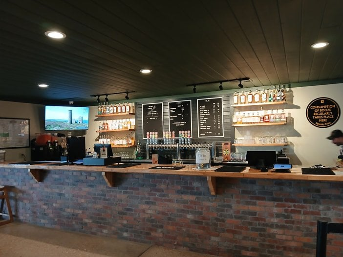
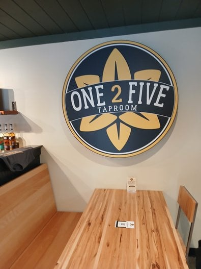
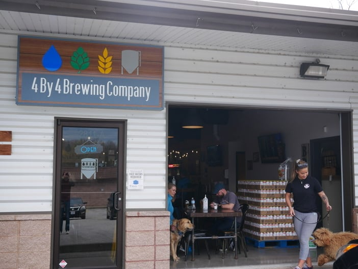
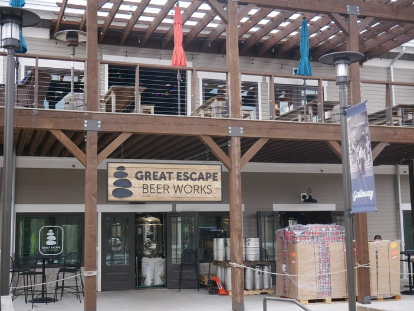
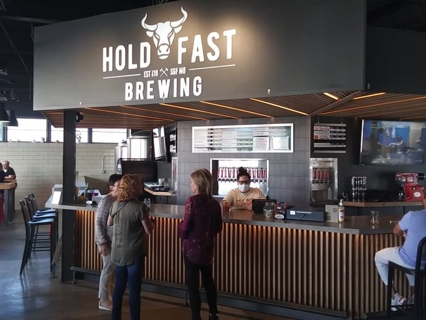
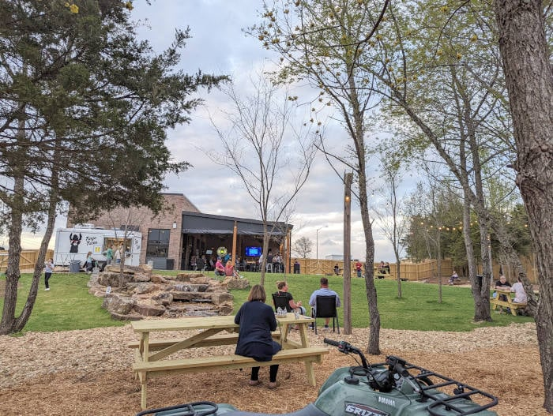

Looking to explore some locally crafted brews in Springfield? You are in the right place.

Here are the best breweries in Springfield and a snapshot of what you can expect at each. Along with spots in town, you will find a few more in the Springfield area, in Ozark, Battlefield and Republic.

Not sure which to visit first? The order in which they got their start is a fun way to work through them all.

## How many breweries are in Springfield?

There are currently ten breweries in and around the Springfield area, and Springfield Brewing Company also runs a taproom out near Rogersville.

Here are the breweries in Springfield, MO, and when each began.

- [Springfield Brewing Company](#springfield-brewing-company) is the original Springfield brewery, with beginnings in 1997. In 2024 it added its [One 2 Five Taproom](#one-2-five-taproom-rogersville) out on Highway 125 near Rogersville.
- In 2011, [Mothers Brewing Co](#mothers-brewing-company) launched.
- On April 26, 2016, [Show-Me Brewing](#show-me-brewing-company) opened its unique arrangement.
- In December of 2017, [4 By 4 Brewing Company](#4-by-4-brewing-company) got its start.
- [Tie and Timber Beer Co](#tie-and-timber-beer-co) began in April of 2018.
- On December 15, 2018, [Great Escape Beer Works](#great-escape-beer-works) was born.
- [Hold Fast Brewing](#hold-fast-brewing-company) debuted August 9, 2019.
- On January 17, 2022, [Wire Road Brewing](#wire-road-brewing) entered the scene.
- In late June of 2023, [Before and After Brewing](#before-and-after-brewing) opened its doors in the Southern Hills Shopping Center.
- Out in Ozark, [Back Home Brewing Company](#back-home-brewing-company-ozark) is a hometown pub that brews its own beer.

### Springfield Brewing Company

[Springfield Brewing Company](https://www.springfieldbrewingco.com/) is the original Springfield brewery and one of the better-known ones in town. It was created as a showroom for the brewing tanks made in Springfield by the Paul Mueller Company.

A visit to this downtown establishment at [305 S Market Ave](https://g.page/SpringfieldBrewco?share) gets you local craft beers from light to dark, restaurant options and a relaxed dining experience, with two floors indoors and two patios.

With a pool table and arcade games, the upstairs is more of a bar. The downstairs has a huge bar and plenty of booth seating.

If you want to sip craft beer while enjoying a truly Springfield-style meal, this is your place.

#### One 2 Five Taproom (Rogersville)

[One 2 Five Taproom](https://springfieldbrewingco.com/one2five-taproom/) is Springfield Brewing Company's taproom out in the country (opened in 2024), at [1846 S State Hwy 125](https://maps.google.com/?q=1846+S+State+Hwy+125,+Rogersville,+MO+65742), just north of Rogersville, where Sunshine (Hwy D) meets Highway 125. It is about 10 minutes from the east side of Springfield, which makes it an easy stop on a back-roads drive to look at fall colors.

Behind the brick bar is a long row of SBC beer on tap, from the 417 Lager and 125 Gold to IPAs, a Märzen, a pils and Bull Creek Brown, plus a nitro option. The shelves are lined with spirits from Ty Iechyd Da Distillery, SBC's small distillery that operates on site.

Hungry? They fire up wood-fired pizza with scratch dough made daily, and there is a small package store if you want to take some beer or spirits home.

Pair a pint with a pizza and grab a seat at one of the big wood tables. It is one of the most relaxing beer stops in 417 Land.

**Note:** Hours vary through the week and the taproom is closed early in the week, so check [SBC's One 2 Five page](https://springfieldbrewingco.com/one2five-taproom/) before you head out.

### Mothers Brewing Company

Most local breweries treat cans, bottles and the business side as an afterthought. Mothers Brewing Company went big when it began brewing in 2011 in a 38,000-square-foot building in the heart of downtown Springfield.

Since then, Mothers has been taking over taps and grocery store coolers across the Midwest.

They launched their first brew on April 1, 2011, a cunning way to say they were not fooling around. They have consistent year-round brews, seasonals that return and a good number of limited-release editions.

The taproom at [215 S Grant Ave](https://g.page/mothersbrewingco?share) feels large but inviting, and the lawn is the place to take your beer and make some memories.

In your Mother's backyard you can find [local events](https://www.mothersbrewing.com/event-listing/) like comedy tours and movie nights, and even join a wiffleball league. Or bring a book and sip a solid brew. It is basically a park with great beer.

Crack open a cold one at Mothers sometime and say thanks to [the Mothers crew](https://www.mothersbrewing.com/about/) for helping pave the way for Springfield's craft beer scene.

### Show-Me Brewing Company

Show-Me Brewing Company is a brewery and also a resource for getting into brewing yourself.

It is at [1925 E Bennett St](https://goo.gl/maps/bvyHKFMCTWCLcPAB8). The location is split into a few sections: a bar and a handful of high-top tables for sampling what they brew, and rows of homebrew and winemaking supplies and equipment for DIYers.

You can also make an entire batch of beer here. Schedule an appointment with a brewing specialist, and you will be guided through a three-hour brewing process to create a custom brew.

Because hours and appointments can change, call ahead to confirm before you go.

### Back Home Brewing Company (Ozark)

[Back Home Brewing Company](https://www.backhomebrewing.co/), at 1502 S 3rd St in Ozark, MO, is just what its owner describes it as:

"We're more like a hometown pub that brews their own beer."

Walking in feels like entering your friendly neighborhood watering hole with rustic, eclectic decor. You can get a range of locally brewed beers on tap, from light beers to stouts and other ales. The other taps typically carry IPAs or ciders from other breweries.

They serve straightforward pub food. Back Home also has a pool table, darts, live music, karaoke, trivia, bike nights, a large bar, a patio and two dining rooms.

If you are looking for a hometown brewery and bar to kick back in, Back Home is the spot in Ozark.

**Note:** Back Home Brewing has been listed as allowing smoking indoors, so if you would rather avoid that, check with them before you go.

### 4 By 4 Brewing Company

[4 By 4 Brewing Company](https://www.4by4brewingcompany.com/), at [2811 E Galloway St](https://goo.gl/maps/dCxiLQMyY8XXDZoC6), Springfield, sits right across the street and up the hill from Sequiota Park in the heart of Galloway Village. It has a relaxing, rustic seating area and a back patio for enjoying the Ozark weather.

4 By 4 has a beer for everyone: light, dark, stout, IPAs and more. They also sell growlers to go.

4 By 4 went through a Chapter 11 reorganization and is still operating.

They outgrew their original space and opened a second location in March of 2023 at 9003 Sawgrass Ave in Fremont Hills, just west of Lambert's: [4 By 4 Brewing, Fremont Hills](https://www.facebook.com/4by4BrewingFremontHills/).

### Tie and Timber Beer Co.

Tie and Timber is a trendy brewery with a long beer list, good cocktails and one of the best patios in Springfield.

They specialize in small batches of craft beer, so the taproom is usually stocked with something new to try. The styles range from traditional and approachable to creative and adventurous, so whether you like beer light or dark, hoppy or malty, fruity or roasty, you can find something to explore.

The beer garden has live music almost every Friday and Saturday night. At the corner of Cherry and Pickwick at [1451 E Cherry St](https://goo.gl/maps/2NzR5DEpMwc8SHAu8), if the beer makes you hungry, there is food within a few steps.

Find more on [Tie and Timber's website](http://www.tieandtimberbeerco.com/).

### Great Escape Beer Works

[Great Escape Beer Works](https://www.greatescapebeerworks.com/) is a brewery at [6021 W US Highway 60](https://maps.google.com/?q=6021+W+US+Hwy+60,+Republic,+MO) in Republic, MO. They moved here from their original spot on Lone Pine Ave in Springfield, which has closed.

The taproom and brewing facility are larger than the original. They serve unique local craft beers of assorted types, including IPAs, lagers and a Peach Velour IPA.

**Note:** If you are a craft pilsner fan, "The Portal" at Great Escape is a fascinating find.

### Hold Fast Brewing Company

[Hold Fast Brewing Company](https://www.hfbrewing.com/), at 235 N Kimbrough Ave, Springfield, runs a trendy downtown bar and seating area that stretches into an outdoor venue. Most of the seating is outside, and a food truck is often parked there.

The atmosphere is loud and boisterous. If you like excitement and fast-paced fun, this brewery is probably your speed.

They carry a wide range of beers, including lights, wheats, lagers, APAs, IPAs, ales, stouts and pilsners. If you want downtown nightlife along with a locally brewed beer, this is the place.

### Wire Road Brewing

[Wire Road Brewing Company](https://wireroadbrewing.com/), tucked slightly away from the highway at 4453 S Timbercreek Avenue in Battlefield, Missouri, has a blend of modern and rustic southern Missouri style.

There is plenty of indoor seating in a well-lit, well-styled taproom. But the outdoor bar, patio and large lawn with a waterfall feature are hard to beat.

For beer, they offer a range of IPAs plus in-house ales, stouts, saisons, porters, pilsners and more. Check the [beer menu](https://wireroadbrewing.com/beer), since it is constantly updated.

There is also an outdoor space for a food truck, so you can find food most days of the week. We think you can't beat the hospitality at Wire Road, and it brings something unique to the brewery scene in the Ozarks.

### Before and After Brewing

[Before and After Brewing](https://www.beforeandafterbrewhouse.com/) is a small neighborhood spot at [2940 E Sunshine St](https://maps.google.com/?q=2940+E+Sunshine+St,+Springfield,+MO) in the Southern Hills Shopping Center on the east side of Springfield. It opened in late June of 2023.

It is a nanobrewery, which means beer is brewed in small batches on site, and you will usually find a handful of its own beers on tap. It is also a coffee shop, a cocktail bar and a place to grab a bite, so it works for a morning latte or an evening pint.

If you are on the east side and want a relaxed, low-key stop that doesn't feel like a big taproom, add this one to your list.

**Note:** Hours are limited and it is closed some days, so check their website before you head out.

## Conclusion: Take the Challenge?

Hitting every one of these breweries in a single day would be a challenge, but it would sure be fun to try.

We hope to see you at one of these local spots soon.

### What new breweries are in Springfield?

The newest spot on the Springfield-area beer scene is [One 2 Five Taproom](#one-2-five-taproom-rogersville), which Springfield Brewing Company opened in 2024 on Highway 125 near Rogersville (you will find it under SBC above).

Among the standalone breweries, the newest is [Before and After Brewing](#before-and-after-brewing), a nanobrewery that opened in late June of 2023 at 2940 E Sunshine St. Just before it, Wire Road Brewing opened in January of 2022 at West Bypass and Republic Road, just outside Springfield city limits in Battlefield, Missouri.
