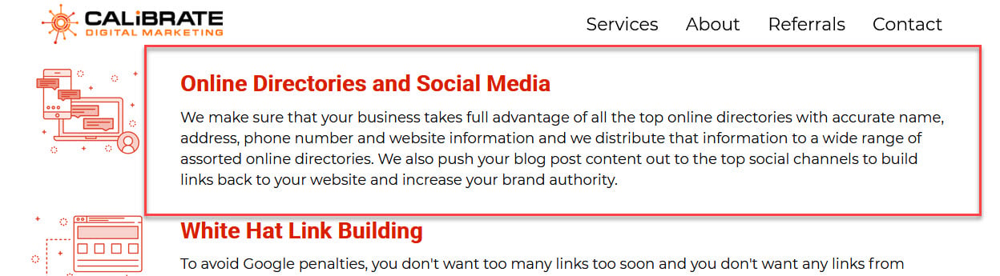
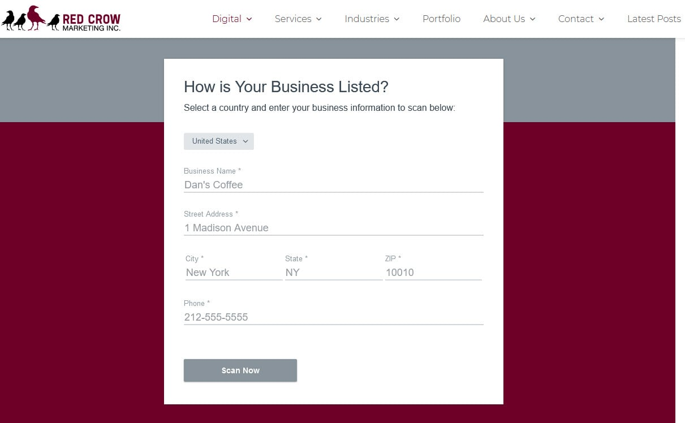

What do you get for investing in citations? You get an essential step from your [small business marketing checklist](/small-business-success/) knocked out.

Consistent listings across the web are also one of the factors in the [best chance for ranking number one](https://www.brightlocal.com/research/seo-citations-study/) locally.

Not all of the locally owned [SEO providers in Springfield](/best-seo-in-springfield-mo/) offer citation services without a subscription to an expensive package.

Below are pros who live in 417 land and will help your website rank higher. They take on the tedious task of cleaning up and building consistent local citations for your business around the web.

Let's dive in.

## Calibrate Digital Marketing

Calibrate offers citation services under the label "Authority Management," a fitting name for the goal of building citations.

The best way to learn more about Calibrate and contact them about this service is their [link-building page](https://calibratedigitalmarketing.com/earn-links-with-authority-management-springfield-missouri/).

## Campaignium

Campaignium manages and repairs business locations by following the Three C's:

- Correctness
- Completeness
- Consistency

You can learn what the three C's mean on their [directory listing optimization page](https://www.campaignium.com/directory-optimization/).

## Red Crow Marketing

Red Crow Marketing, located in Springfield, scours "the internet to audit your business information." They also have a free local listing scanning tool.

You can check out the tool and their [citation improvement services](https://www.redcrowmarketing.com/digital-marketing/local-seo/).

## A Place to Grow From

The [results of building citations](https://moz.com/learn/seo/local-search-data-us) are simple:

- Have a consistent appearance online so Google and your future customers are not confused.
- Keep Google happy by keeping customers happy. Google's goal is to deliver only information it knows is accurate. That keeps the people searching on Google satisfied and coming back.

Connect with one of the local agencies above to knock this task out fast, so your current and future customers, and Google, know exactly who, where, what and how your business serves.
