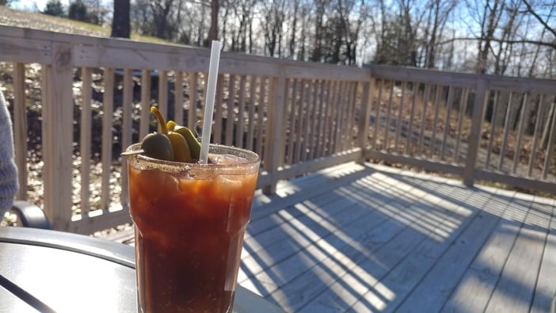
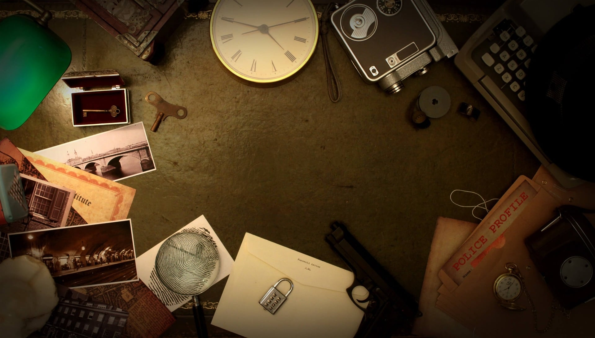
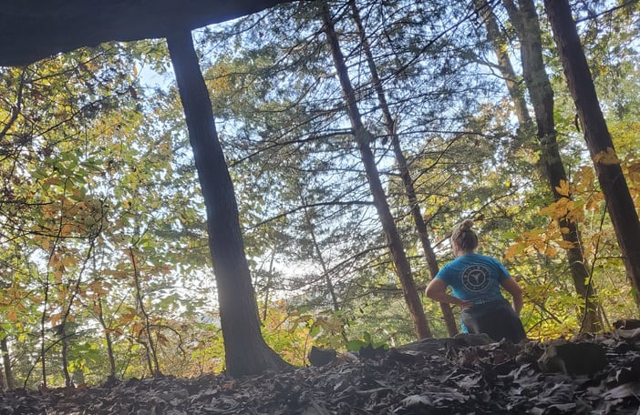
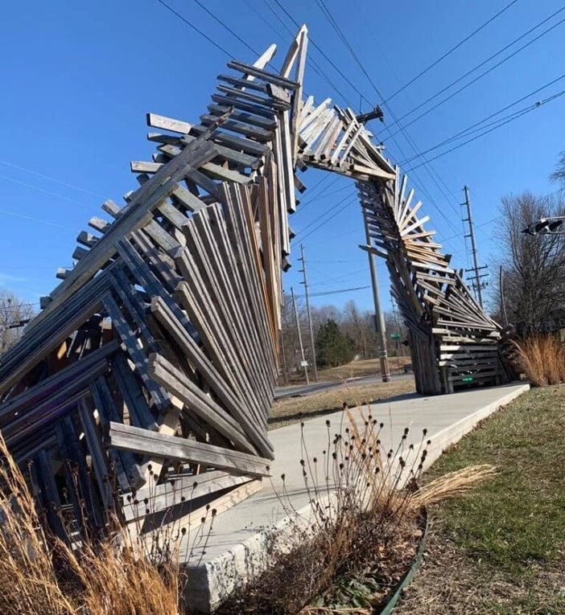

Finding a new place to take your guy or gal on a date can be tough. If you look hard enough, you can find plenty of fun date ideas right here in Springfield.

Or you can skip the hard looking and read this list.

In this article:

- "Cute" date night ideas
- Fun date night ideas
- Romantic things to do in Springfield
- Free or cheap date night ideas
- Uniquely Springfield things for couples to do
- Outdoor date ideas
- At-home date night ideas

Hours, menus and schedules change, so check each place's website or social page before you head out.

## "Cute" Date Night Ideas

### Create Something Unique Together

Want to impress your date with your crafty skills, or at least your willingness to try something creative? Head to one of the many DIY art studios in 417 land.

From painting and woodworking to pottery and glass blowing, there are plenty of classes to choose from. Browse this [list of Springfield art classes](/art-classes-in-springfield/), have some fun, and maybe discover a hobby you both love.

### Cook, Bake, and Decorate with Your Date

Prefer your creativity to end in something edible? [Pickwick and Cherry](https://www.pickwickandcherry.com/culinary-experiences/) has offered date night cooking classes where you and your partner prepare a meal together. Check their site for current classes.

If you want to make something sweet, look at the baking classes from [Katie Made](https://www.katiemadeit.com/new/baking-classes/).

Would you rather leave the cooking to someone else and just do the fun decorating part? [The Studio at Rustic Romance](https://www.rusticromancevintagemarketplace.com/) has supplied baked goods and icing so you can create an edible masterpiece.

### Copper Run

If you like a classy cabin feel and handcrafted adult beverages, visit Copper Run.

[Copper Run Distillery](https://copperrundistillery.com/) was the first legal distillery in the Ozarks after Prohibition and is a good spot for moonshine, whiskey and rum. Get your mind past sharp, cheap moonshine. The cocktails (a "Shine-a-Rita" or a "Moonshine Mary," for example) and the signature infusions are worth trying. Or go straight up with a flight of their spirits.

Besides the drinks, there are cheese board-style food options, live music some nights, and a deck you may never want to leave.

Copper Run sits just south of Busiek at [1901 Day Rd, Walnut Shade, MO 65771](https://www.google.com/maps/place/Copper+Run+Distillery/@36.801264,-93.2444945,15z/data=!4m5!3m4!1s0x0:0xb5e09cd6981319f2!8m2!3d36.8012122!4d-93.2444815). It's about a 30-minute drive from Springfield.

### Ice Skating

There's no better excuse to hold your date's hand than gliding around a rink together.

[Jordan Valley Ice Park](https://parkboard.org/308/Open-Play-Public-Skating) has an indoor rink with public skating sessions throughout the week. If you'd like something more private, the ice park also offers skating lessons. Check the session schedule before you go.

### Have a Dance Night

Springfield has many dance studios where you and your date can have fun, make a memory, or both. Options range from swing, salsa and ballroom lessons to learning the choreography to "Thriller," or working out your first dance for a wedding.

See the [dance classes in Springfield](/dance-classes-springfield-mo/) for places to start.

### Movie It Up at the Moxie

[Moxie Cinema](https://www.moxiecinema.com/) is an independent, non-profit movie theater that focuses on quality over quantity. It shows critically acclaimed films you won't find at the other theaters in town, with a mission to showcase cinema that inspires, educates and enriches its viewers.

### Pedi It Up

Kick your feet up and get some couples pampering at one of the spas and salons in town. Pedicures aren't just for gals, and sharing one is a relaxing way to spend time together. Just try to hold in the giggles if you're ticklish.

[Acacia](https://www.acaciaspa.com/), [Nu Essence](https://nuessencespa.com/) and [Dharma](https://www.dharmadayspa.com/) are a few places in Springfield that have offered couples packages.

### Relive Your First Date

Rekindle the romance by going back to the spot of your very first date. Springfield is good at supporting local businesses, so even if it's been years, your first date spot may still be there waiting for you.

### Visit an Art Gallery

Impress your date with a trip to one of Springfield's art galleries.

[Hawthorn Galleries](http://www.hawthorngalleries.com/) is in the heart of downtown and has two levels of art from local and nationally recognized artists.

[Fresh Gallery](https://www.freshgallery.org/), on Walnut, shows art exclusively from local artists in every medium, and gives you a chance to meet the artists.

The [Springfield Art Museum](/the-springfield-art-museum/), near [Phelps Grove Park](/phelps-grove-park/), is closed for renovation, with a reopening expected around 2028. Add it to your list for when the doors open again.

## Fun Date Night Ideas

### 1984

Whatever your age, you and your boo will have a good time at 1984, an arcade packed with games from the past. Admission has been a flat fee per person, so you can play without lugging around quarters. That leaves a free hand to hold your date's while you take on Space Invaders and Centipede.

Get the details on the [1984 arcade site](https://www.1984arcade.com/).

### Big Shots Golf

Take it up a notch from ordinary mini golf with [Big Shots Golf](https://www.bigshotsgolf.com/locations/springfield-mo/). It has dozens of hitting bays, augmented reality golf games and mini golf.

Not into golf? There's still plenty to do, including karaoke, ping pong and bocce. You can also order made-from-scratch food, handcrafted cocktails and beer while you practice your swing.

### Bowling

Bowling is an oldie but a goodie, and it never goes out of style. Springfield has plenty of lanes to choose from:

- On the west side, try [Sunshine Lanes](https://sunshinelanesbowling.com/).
- On the east side, try its sister location, [Enterprise Lanes](https://enterpriseparklanes.com/). Both are locally owned by the Wiemer family.
- In south-central Springfield, [Andy B's](https://www.bowlandybs.com/springfield/) has a dining area with dinner options to enjoy before or after your game.

### Brewery Date Night

The Ozarks are home to dozens of craft breweries, and you can find a list in our guide to [Springfield breweries](/best-breweries-in-springfield-mo/). They pour a range of beer styles, and many also serve cocktails and wine.

Breweries also tend to have a relaxed atmosphere, with live music, games, events and food trucks, which makes them an easy choice for a night out.

### Escape an Escape Room

Being trapped in close quarters, working on problem solving and teaming up to save the world. What more could you want on a date?

Several companies in Springfield lock you and your partner in a room for 60 minutes to work through puzzles before time runs out. Look at [417 Escape Artist](https://417escapeartist.com/springfield-location/), [Entrap Escape Rooms](https://entrapescaperooms.com/springfield-escape-room/) and [Pythian Castle](https://pythiancastle.com/escape-rooms.html). Each room has its own theme and difficulty level, so choose wisely.

### Food Truck It Up

The quickest way to your date's heart is through their stomach, and a food truck is a fun way to get there.

Tucked in the parking lot of Ace Hardware on S Campbell, [Tacos El Champu](https://www.facebook.com/tacoselchampu/) is one of our favorites. Hands down, some of the best tacos in Springfield.

Want more options? See our list of [food trucks in Springfield](/best-food-trucks-in-springfield-mo/).

### Lend Helping Hands

Let go of your date's hand long enough to help someone else. Volunteering is a good way to give back to the community, and it's a great way to bond with the person you're working alongside.

Many local organizations are looking for volunteers. Whether your skills are carpentry, cleaning up, handing out food or washing animals, a local volunteer listing site can help you find a fit.

### Millsap Pizza Nights

Outside the hustle and bustle but still inside the city limits, [Pizza Night at Millsap Farm](/pizza-nights-at-millsap-farm/) has been a seasonal favorite. Expect live music, community and pizza made fresh in front of you in their brick ovens. The setting under the trees and string lights is hard to beat.

Check the farm's schedule for this season's dates.

### Play Board Games at a Local Shop

If you both like board games but still want to get out of the house, visit a local shop that lets you play on site. [Nameless City Board Games](https://www.facebook.com/NamlessCityGames/) on S Campbell and [Meta-Games](https://www.mguinc.com/) on E Sunshine are two options.

You can also grab a drink and pick from a big game collection at places like [4 by 4 Brewing Company](http://4by4brewingcompany.com/), near [Galloway Village](/galloway-village-springfield-mo/), or [Best of Luck Beer Hall](https://www.bestofluckbeerhall.com/) downtown.

### Roller Skating

For retro fun on eight wheels, take your date to [Springfield Skateland](https://springfieldskateland.com/). The rink is good for all ages and a fun place to make memories.

Like most roller rinks since the 70s, Skateland has a spot to rest and buy snacks, a few arcade games for a breather from the floor, and plenty of retro music.

### Wonders of Wildlife Aquarium

The aquarium connected to Bass Pro took years to complete, and it was worth the wait. You and your date can easily spend hours in the exhibits, which are filled with creatures from around the world and built with a lot of attention to detail. [Wonders of Wildlife](https://wondersofwildlife.org/) was voted America's Best Aquarium in a national reader poll.

## Romantic Things to Do in Springfield

### Bed and Breakfast

You don't have to travel far for a mini-getaway. The Springfield area has plenty of bed and breakfast options.

[Walnut Street Inn](https://www.walnutstreetinn.com/) is one of the most charming and historic options in town. The property is gorgeous, and they've been known for little touches like rose petals on the bed, candles lit before you enter, fresh flowers and sweet treats.

[Beautiful Cape Cod](https://www.vrbo.com/610071) is a getaway in central Springfield. Its listing mentions a stocked bar, an in-ground pool and a jacuzzi.

### A Few Outside of Springfield Options

About 6 miles outside of town, [The Bombay Getaway](https://www.vrbo.com/1486970) at Arlie's Farm offers farm views and quiet. Read more in our post on [Arlie's Farm and the Bombay Getaway](/bombay-getaway-at-arlies-farm-in-rogersville/).

A little farther out, but still within about 10 miles, [The James River Cabin](https://www.vrbo.com/2030957) sits on a 25-acre property along the James River, surrounded by woods and water. The listing describes a fireplace, a porch swing and a hammock. For a more active stay, it mentions hiking, bicycling, kayaking, fishing and swimming. Check the listing for what's currently included.

### Couples Massage

A couples massage is a way for you and your partner to relax and truly unwind together. Naked or clothed (or somewhere in between), the privacy of the couples massage room means you can do what's comfortable.

[Grove Spa](https://www.grovespa.com/schedule), [Acacia Spa](https://www.acaciaspa.com/) and [Dharma Day Spa](https://www.dharmadayspa.com/) are all good options in the Springfield area.

### Hold Hands at the Theater

Show off your cultured side with a night at the theater. Springfield has several theaters staging live musicals, plays, ballets and sometimes original work by local writers.

Check the schedules for [Landers Theatre](https://www.springfieldlittletheatre.org/), [Springfield Contemporary Theatre](http://www.springfieldcontemporarytheatre.org/) and [JKH Hall](https://www.hammonshall.com/). Missouri State's Theatre and Dance Department also posts its upcoming productions on its [current productions page](https://theatreanddance.missouristate.edu/CurrentProductions.htm).

### Lavender Falls Tastings

Lavender Falls Farm sits in the rolling hills less than 30 minutes outside of Springfield. Some farms come with a certain aroma, but this one smells like blooming lavender and fresh spring water.

The farm has hosted Tuesday tasting dinners, a multi-course meal made for the event, so you and your date can enjoy the grounds while you eat. Visit the [Lavender Falls Farm site](http://www.lavenderfallsfarm.com/) and check their calendar for current events and reservations.

### Relax at a Concert

If you want live music without the choreography and the plot, a concert might be more your speed.

The [Springfield Symphony Orchestra](https://www.springfieldmosymphony.org/) performs several concerts through the year where you can sit back, hold hands and soak up the music. Missouri State's jazz bands, orchestras and ensembles also hold concerts, listed on the [MSU band calendar](https://www.missouristate.edu/band/calendar-of-events.htm).

For a more relaxed setting, look for the [Gigs in the Garden](https://www.friendsofthegarden.org/events/gigs-in-the-garden/) concerts at Nathanael Greene/Close Memorial Park.

### Tea Bar and Bites Themed Dinners

Have you been to [Tea Bar and Bites](https://teabarandbites.com/)? It's on picturesque Pickwick Avenue, with a secluded brick-paved patio, and it's full of charm. Any day is a good day to visit, but their themed dinners have been a special treat. Check their website for upcoming dinners and reservations.

## Free or Cheap Date Night Ideas

### Fun Acres

Fun Acres is a spot to get your mini golf on, and a good excuse to cuddle up and show your date how to hold the club. The 18-hole course is filled with vintage statues and sculptures, and the atmosphere is lighthearted.

You might have lived in 417 land for years without noticing it. It's tucked behind a shopping strip off Campbell, but it's worth hunting for. Get the address, prices and hours on the [Fun Acres site](http://www.funacre.net/).

### Busiek State Park

When the weather is right, take your date out to [Busiek State Forest and Wildlife Area](/busiek-state-forest-and-wildlife-area/). With more than 2,000 acres of conservation land and miles of trails, there's plenty to explore. There's also a camping area if you want to turn date night into an overnight trip.

### Geocaching

Geocaching is a modern-day treasure hunt, and always a fun date choice. Participants hide a container of small treasures and a log book, post its GPS coordinates to the geocaching database, and leave it for others to find.

There are hundreds of geocaches in Springfield alone, and millions worldwide.

#### How Does It Work?

Every geocache has a rating for difficulty, terrain and container size. To get started, sign up for an account through the geocaching app or [on their website](https://www.geocaching.com/play). Then use the app to see nearby caches. Tap one and the app guides you there with GPS directions or an in-app compass.

### Marble Hunting

Marble hunting is another treasure-hunt adventure, and it's what it sounds like: you go out and look for marbles that others have hidden. Find out how to [get started marble hunting in Springfield](/marble-hunting-springfield-mo/).

### Pickleball

Pickleball combines tennis, badminton and ping-pong. It's played on a badminton-size court with a modified tennis net, using paddles and a wiffle-style ball.

There are several [pickleball courts in Springfield](/pickleball-in-springfield-mo/) to play on. If you're new to the game or need a refresher before date night, read the rules from [USA Pickleball](https://usapickleball.org/pickleball-skills/level-one/how-to-play-pickleball/).

### Explore a Nature Trail

Wildlife, trees and seasonal blooms can make you feel like you've left the city. The [conservation area](https://goo.gl/maps/QNQkuVWpRRk3gpiu7) at the Springfield Conservation Nature Center is one of the best, and our guide to [nature trails in Springfield](/best-hiking-and-walking-trails-in-springfield/) has more.

### Springfield Sculpture Walk

The Springfield Sculpture Walk is a rotating collection of outdoor sculptures displayed around town. Open the map on the Sculpture Walk website or in the phone app to find the current pieces. You can see the sculptures on [the map](https://sculpturewalkspringfield.org/map/) and read more about the [Springfield Sculpture Walk](/sculpture-walk/).

## Uniquely Springfield Things for Couples to Do

### Andy's Frozen Custard

Andy's Frozen Custard now has locations across the country, but it was born here in the Ozarks. Are you even a loyal 417 lander if you haven't taken a date to Andy's?

With a wide variety of toppings and flavors, there's something for every custard lover. The shops even use local ingredients like Askinosie Chocolate. Andy's is part of what makes Springfield, Springfield, and it belongs on every local's date night list.

### Askinosie Chocolate Factory Tour

You may know there's a chocolate factory right here in 417 land. Did you know you can tour it? Askinosie has offered public tours that give a behind-the-scenes look at how they make their chocolate. Check the [Askinosie site](https://askinosie.com/) for current tour days and booking. Buy some sweets for your sweet afterward.

### Bass Pro

Bass Pro might not be your first thought for date night, but hear us out. If you and your date like wildlife, the outdoors, or just cute turtles, you can spend hours in the "Granddaddy of all Bass Pro Shops."

Bass Pro got its start in Springfield and still draws locals and thousands of tourists each year. Even if you don't plan to shop, you can look at wildlife sculptures, the alligator pit, an in-store pond filled with turtles, several aquariums, the National Archery Hall of Fame, candy and soda shops, waterfalls and a full-service restaurant.

### Visit the Fork

It might not fill a whole date night, but visiting The Fork makes a fun, uniquely Springfield quick stop. It sits behind the Food Network building in Chesterfield Village and stands 35 feet tall. Get the history in our post on the [world's largest fork](/largest-fork-springfield-mo/).

Afterward, you have plenty of date night restaurants to choose from in the neighborhood.

## Outdoor Date Ideas

### Float on the River

Nothing tests a couple's teamwork like steering a canoe together. If you're up for it, take your date out on one of the many rivers in the Springfield area.

Not sure where to start? 37 North has led the [James River Float Series](/james-river-float-series-springfield-mo/), guiding you down the river and teaching a few things about what makes our waterways special.

### Paddleboarding

Take your water time up a notch with paddleboarding. The James River is a great place for it if you can stay upright in quick-moving water. If you're new to the sport, calmer water like [Lake Springfield](https://www.parkboard.org/lakespringfield) is a better place to start, and you can rent paddleboards there if you don't own one.

### Picnicking the Easy Way

Want an easy picnic date? [Save the Date Picnics](https://www.instagram.com/savethedatepicnics/) puts together a customized picnic plan for you and your date. Or make some sandwiches, grab a blanket and head to one of the [best parks in Springfield](/best-parks-in-springfield-mo/).

### Romantic Picnic Idea in 417

For a more romantic setting, it's hard to beat the [Springfield Botanical Gardens](https://parkboard.org/274/Springfield-Botanical-Gardens). With a Japanese stroll garden, gazebos and plenty of paths for walking, it's easy to find a romantic picnic spot.

### Take Me Out to the Ballgame

Springfield has baseball, football, golf, sand volleyball, soccer and pretty much every other outdoor sport you might want to watch with your date.

Our pick is [Hammons Field](https://www.mlb.com/milb/springfield) for a Springfield Cardinals baseball game. You can also root alongside your date at the college sports games in the area, or catch an adult league game.

### Dickerson Park Zoo

Take a walk on the wild side with a date at the zoo. [Dickerson Park Zoo](https://dickersonparkzoo.org/) covers almost 100 acres in north Springfield. You can stroll the paths hand in hand, see animals from around the world, ride the train, stop at the cafe and pick up a memento at the gift shop.

## At-Home Date Night Ideas

These date night boxes are a fun way to liven up an evening at home.

### Local Box of Goodies

Bring the best of local home with a box from a local spot.

- [Homemade Delivered](https://homemadedelivered.com/) will shop, prepare and deliver an in-home date night meal.
- [NoBaked](https://www.nobakedpickup.com/s/order?location=11ea1636f402405ab0d80cc47a2b63e4) sells variety packs of cookie dough to sample at home. Sometimes they bundle it with beer from [4 by 4](https://www.talech.com/biz/ordering/147680/4-By-4-Brewery-SPRINGFIELD-MO#/menu).
- [D'Lish](https://www.dlishdesserts.net/s/order) has a variety of baked goods to enjoy on the couch.

### DIY Art Kits

Get crafty at home with a DIY-to-go kit from [AR Workshop](https://www.arworkshop.com/), which you can pick up from their shop on Battlefield. Options have included painting, string art, canvas and woodwork. Choose a project on their site, order it, and pick it up when it's ready.

### Charcuterie Date Night

You want the variety of a charcuterie board without the embarrassment of pronouncing "charcuterie" to a waiter. Check [417 Charcuterie](https://www.417charcuterie.com/) for a date night box, which they have offered for two. The only person who will know how badly you butcher the word is your date.

### Pottery-To-Go Packages

You don't have to be at the pottery studio to create a ceramic keepsake. [Firehouse Pottery](https://us.partywirks.com/storefront_express/main/vendor/firehouse_pottery/15/1669/4422) has offered Pottery-To-Go packages with the ceramic piece, glaze and paintbrushes. When your masterpieces are finished, take them back to the studio for firing.

## What Are You Waiting For?

We hope this list gets your ideas going. Don't worry too much about where to go or how much money you have, because there are plenty of free and cheap options in Springfield. Sometimes the best date nights happen in your own backyard, so stop thinking and pick one.
