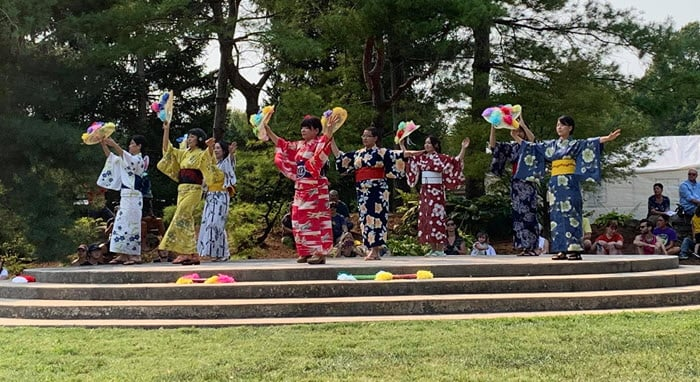
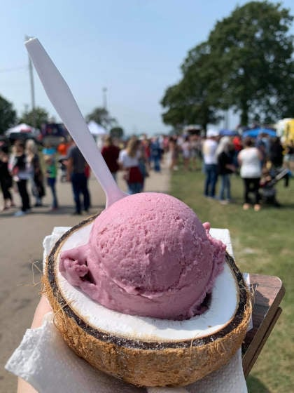
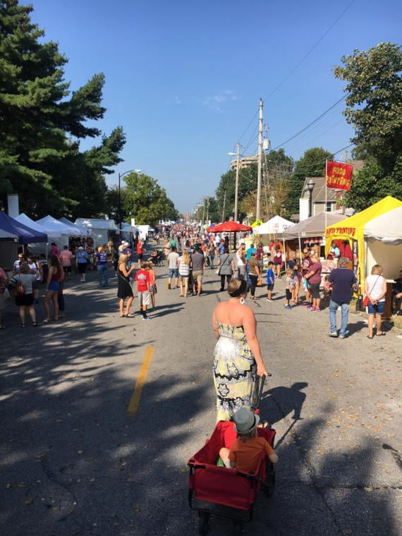
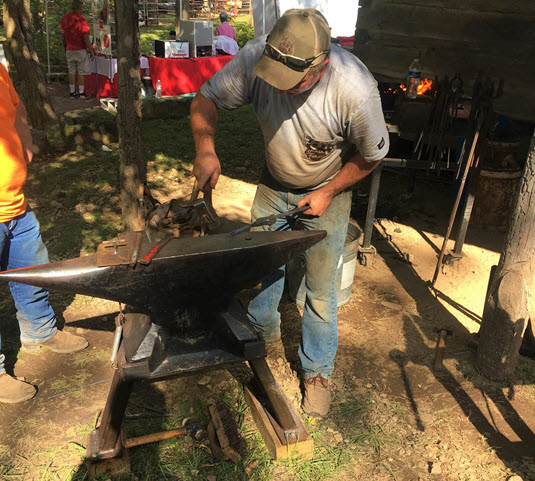
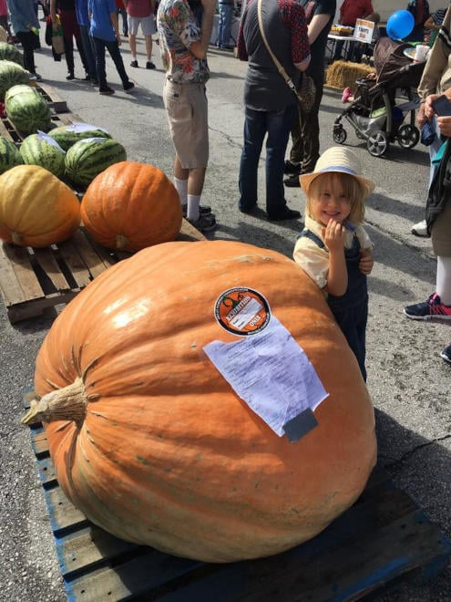
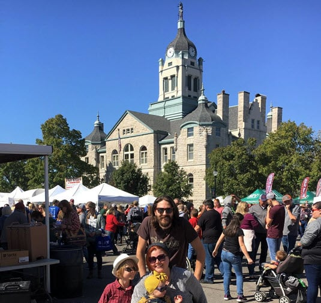
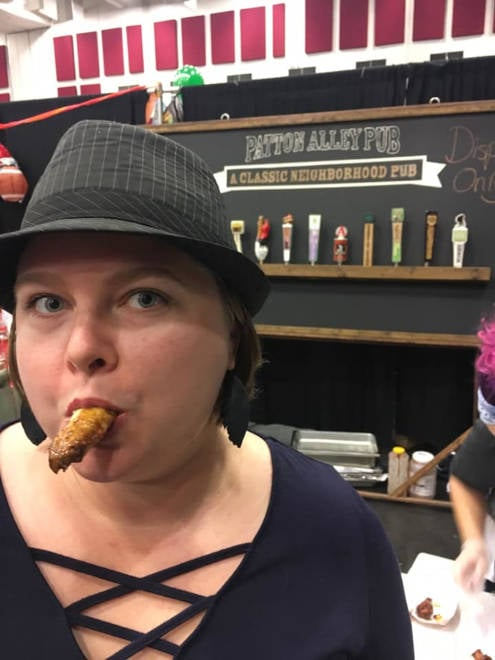
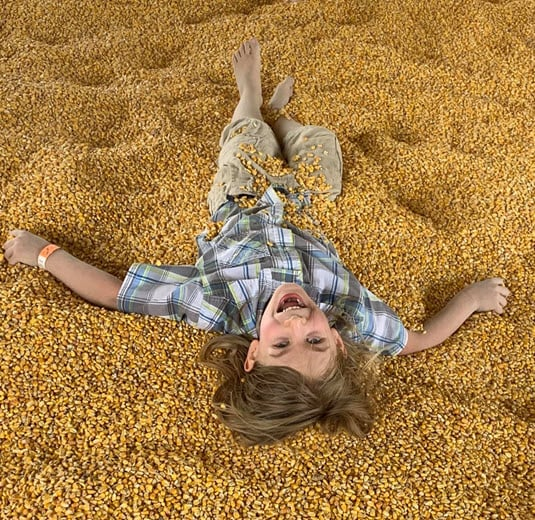

It's faaaaall! Maybe it's not "officially" fall until September 22nd, but as soon as September hits, many of us are ready for pumpkins, apple picking, crisp air, crunchy leaves and fall festivities.

The organizers of fall festivals in 417 land seem to agree. Fall events usually kick off at the beginning of September around here and run all the way through mid-November.

Here are some of the fall things waiting to be explored this fall in Springfield MO and the surrounding 417 land.

Festival dates shift from year to year, so each listing below says when the event usually happens. Check the festival's website or social page for this year's dates, times and tickets before you go.

These events are listed in the order they usually happen. If you've already missed the early ones, scroll down to find what's coming up. At the end, you'll find a section of ongoing activities that run through the fall season.

## Japanese Fall Festival

Usually early September, over a weekend. Check the site for dates.

The Japanese Fall Festival at the Mizumoto Japanese Stroll Garden is a favorite. The garden is one of the [top things to do in Springfield](/best-things-to-do-in-springfield-mo/) any time of year, but it really comes alive during this festival.

Catch a show or two. Guests from Springfield's sister city in Japan have performed traditional yosakoi dance, storytelling, music and more. As you walk the festival, you'll find Japanese vendors, crafts and activities.

Stay until dusk to see the glow of hundreds of torches during the candlelight walk.

[Japanese Fall Festival details](https://peacethroughpeople.org/events/japanese-fall-festival/)

## Seymour Apple Festival

Usually mid-September, Thursday through Saturday. Check the site for dates.

There's a little something for everyone at this apple festival. Expect live entertainment, vendors and crafters, a turtle race and plenty of food.

Apple-themed activities fill the schedule: a Johnny Appleseed contest, an Apple Princess crowning, an apple peeling contest and an apple baking contest. For runners, there's a 5K. For everyone else, there's the Apple Fest parade to watch from the sidelines.

[Seymour Apple Festival website](https://seymourapplefestival.com/)

## MO Food Truck Fest

Usually mid-September, on a Saturday. Check the site for dates.

The name explains it. Food trucks come together at the Ozark Empire Fairgrounds for a festival built around food, with top trucks from all over 417 land and a cuisine for every appetite.

Grab your favorite dish (or two or three), find a spot on the lawn and listen to live bands. Bring friends so you can share each other's finds. Walk around the vendors to work off the calories.

[MO Food Truck Fest website](http://www.mofoodtruckfest.com)

## State of the Ozarks Fest

Usually mid-September, on a Saturday. Check the site for dates.

SOTO (State of the Ozarks) is a community of local artists, craftsmen, mom-and-pop shops and hometown restaurants. Its goal is to encourage tradesmen in both business and life.

Once a year, the group hosts a festival in the historic district of Hollister, Mo. It features contemporary artists, traditional craftsmen and local food. What makes it different from your average fall fest is the dancing, Ozark mountain music, European combat demonstrations and lots of Ozark history.

[State of the Ozarks festival page](http://stateoftheozarks.net/showcase/events/soto-fest/)

## Autumn Daze Festival

Usually the third weekend of September, Thursday through Saturday. Check the site for dates.

Branson has hosted the Autumn Daze Festival for decades, and it shows. Hundreds of craft vendors show glasswork, jewelry, soaps, woodworking and plenty of knick-knacks, with live entertainment day and night.

There are also plenty of food trucks, so come hungry.

[Autumn Daze Festival details](https://www.explorebranson.com/event/autumn-daze-arts-crafts-music-festival/2496)

## Marshfield Harvest Days

Usually late September, Friday through Sunday. Check the site for dates.

The Marshfield community knows how to make everyone feel welcome, and it shows at its festivals. Marshfield Harvest Days takes over the square with vendors, food, live music and some old-fashioned pumpkin chuckin'.

[Marshfield Harvest Days on Facebook](https://www.facebook.com/profile.php?id=100057586954673)

## Marionville AppleFest

Usually late September, Friday through Sunday. Check the site for dates.

Marionville is the home of the white squirrel, and another town that makes visitors feel like locals. On festival weekend you'll find parades, vendors, a car show, pageants and games filling the town square.

True to the apple theme, there's an apple dessert auction where you can bid on a delicious prize.

[Marionville AppleFest website](http://marionvilleapplefest.com/)

## Cider Days

Usually late September, over a weekend. Check the site for dates.

If you haven't heard of Cider Days, are you really a local 417er? It's a community favorite, held on historic Walnut Street.

You can meet regional artists and buy their creations. Several performance stages along the festival route mean live entertainment is never far away. And of course, there's plenty of apple cider.

[Cider Days information](http://itsalldowntown.com/ciderdays)

## The 1860s Lifestyle Exposition

Usually late September, over a weekend. Check the site for dates.

The Gray/Campbell Farmstead opens its buildings to the public for the 1860s lifestyle expo, a look at what life was like in the 1860s. Expect cooking and crafting, and a notable lack of cell phones and electricity.

It's a chance to see a self-sufficient, living-off-the-land lifestyle up close.

[Gray/Campbell Farmstead website](https://www.graycampbellfarmstead.org/)

## Fall Festival and Antique Market

Usually late September, on a Saturday. Check the site for dates.

If you want a more intimate festival, this one is for you. Schofield + Gray, a small antique market in Fordland, has hosted a little fall festival on a cozy homestead.

Past lineups have included home decor, garden items, vintage and antique vendors, and gifts, with food trucks and dessert vendors invited to join.

[Schofield + Gray](https://www.schofieldgray.com/)

## Fair Grove Fall Festival (Heritage Reunion)

Usually late September, over a weekend. Check the site for dates.

This is one of the biggest fall events in the area, and it draws huge crowds. There's a parade to get things started, food at every corner, live music at the old mill and hundreds of vendor booths.

The organizers are picky about who joins the vendor lineup. The committee allows only quality, original and handmade items, so you'll find something for everyone.

[Heritage Reunion details](https://www.fg-historical.org/index.php/heritage-reunion)

## Republic Pumpkin Daze

Usually early October, Friday and Saturday. Check the site for dates.

Huge pumpkins (we're talking over 600 pounds), gourds, vegetables, flowers and homegrown produce come in from across the area to show off at this festival.

Pumpkin Daze has been going on for decades. Apart from prize-winning pumpkins, you'll find rows of vendors, food, games, entertainment and a good community of fall festival goers.

[Republic Pumpkin Daze website](https://www.republicpumpkindaze.com/)

## Harvest Moon Festival

Usually early October, on a Saturday. Check the site for dates.

The Harvest Moon Festival in Forsyth, Mo., is small but worth a stop. Past festivals have included a dog show, a car show, a kids zone and a parade, along with food, live music, vendors and crafters.

[Forsyth Area Chamber events](https://www.facebook.com/forsythareachamber/events)

## Ozark Arts & Craft Show

Usually early October, Friday through Sunday. Check the site for dates.

Crafters and artists fill Finley River Park for an arts and craft show with more than 300 vendors showing original work. Food trucks are on hand, so you can keep going on the hunt for that perfect handmade item.

[Ozark Arts & Craft Show website](http://www.ozarkcraftfair.com/)

## Apple Butter Makin' Days

Usually mid-October, Friday through Sunday. Check the site for dates.

If you only go to one fall festival (which would be a shame), this is a strong pick. Apple Butter Makin' Days sets up around the town square in Mt. Vernon, where trees line the streets and show off their fall color.

Apple butter is made in huge cauldrons right on the courthouse lawn, and the smell drifts through the air. Vendors fill blocks around the square, with food vendors on every corner and live entertainment as you walk.

[Apple Butter Makin' Days details](https://www.mtvchamber.com/apple-butter-makin-days.html)

## Sparta Persimmon Days Festival

Usually mid-October, Friday and Saturday. Check the site for dates.

Persimmon Days is another small but mighty festival. It has been going for decades in the friendly town of Sparta, Mo., with vendors and entertainment gathered for the weekend.

[Sparta Persimmon Days website](https://www.spartapersimmondays.com/home)

## Wingapalooza

Usually early November, on a Saturday. Check the site for dates and tickets.

Multiple 417 restaurants battle it out at the Springfield Expo Center to decide who has the best wings, and you get to be the judge. Visit every restaurant booth, try the wings (and go back for seconds) and vote for your favorite.

Springfield Sertoma adds live music, mixed drinks and beer, a wing eating contest, raffles and a silent auction. The event benefits the Boys and Girls Clubs of Springfield.

[Wingapalooza website](https://wingapalooza.com/)

## Ongoing Fall Activities

If you want a more flexible schedule, these venues offer fall activities multiple times throughout the season. Check each one's website for this year's dates, hours and prices.

### The Exeter Corn Maze

Exeter Corn Maze is much more than a corn maze. Past seasons have included axe throwing, corn cannons, zombie paintball, a petting zoo, a giant slide, barn swings, hayrides, a rock wall, pumpkin picking, pig races and plenty of places to eat. There's too much to cover here, so check their site for the current lineup.

[Exeter Corn Maze website](https://exetercornmaze.com/)

### Pickin Patch Farm

Get your pumpkin pickin' on at this farm in Marionville, Mo. Besides a selection of fall pumpkins and gourds, the farm has offered hayrides, a corn maze and scenery for that perfect fall selfie.

[Pickin Patch Farm on Facebook](https://www.facebook.com/pickapumpkin)

### Country Roads for Down on the Farm Fall

[Country Roads](https://countryroads.farm/) has a lot of family entertainment during the fall. Indoor and outdoor play areas, bouncy pillows, hayrides and a petting zoo are a few things to enjoy there. In the fall, they add a pumpkin patch, a corn maze and other fall-themed fun.

### Gardener's Orchard

Visit Gardener's Orchard at least once this fall. The family that owns the orchard has worked hard to give 417 land a place to pick apples, enjoy fall scenery, eat something fresh from their bakers and romp in the play barn.

If you're in the mood for indulgence, they also make fresh apple doughnuts and cider slushies.

[Gardener's Orchard and Bakery](https://gardenersorchardandbakery.com/)

### Harvest Fest at Rutledge-Wilson Farm Park

The city farm turns into a fall wonderland for Harvest Fest. It usually runs from late September through October, with a 5-acre pumpkin patch open for picking. The park concessions are open, and the kettle corn is a local favorite.

During the first weekends of October, you can also try the 2.5-mile corn maze. The average time to finish is about an hour, so wear walking shoes. A downloadable map is available if you get lost in the corn. We won't tell.

[Harvest Fest details from Springfield-Greene County Park Board](https://www.parkboard.org/531/Harvest-Fest)

### Shepherd's Pumpkin Fest

The Shepherd of the Hills turns into a fall farm, usually from late September through October. Families can enjoy jeep hayrides, scarecrow building, pumpkin picking and other fall activities. While you're there, get a scoop of their hand-dipped pumpkin spice ice cream.

[Shepherd's Pumpkin Fest details](https://theshepherdofthehills.com/shepherds-pumpkinfest/)

### 417 Land Foliage

One of the best things about autumn in the Ozarks is being surrounded by fall color. Take a drive almost anywhere in the area and you'll see trees in orange, brown, yellow and red.

Want to enjoy the cool weather at a slower pace? Put on your hiking shoes and visit one of the [top hiking and walking trails in Springfield, MO](/best-hiking-and-walking-trails-in-springfield/) to soak in the colors.

## So Much to Enjoy

With two dozen fall festivals and activities to choose from, there's no reason to skip fall in 417 land. Pick a weekend, check the details, and get out there.
