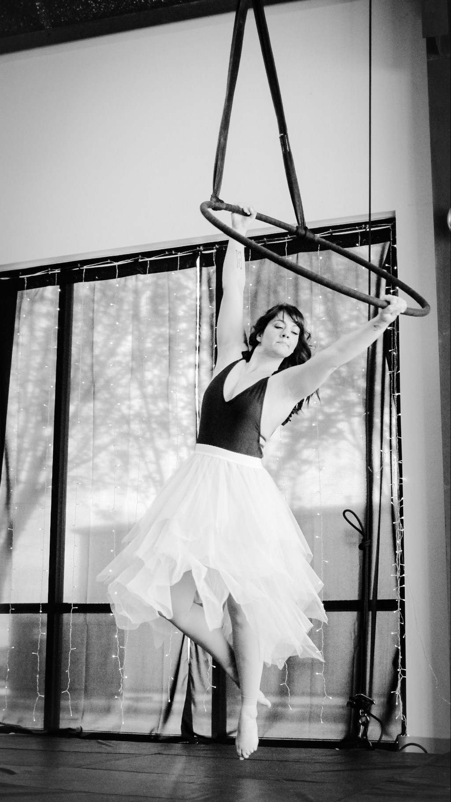
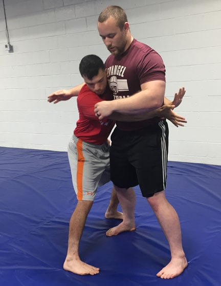
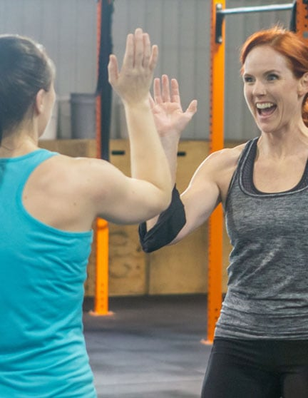
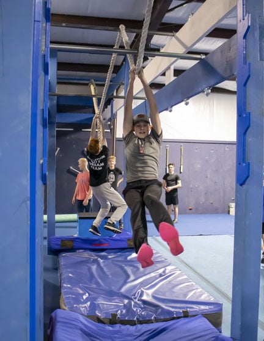
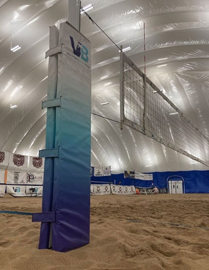
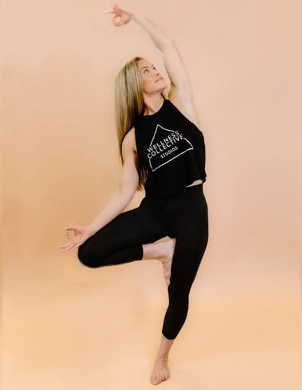

Looking to step up your fitness routine or find a good gym? The Springfield, MO area has gyms and professionals who can help you reach your physical activity and health goals. Here's our guide to workout classes and wellness pros in the area.

Class schedules, memberships and trial offers change, so check each website for current details.

## 417 Aerial

[417 Aerial](https://www.417aerial.com/) is a circus arts studio in Nixa that specializes in aerial arts. Think of dance, but with the elegant movements performed suspended in the air.

Aerial performance takes upper body and core strength, so training balances full-body strength and conditioning with the elegance and stability of artistic dance. The studio has five trainers, and classes keep a fun, encouraging energy. It's a good way to stay active in an unusual way.

Studio owner Deidra Johnson trained alongside choreographers of Le Reve and with performers and gymnasts from Cirque du Soleil. Even with that resume, she keeps a humble outlook.

417 Aerial offers classes for ages 4 and up and welcomes all skill levels and abilities. Many students walk in with no aerial, dance or sports background. The team's focus on helping students fly is what makes this studio special.

## 417 Brazilian Jiu Jitsu

[417 Brazilian Jiu Jitsu](https://www.417bjj.com/) is an all-encompassing studio on Commercial Street. Owner Glenn Cozzens understands that the roots of martial arts run deeper than mastering combat techniques.

As any jiu jitsu student knows, you become aware of your mental state and build fortitude, focus, self-control, confidence, determination and decision-making. Glenn and his instructors teach self-development and personal growth through the principles of tactical self-defense. Young adults benefit from the foundation, and the lessons carry through life.

They also offer folkstyle wrestling instruction, designed to help high school students build skills for the collegiate level.

Jiu jitsu is practical for adults, too. 417 Brazilian Jiu Jitsu offers women's self-defense, street choke classes and boxing. Glenn, who served seven years in the US Army, can provide specialized training and tactics for law enforcement and security personnel. If you know nothing about martial arts and self-defense, the instructors will teach you the basics.

## CrossFit Republic

[CrossFit Republic](https://crossfitrepublic.com) is a value-driven gym with a strong reputation in the Republic area. Owners Macy and Jen Mitchell practice servant-leadership with their members and the Republic community.

The CrossFit concept combines everyday movements with higher intensity. It focuses on mobility, such as squatting and pushing, and builds those movements for greater personal wellness.

The gym encourages constructive, positive behavior. Members describe a complaint-free, drama-free, judgment-free culture, and they work as one team to better each other and the Republic community through fitness.

Individuals and families of all ages and fitness levels are welcome. The gym has a 24/7 access option, so you can fit workouts around your lifestyle. Visit the [CrossFit Republic get started page](https://crossfitrepublic.com/get-started/) to learn how to begin.

## Divinely Whole Wellness

Do you want to improve your physical and mental health but don't know where to start? The mission of [Divinely Whole Wellness](https://www.kealanicerys.com/) is to lead women back to the wholeness within themselves through whole foods and holistic health.

Everyone is different and has unique needs, so they offer services including coaching, healing, nutrition planning and support, tailored to your journey. The approach is holistic and includes teachings from Jesus Christ, aimed at physical health and spiritual wellness.

Book an appointment through their site to start a journey that is uniquely yours.

## Powerline Health

Struggling to find the path to better health and wellbeing? [Powerline Health](https://www.powerlinehealth.com/) is led by Nurse Mary, a certified nurse with decades of experience in healthcare.

With [iTOVi scans](https://www.powerlinehealth.com/itovi-scan/) and other personalized assessments, Nurse Mary can assess which supplements or choices may suit you. With her years of nursing experience, she also offers personalized guidance on making conscious health choices.

She sources supplements and works with natural health formulators to create unique blends. That can take some of the guesswork out of figuring out which supplement is right for you.

## Springfield Warrior Sports

[Springfield Warrior Sports](https://www.springfieldwarriorsports.com/) is a place where anyone can have fun during a workout. Along with weights and traditional exercise equipment, you can run, jump, climb, swing and dangle. Built like an obstacle course, this gym is designed so fitness doesn't feel like a chore.

The training grows you mentally as well as physically. The obstacles can be difficult, so perseverance, goal setting, team building and determination are part of the work. Check their site for classes by age and for trial class options.

## Volleyball Beach Ozark

Remember playing in the sandbox with friends as a kid? That's basically [Volleyball Beach Ozark](https://volleyballbeachozark.com/). It describes itself as home to the largest indoor beach facility in America.

Volleyball is all about movement, and it improves muscle strength, tone and cardiovascular health. At Volleyball Beach Ozark, you can play year-round with friends in a climate-controlled space, with no sunburn and no skinned knees. Walking on sand is a good workout for your legs, too.

When spiking the ball on your friends gets tiring, catch your breath at the Volleyball Beach Bar & Grill, which serves beach favorites such as wings, burgers, sandwiches and pizza. The bar and grill is open for walk-ins.

The founder's vision is to build a family-like culture and community around the sport, and it shows.

## Wellness Collective Studios

Are you looking for a holistic, total-body approach to wellbeing? [Wellness Collective Studios](https://www.wellnesscollectivestudios.com/) at 248 E Primrose St has a team of wellness professionals who can help you make meaningful changes.

From yoga and group fitness classes to personal care therapies and personalized training, Wellness Collective has a wide mix of options. A supportive community of members makes it easier to stay motivated.

Their services focus on body, mind and spirit. Whether you want to relieve stress with massage or get in shape with one-on-one personal training, check out the classes and wellness professionals listed on their website.
