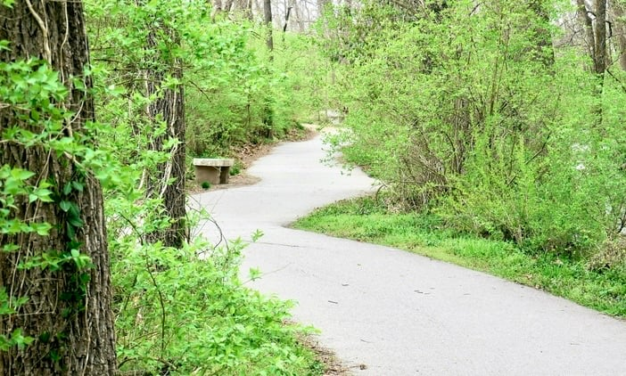
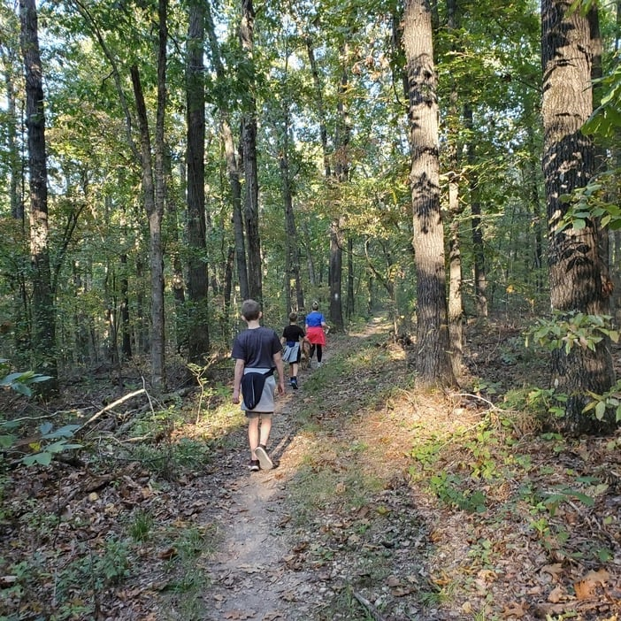
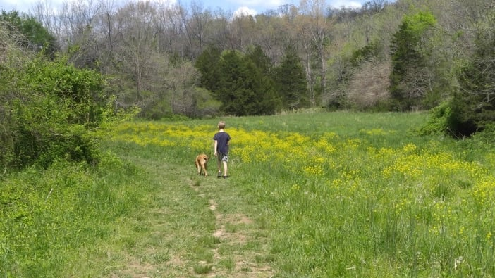
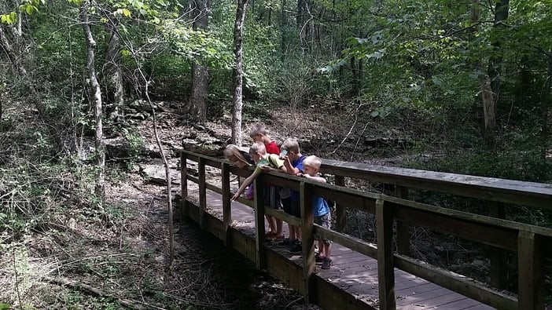
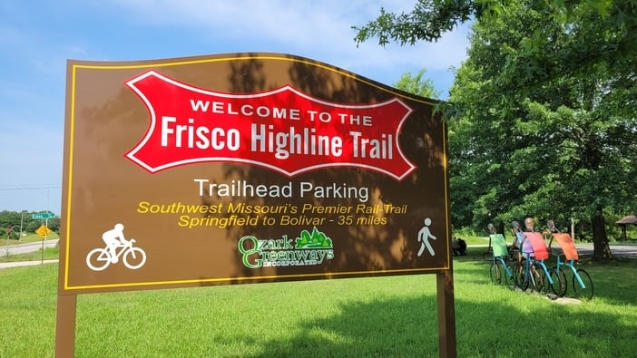
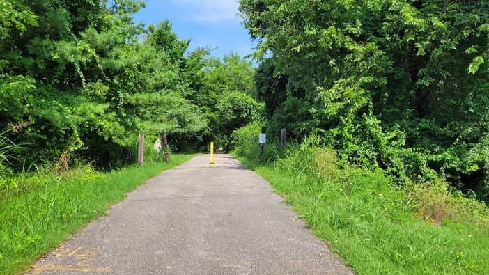
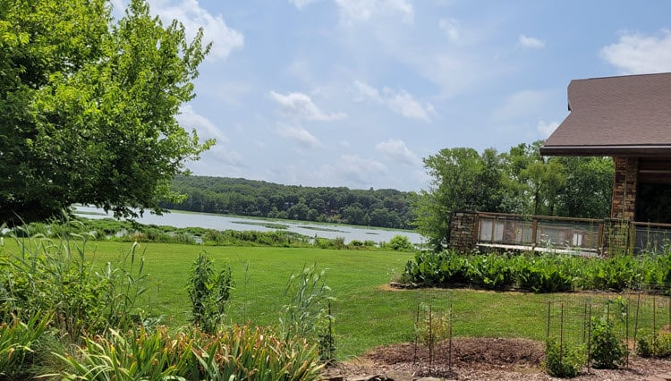
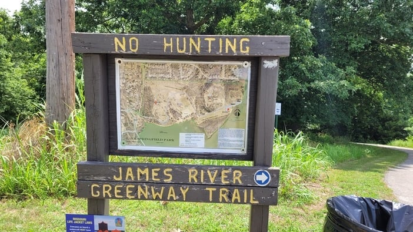
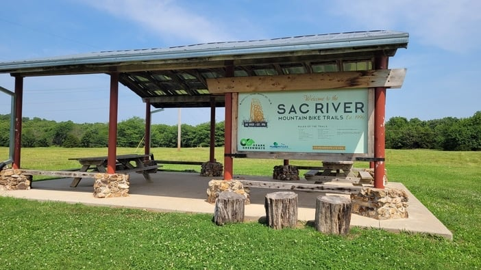

Whether you want quality time with family, a challenging hike or some downtime in nature for yourself, the Springfield area has a trail for it.

These hiking trails and walking paths offer seclusion and scenic spots, and a good excuse to get outdoors.

Let's dive in.

## Best walking trail: Galloway Creek Greenway

[Galloway Creek Greenway](/galloway-creek-greenway-trail-in-springfield-mo/) has a little something for everyone and is one of our favorite trails.

For the art lover, there are sculptures along the trail. For the nature lover, there are wooded areas, creeks and even a cave area. For the people watcher, the trail runs through [Sequiota Park](/sequiota-park-springfield/) and the ever-buzzing Galloway Village. And for the seeker of the unique, there is a stop at Springfield's pet cemetery.

Off the trail in [Galloway Village](/galloway-village-springfield-mo/), you will also find great coffee, a couple of [Springfield breweries](/best-breweries-in-springfield-mo/), unique shops, sushi, burgers and more.

### Top pick for hiking: Busiek

[Busiek State Forest and Wildlife Area](/busiek-state-forest-and-wildlife-area/) is one of the best-kept secrets for real nature lovers near Springfield. It sits halfway between Springfield and Branson [off Highway 65](https://www.google.com/maps/place/Busiek+State+Forest+and+Wildlife+Area/@36.8628926,-93.2361817,15z/data=!4m5!3m4!1s0x0:0x74c5d4e47ac97d3f!8m2!3d36.8628926!4d-93.2361817), and it has something for everybody.

There are plenty of great greenways in town, but if you want elevation change, uneven terrain and surprise creeks, Busiek is for you. It has water for the kids to splash in, beautiful trails and a gun range separated from the trails.

With 18 miles of trails, you can take a short jaunt or plan to spend the day. Either is worth your time.

### The perfect middle: Springfield Nature Center

The [Springfield Conservation Nature Center](https://mdc.mo.gov/discover-nature/places/springfield-conservation-nature-center) is a forested gem tucked into the Springfield urban sprawl. It is a good fit for any city dweller who wants to connect with nature.

Because it is so close to town, you can be in nature every day if you want. The terrain varies, and some of it is paved for easy walking, so it takes a while to see everything the park offers.

You will find enough wildlife to keep you interested, including deer, owls, eagles, geese, herons, squirrels, turkeys and more. The indoor portion of the Nature Center has exhibits that teach you things you did not know about your own surroundings.

The Nature Center is at [4601 S Nature Center Way](https://www.google.com/maps/place/Springfield+Conservation+Nature+Center/@37.127927,-93.2397846,15z/data=!4m5!3m4!1s0x0:0xe3e72fc61411a76!8m2!3d37.1281499!4d-93.2396798) in southeast Springfield and works for everyone in the family who is old enough to walk.

### Fassnight Creek Greenway

The Fassnight Creek Greenway starts near Fassnight Park and runs almost all the way to Phelps Grove Park, near the heart of Springfield.

You get views of Fassnight Creek as you follow the trail under Campbell Avenue, Bennett Street and Jefferson Avenue. The trail currently ends just east of Jefferson, a short ride from [Phelps Grove Park](/phelps-grove-park/), which sits next to [the Springfield Art Museum](/the-springfield-art-museum/).

### Frisco Highline Trail

Stretching more than 35 miles, the Frisco Highline Trail has a trailhead [in northwest Springfield](https://www.google.com/maps/place/Frisco+Highline+Trail,+Missouri/@37.2677691,-93.3875269,17z/data=!4m5!3m4!1s0x87c58a8b65657e5b:0x969c654fc2e51850!8m2!3d37.2674319!4d-93.3864433) and winds through Willard, Walnut Grove and Wishart, all the way up to Bolivar.

History runs through every mile of the trail, which follows the route of the old Frisco Railroad. Stop at the kiosks along the path to read a bit of that history.

When you plan a trip on the Frisco trail, leave time for stops at places like 7C's Winery in Walnut Grove, La Petite Gemme Prairie, the Polk County Museum or one of the 16 Bridges of Polk County.

There is a lot to do along this trail. For a complete list of things to see, check the [Ozark Greenways page for the Frisco Highline Trail](https://ozarkgreenways.org/explore/greenway-trails/frisco-highline-trail/).

### Lake Springfield Park Trail

As the name suggests, the Lake Springfield Park Trail gives you views of Lake Springfield along its 1.4-mile wood chip path. You will roam through prairie, walk through woods (and probably spot some wildlife) and stroll by the lake.

My favorite thing about this trail is the abundance of geocaches on and near it. If you are a geocacher, this is your trail.

Want more than a quick 1.4 miles?

### Greater Ozark Audubon Trail and James River Greenway Trail

The Lake Springfield trail also follows a portion of the Greater Ozark Audubon Trail and connects with the James River Greenway Trail, so you can keep going.

### Sac River Mountain Bike Trails

The [Sac River Mountain Bike Trails](https://www.google.com/maps/place/Sac+River+Mountain+Bike+Trail/@37.2820128,-93.3468067,14.25z/data=!4m5!3m4!1s0x87c58980a13a5559:0x91eacf262a4f612d!8m2!3d37.2887677!4d-93.3386663), north of Dickerson Park Zoo, have 14 miles of single-track trail through 300 acres of woods in northwest Springfield.

They are a great place to mountain bike, and they are also open for trail running and hiking. There are 5 loops to choose from, ranging from easy to difficult.

Whichever loop you pick, bring a map and a fully charged phone. It is easy to get turned around deep in the Ozarks woods.

## Get outdoors

We hope this introduced you to a few new spots that make your days feel more exciting and a little less routine. Whether you are spending time with family, taking on a challenging hike or just enjoying downtime in nature, these trails offer seclusion and a break from the everyday.

Hope to run across you on one of these trails soon.
