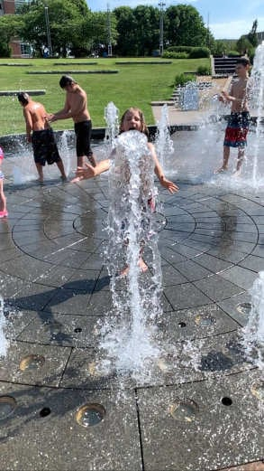
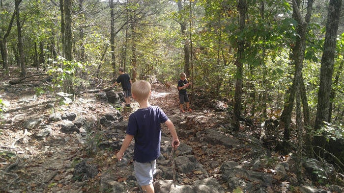
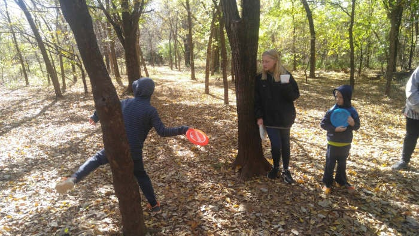
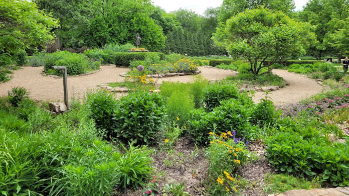
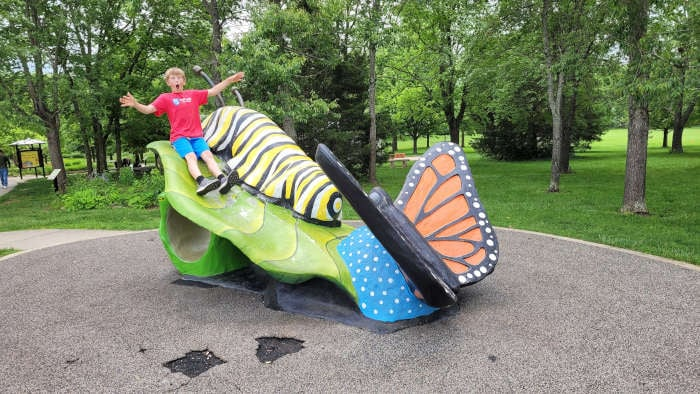
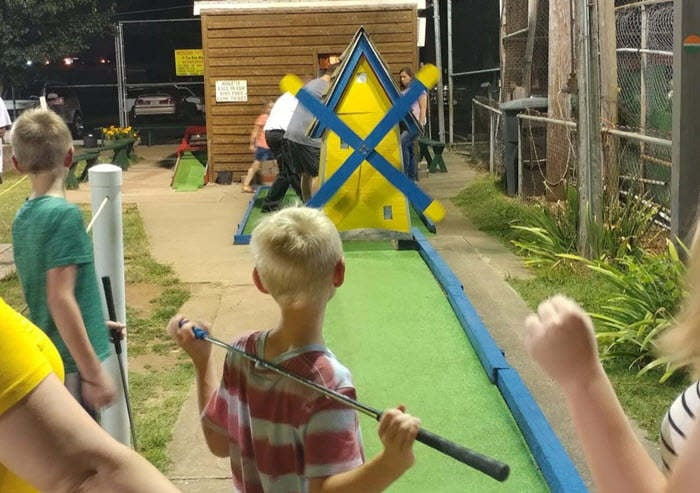
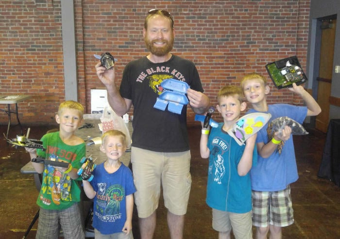
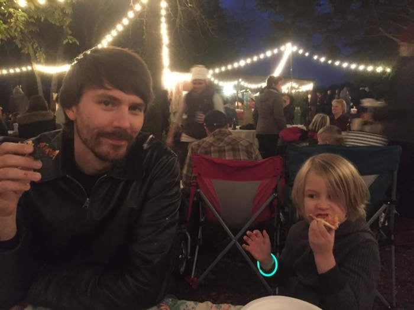
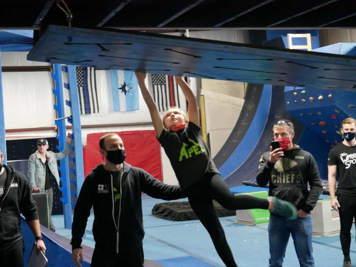
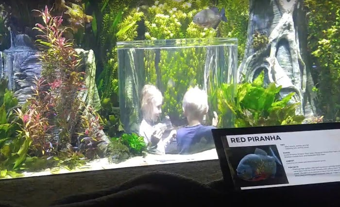

Do you want to find the best family activities in Springfield, MO?

There are plenty of things kids of all ages will enjoy. From parks and museums to [events in Springfield](/events/), there is something for everyone. Here is a list of ideas, sorted by cost.

In this article:

- Free things to do with kids
- Cheap things to do
- Springfield's "premium" activities for families

Let's dive in.

**Note:** If you are planning for summer, take a look at the [summer camp options in Springfield](/best-summer-camps-springfield-mo/) too. Admission prices change often, so each paid activity below links to the place's own site where one is available.

## Free things to do with kids

### Jordan Valley Park

Free fountains to play in, rock climbing walls, concerts and more can be found at [Jordan Valley Park](/jordan-valley-park/) in the middle of Springfield.

It is hard to say how many hours of play our kids put in here when they were younger. Between the stream rolling down the hill, the fountain party and the shallow swimming at the bottom, it was (and still is) one of our [favorite parks in Springfield](/best-parks-in-springfield-mo/).

There is also a bird's-eye view of the trucks and scrap yard activity at the recycling center across the railroad tracks behind the park.

Grab some snacks and head to the park at [635 E Trafficway](https://www.google.com/maps/place/Jordan+Valley+Park/@37.2117338,-93.2840711,18z/data=!4m5!3m4!1s0x0:0xbf000a37a522467c!8m2!3d37.211047!4d-93.2829538).

**Note:** Free parking is almost always available in the parking garage directly across the street.

### Bass Pro

Have kids who love guns or animals? Want something fun to do inside?

With the Gun Museum, the Archery Hall of Fame, underwater fish feeding shows and more, Bass Pro is not only one of the [top things to do in Springfield](/best-things-to-do-in-springfield-mo/). It is a great place for kids to explore.

Bass Pro also hosts festivals inside during the year, including a Winter Wonderland over the holidays, so check what is on before you go.

### Busiek

Want to turn a chaotic day into fun, relaxation and a little exercise for free?

The 2,500 acres at [Busiek State Forest and Wildlife Area](/busiek-state-forest-and-wildlife-area/) are waiting. With camping, streams, trails and more, you can be in the woods in about 20 minutes.

Wear shoes or sandals that can get wet and are comfortable for walking. Depending on recent rain, you may have to cross a stream to continue on the trail.

You can also grab a couple of lawn chairs and park by one of the swimming holes while the kids play.

### Disc golf

Disc golf is a mix of golf and frisbee. You work through a course, throwing discs (smaller, harder cousins of the frisbee) at metal baskets in as few throws as possible.

Games take you through a 9 or 18 basket course, each hole with its own par. The player with the lowest total score wins.

The discs are made to be thrown hard and far, so you will want real disc golf discs rather than an old frisbee. Most outdoor sports stores sell starter sets, and playing is free on public courses.

You can find the [disc golf courses in and around Springfield](https://www.parkboard.org/657/Disc-Golf) on the Park Board's site.

### Missouri Institute of Natural Science

Want to dig up a fossil?

The Missouri Institute of Natural Science has a museum with hundreds of mineral, plant and animal fossils. Kids can excavate for fossils on the property, and they may be able to take home what they find.

The grounds also include nature trails, special events and field trips. Check [their website](https://www.monatsci.org/) for current hours and admission.

### The Moxie

The Moxie is a non-profit movie theater at [305 S Campbell downtown](https://www.google.com/maps/place/Moxie+Cinema/@37.2080048,-93.2946601,15z/data=!4m5!3m4!1s0x0:0x19b5ed51133ad20f!8m2!3d37.2080048!4d-93.2946601). Its afternoon and evening shows are not typically for kids, but Moxie Mornings are a different story.

A Moxie Morning is a themed experience where kids and adults get inspired to create. Younger viewers (ages 2 to 6) watch short films built around a theme and then make a hands-on art project. For ages 7 and up, the Movie Flix events show classic films, with the goal of introducing kids to the movies worth seeing before they turn 13.

See [their education calendar](https://www.moxiecinema.com/education) for the current Moxie Mornings schedule.

### Rutledge-Wilson Farm

Part farm, part park, part nature center, Rutledge-Wilson Farm Park is a free outing the whole family will like.

The park's 207 acres offer a farm-themed playground, room to reconnect with nature and a one-mile paved trail along Wilson's Creek Greenway. Kids pick up early learning skills while they explore.

There is even a [Farm Park scavenger hunt](https://www.parkboard.org/DocumentCenter/View/7954/ScavengerHunt_FarmPark) you can download from the Park Board. The park is at [3825 W Farm Rd 146](https://www.google.com/maps/place/Rutledge-Wilson+Farm+Park/@37.1863617,-93.3579016,15z/data=!4m5!3m4!1s0x0:0xfe8850b854bdfbc8!8m2!3d37.191319!4d-93.360734), just off W Bypass north of Sunshine.

### Springfield Botanical Gardens

The Springfield Botanical Gardens, at Nathanael Greene/Close Memorial Park, is a 113-acre nature center with several dozen gardens of native and exotic plants.

Daylilies, hosta, Asiatic lilies, roses, peonies, iris, dwarf conifers and ornamental grasses are just a few of the plants you will find. If you have plant lovers in the family, this one is for you.

The park also has:

- Several paved walking trails
- Drummond Lake, home to geese, turtles, fish and more
- A Butterfly House that is open from April to October
- The Gray-Campbell Farmstead, the oldest surviving cabin in Springfield
- The Mizumoto Japanese Stroll Garden

You will also find playgrounds, picnic tables, wide open spaces, a gift shop and access to the South Creek Greenway.

The gardens are at 2400 S Scenic Ave, Springfield, MO 65807.

### Springfield Conservation Nature Center

The Springfield Conservation Nature Center is an 80-acre stretch of woods inside the city limits.

It has 3 miles of walking trails, occasional programs and events, nature and conservation exhibits, a visitor center with an information desk, a gift shop, an auditorium, classrooms and restrooms. There is also a covered picnic area and pull-through parking for buses and RVs.

Hunting and fishing are not allowed on the grounds, but if you want to walk Ozark trails without leaving town, this is a good place to do it. Details are on the [Missouri Department of Conservation page](https://mdc.mo.gov/discover-nature/places/springfield-conservation-nature-center).

The Nature Center is at 4601 S Nature Center Way, Springfield, MO 65804.

### The World's Largest Fork

This fork in Springfield weighs 11 tons and stands more than 35 feet tall. It is the kind of sight that makes kids say wow.

It will not fill hours by itself, but it sits in Chesterfield Village in southwest Springfield, so there is plenty to do nearby. It is a little hard to find. The official address is [2215 W Chesterfield](https://www.google.com/maps/place/World's+Largest+Fork/@37.1453763,-93.3232513,15z/data=!4m5!3m4!1s0x0:0x5ee0086548a0d875!8m2!3d37.1453763!4d-93.3232513), and you can read more about [how to find the largest fork in the world](/largest-fork-springfield-mo/).

## Cheap things to do

### Air and Military Museum of the Ozarks

The Air and Military Museum of the Ozarks started in 1989 with a single showcase. Today the museum holds more than 5,000 pieces of military history, and as a not-for-profit it makes hands-on, historical military equipment accessible to the public.

You can take a simulated flight on a real Cobra AH-1S Army helicopter and walk through the museum to see and interact with real pieces of military history. For families with a military history buff, it is a good way to spend a day.

The [Air and Military Museum of the Ozarks](https://www.ammomuseum.com/) is at 2305 E Kearney, Springfield, MO 65803. See their website for current admission.

### Fun Acre

Do you wish you did not have to pay double digits for mini golf? Fun Acre has long been a budget-friendly pick, and it tends to be busy. The 18-hole course has changed little over the years.

Fun Acre is at [214 W Glenwood](https://www.google.com/maps/place/Fun+Acre/@37.1692237,-93.2935028,15z/data=!4m5!3m4!1s0x0:0x5b1eeca828dfd4b1!8m2!3d37.1692237!4d-93.2935028), just north of Sunset off Campbell. Call ahead for current hours, prices and accepted payment before you go.

### Brightspeed Ice Park (formerly Jordan Valley Ice Park)

Brightspeed Ice Park, formerly Jordan Valley Ice Park, is an ice skating rink where families get exercise and enjoy each other almost every day.

A handful of days each year do not have public skating, so check the open skate times on the [Springfield Park Board's website](https://parkboard.org/icepark), where you will also find current admission.

Beyond open skate, there are figure skating and hockey classes and lessons for kids. The rink is home to the MSU Ice Bears and the Jordan Valley Figure Skating club, among others, so there are games and events to catch throughout the year.

Whether you want to skate around or get hooked on figure skating or hockey, it is a good activity for kids and families.

### Mizumoto Japanese Stroll Garden

The Mizumoto Japanese Stroll Garden is a calm escape from city life. Even the walk up to the entrance encourages you to slow down.

The 7.5-acre garden has a moon bridge, koi in a pond, a tea house, a meditation garden and more. It sits at [2400 S Scenic Rd in Springfield](https://www.google.com/maps/place/Mizumoto+Japanese+Stroll+Garden/@37.1708229,-93.3338144,16z/data=!4m12!1m6!3m5!1s0x0:0xa2acfce723a04fea!2sMizumoto+Japanese+Stroll+Garden!8m2!3d37.1726104!4d-93.3232211!3m4!1s0x0:0xa2acfce723a04fea!8m2!3d37.1726104!4d-93.3232211). See the [Park Board's Mizumoto page](https://www.parkboard.org/mizumoto) for current admission.

## Springfield's "premium" activities for families

### 1984

Do kids these days even know what an arcade is?

[1984](https://www.1984arcade.com/) is an unlimited-play arcade where the video games and pinball machines all date from around 1984. It gives you and your kids a chance to compete, cheer each other on and learn what the good old days of the arcade were like. Check their site for current pricing and hours.

### Dickerson Park Zoo

Dickerson Park Zoo is Springfield's own full-featured zoo, with lions, bears, monkeys, reptiles and amphibians, giraffes, hippos and many more animals to meet.

If you have animal lovers in the family, it is an easy excuse to spend the day outside. Check the [zoo's website](https://dickersonparkzoo.org/) for current admission, hours and group rates.

The zoo is at 3043 N Fort, Springfield, MO 65803.

### Discovery Center of Springfield

The Discovery Center of Springfield is the local non-profit science center, with experiences for parents and children alike.

Do you have science fans in the family? Past exhibits and activities have let kids:

- Walk through a display showing the inner workings of a giant eyeball
- Dig for dinosaur bones
- Take home a sample of their own DNA
- Ride the HighWire bike

The center has dozens of hands-on exhibits related to science, technology, engineering and math. Check [the Discovery Center's website](https://www.discoverycenter.org/) for current exhibits, hours and ticket prices, including military and senior rates.

The Discovery Center is at 438 E St. Louis St., Springfield, MO 65806.

### Fantastic Caverns

Do you have cave lovers or adventure seekers in the family? Then a trip to Fantastic Caverns, America's Ride-Through Cave, is hard to beat.

The cave is so big that it is toured on Jeep-drawn trams. That gives visitors a full look at the size and beauty of the cave and helps protect its natural features.

Check the Fantastic Caverns website for current ticket prices, group rates and season passes. The caverns are at 4872 N Farm Rd 125, Springfield, MO 65803.

### Itty Bitty City

Itty Bitty City encourages kids to explore and use their imaginations through creative play. Children can join staged adventures, story-telling role-playing games, pretend world building with blocks and dress-up.

A staff member is always on hand with ideas for sparking imagination. See [IttyBitty.City](https://ittybitty.city/visit-us/tour/) for current admission, hours and visit details.

### Laura Ingalls Wilder Home and Museum

Laura Ingalls Wilder's Little House books are loved around the world. The Laura Ingalls Wilder Home and Museum is in Mansfield, about an hour away from Springfield, and is a good day trip for families who have read the books.

Tour the farmhouse that inspired her Little House series and see how the family lived, with personal furnishings and daily-life items still in the home. The museum displays Pa's fiddle, tools used on the farm, quilts and other family belongings.

See [lauraingallswilderhome.com](https://lauraingallswilderhome.com/) for current hours, ticket prices and availability.

### Millsap Farm Pizza Night

Millsap Farm pizza nights are about more than wood-fired pizza. The pies are made with organically grown produce from the farm and local cheese, meat and sauces.

There are campfires, picnic tables and plenty of space under string lights to roll out a blanket, while local musicians play. Pizza nights run weekly for much of the year and fill up fast, so [check availability for pizza night](https://app.barn2door.com/e/Qna03/all) before you go. You can read more in our guide to [pizza nights at Millsap Farm](/pizza-nights-at-millsap-farm/).

### Springfield Warrior Sports

Springfield Warrior Sports is a gym, a kids' playground, a competition team and a coaching program in one. It is one of the top [fitness programs in Springfield](/best-fitness-springfield-mo/) and a credentialed ninja gym with ties to national ninja warrior networks.

The gym helps kids (and adults) get better at conquering obstacles one week at a time. Kids can drop in to play, take classes or join a team that competes in ninja competitions during the season.

Check the [Springfield Warrior Sports website](https://www.springfieldwarriorsports.com/) for current drop-in pricing, and look for a [first-visit voucher](https://springfield-warrior-sports.square.site/product/first-visit-voucher/13?category_id=8&cp=true&q=false&sa=false&sbp=false) or a [trial class](https://springfield-warrior-sports.square.site/product/trial-class/14?category_id=8&cp=true&q=false&sa=false&sbp=false), which are good ways to try the gym for the first time.

The gym is off S Campbell in Springfield. There is another ninja gym in Republic, Republic Warrior Sports, that may be closer if you are west of Springfield.

### Urban Air Trampoline and Adventure Park

[Urban Air Trampoline and Adventure Park](https://www.urbanairtrampolinepark.com/locations/missouri/springfield-mo) has plenty to do. It is a trampoline park, so there are a lot of trampolines, but it also has a Warrior obstacle course, a cafe with pizza, soda and pretzels, a Sky Rider that zigzags overhead, a virtual reality arcade and an Adventure Hub with a rope course and an indoor tube playground.

There is enough to do that you may not fit it all into one visit. If you have action junkies in the family who love jumping, flying and obstacle courses, this is the spot.

Ticket options vary by attraction level, age and visit length, and spectator tickets have been available, so see the park's site for current pricing. Urban Air is at 2825 S Glenstone Ave, Springfield, MO 65804.

### Wonders of Wildlife National Museum and Aquarium

Wonders of Wildlife National Museum and Aquarium sits right next to Bass Pro in Springfield and is billed as one of the largest immersive wildlife attractions in the world.

The museum spans 350,000 square feet and has more than 1.5 miles of indoor trails. It is, put simply, a massive aquarium, with immersive habitats that show off hundreds of species and teach visitors about conservation through history.

If your family loves animals, the ocean or marine life, it is a memorable day. Ticket prices vary by day and age, and group and family deals are available, so see the [Wonders of Wildlife website](https://www.wondersofwildlife.org/) for current pricing.

The museum is at 500 W Sunshine Street, Springfield, MO 65807.

## Have fun exploring

Springfield has a lot to offer families, but it can feel intimidating when you do not know where to start. One thing that stands out is how many free or inexpensive things there are for kids in this city. Check those out first if your budget is tight.

We hope you have as much fun doing these activities with the kids as we did putting this list together.
