With so much to see and do in Springfield, MO, it's a great place to live. One of the best parts is the parks.

In this article:

- [Parks in Southwest Springfield](#southwest-springfield)
- [Northwest Springfield Parks](#northwest-springfield)
- [Central Springfield Parks](#central-springfield)
- [Downtown Parks](#downtown-parks-in-springfield)
- [Northeast Springfield Parks](#northeast-springfield)
- [Parks in Southeast Springfield](#southeast-springfield)

If you're looking for a place to take a walk or a light hike in Springfield, also see our guide to the [best hiking and walking trails in Springfield](/best-hiking-and-walking-trails-in-springfield/).

Let's dive in so you can get outside.

## Southwest Springfield

### Chesterfield

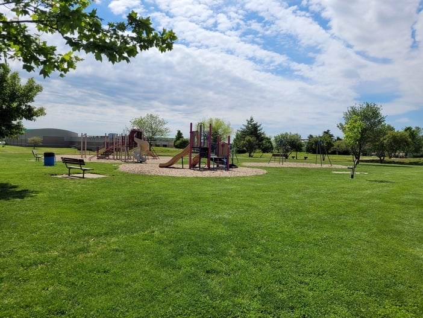

211 W Republic Rd

With an expansive field, a track, plenty of playground space and an entire community center, Chesterfield Park is a gem hiding in plain sight in southwest Springfield.

It's a great place to fly a kite, go for a walk, or sit in a shaded pavilion and watch your kids play. The community center has an indoor pool, a fitness area and plenty of other opportunities for fitness and fun. It's also one of the places with [pickleball courts in Springfield](/pickleball-in-springfield-mo/).

### McBride

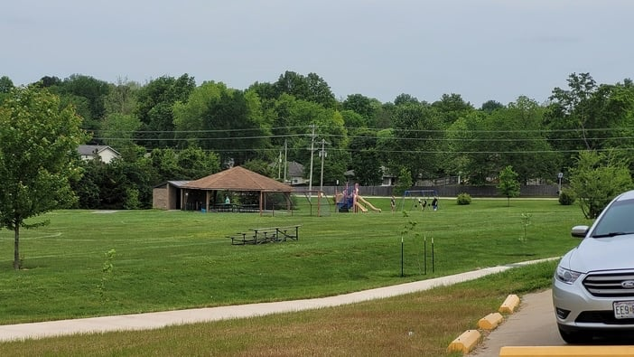

5005 S Farm Road 135

McBride Park is one of three parks in this guide with a **disc golf course**. After your round, enjoy the park trails, use the soccer field, or stop for lunch at the picnic areas.

The park partners with McBride school to offer an **inclusive playground** you can use outside of school hours.

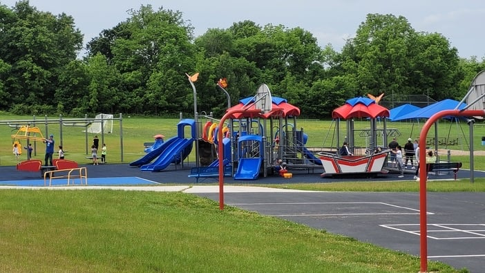

### Nathanael Greene / Close Memorial

2400 S Scenic Ave

You could visit this park many times and still not see everything across its more than **100 acres**.

The park is home to **Springfield Botanical Gardens**, which has long been rated among Springfield's top attractions. If you're there from April through October, check out the **butterfly house**.

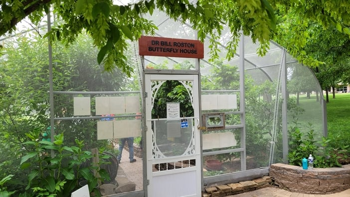

If you're a history buff, or just like looking at old stuff, stop by the **Gray/Campbell Farmstead** on the east side of the park. It's the oldest cabin in Springfield.

The park is also home to the [Mizumoto Japanese Stroll Garden](https://www.parkboard.org/261/Mizumoto-Japanese-Stroll-Garden). There's much more to explore, and you can [find out about the park here](https://www.parkboard.org/botanical).

### Rutledge-Wilson Farm Park

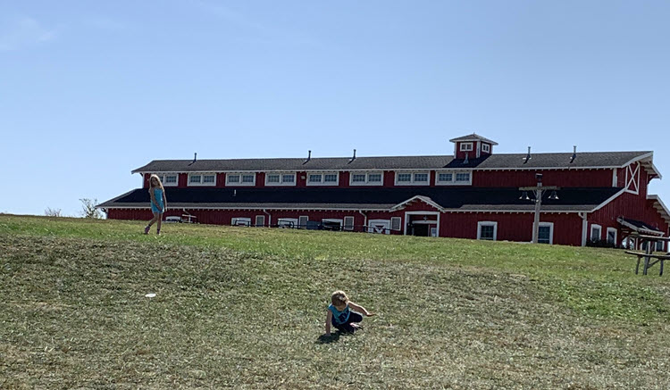

3825 W Farm Rd 146

Yes, a farm park. Rutledge-Wilson Farm Park is a park that's also a working farm.

When you visit, you're welcome to **greet the animals** in the barn and around the property at the top of the hill. The fields grow pumpkins, corn and other demonstration crops, and you'll find gardens and flower beds throughout.

Within the 207 acres are pasture land, trails, a 20-acre **native prairie**, Wilson's Creek and a pond for fishing. There's also a **farm-themed playground** with hours of hide-and-seek and climbing, plus pedal tractors for the kids.

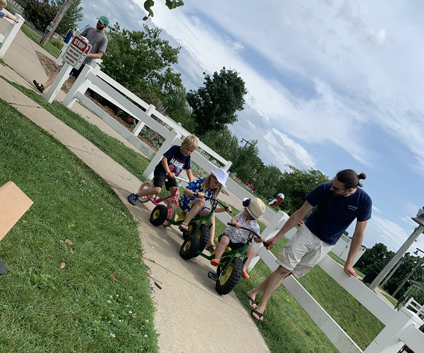

Find out more about the animals, activities and events on the [Farm Park website](https://www.parkboard.org/farmpark).

## Northwest Springfield

### Doling

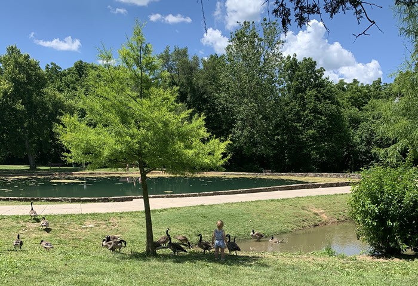

301 E Talmage St

In the early 1900s, Doling Park ran as an amusement park, with a roller coaster, a pony show and a **famous roller rink**. Those uses are long gone, and a **family-friendly park** remains.

Doling has a cave, fresh springs, Doling Lake with plenty of geese, trails in the wooded area and multiple playgrounds. The remnants of the old roller rink's brick building have become a space that can be rented for outdoor weddings and events. There's also a museum in the park where you can learn about Doling's colorful history.

### Ritter Springs

3683 W Farm Rd 92

With more than **200 acres** to explore, [Ritter Springs Park](https://parkboard.org/543/Ritter-Springs-Park) is on the outer edge of Springfield but worth the drive.

You can spend hours hiking the wooded trails. If hiking isn't your thing, relax by the **lake** or the streams. Ritter Springs also has playgrounds, pavilions and picnic tables, and an archery range.

### Nichols

1900 W Nichols

Nichols Park is another **hidden gem** in northwest Springfield. Most of its borders are surrounded by neighborhood homes, and it's away from any major roads.

It's one of the Springfield parks with an **outdoor pickleball court**. You can also watch a game at the lighted baseball field, check out the playground, or plan a cookout with the park's grills and picnic area. See our guide to [pickleball in Springfield](/pickleball-in-springfield-mo/) for more places to play.

### Washington

1600 N Summit

Established in 1896, Washington Park was one of the first public parks in Springfield.

The **large wooden gazebo** is the centerpiece and has been the stage for performances over the decades. It's easy to picture a brass band or barbershop quartet playing for park-goers on a lazy afternoon.

The four-acre park also includes a playground, basketball and tennis courts, a **picnic area** and grills.

## Central Springfield

### Fassnight

1301 S Campbell Ave

Springfield built its first public swimming pool and a two-story fieldstone bathhouse at Fassnight Park. They're still there today because, even though the city considered changing the architecture in the late 70s, the public asked that the buildings keep the original structures that had stood for half a century.

While you're checking out the historic structures, note the **stone bridges** the city built over the creek in the 1930s. The park has **28 acres** to roam, and the creek is often flowing.

Because of its central location and wide-open spaces, Fassnight is often the host of events, car shows and community picnics.

### Meador

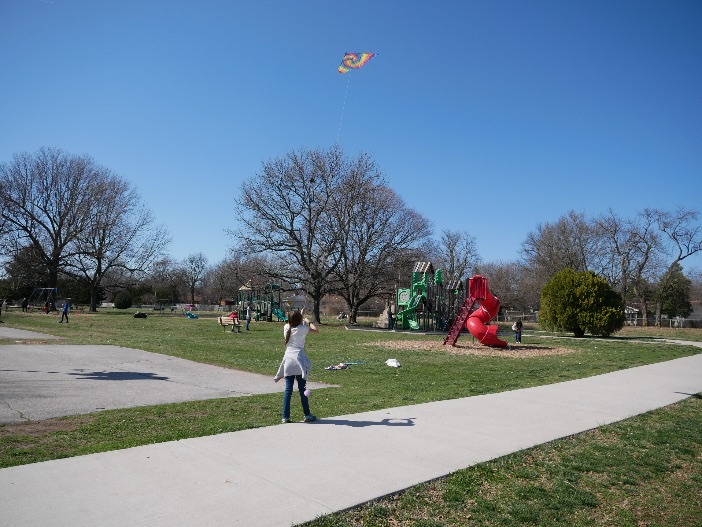

2500 S Fremont

Meador is a park for sports lovers. It has a baseball stadium, four tennis courts, a basketball court and **five softball fields**, and it's home to the Drury University baseball and softball teams.

Sitting on **40 acres** behind Battlefield Mall, it's easy to miss if you stick to the main roads. Seek it out for the **pickleball courts**, if nothing else.

Meador also has playgrounds, grills, picnic tables, a wading pool and a swimming pool for the less sports-minded.

### Phelps Grove

950 E Bennett St

When you need a peaceful spot to spend an afternoon, [Phelps Grove Park](/phelps-grove-park/) should be first on your list.

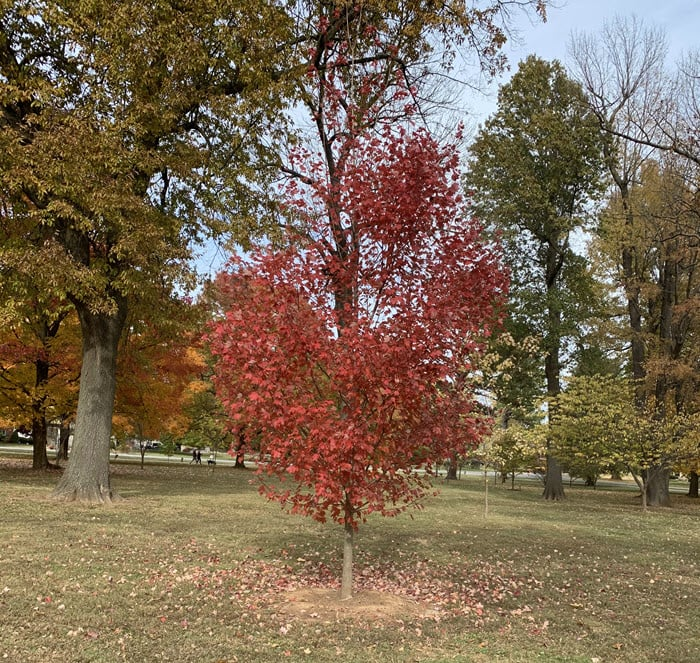

The park is nestled in a **historic neighborhood** surrounded by gorgeous homes. Maybe it's the **old trees** that make it peaceful, or the quiet that comes from being away from major roads. It might also be the park-goers themselves, who lie in tree hammocks, find a shady spot to read, or join the yoga and exercise classes the park hosts.

Read more about the park, nearby attractions and its history at the link above.

## Downtown Parks in Springfield

### Founders Park

330 E Water Street

When I think of a park, I usually think of grassy paths, playgrounds and a few picnic tables. Founders Park has none of that, but it's still a good one.

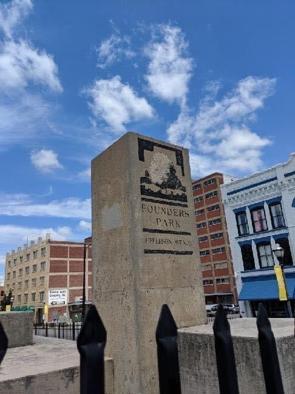

The park is where Springfield started, and it's designed after the historic Phoenix Quarry, which operated just north of Springfield. Founders is less than an acre and made mostly of concrete.

Take some time to look at the **10 ft by 120 ft mural** that shows the first 100 years of Springfield's history. My favorite spot is the **spring**, a re-creation of the original spring on the property when the city's founders were getting started.

If you still want a bit of nature, Founders has a small upper woods area and a place that grows native prairie grasses.

The park also has a **250-seat amphitheater** made of concrete slabs, with concerts, performances and movie showings held there regularly. Check the [Founders Park page](https://www.parkboard.org/founders) for what's on.

### Jordan Valley

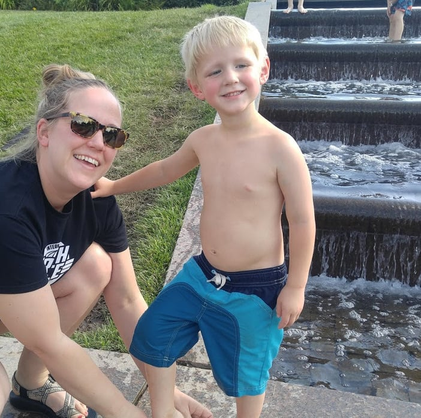

635 E Trafficway St

Just a short walk down the Jordan Creek Greenway from Founders Park is Jordan Valley Park. You can enjoy it any time of year, but summer is when it comes alive. The fountains are on and the **cascading stream** is flowing.

The park fills up with locals who wade in the stream, splash in the fountains and relax on the **grassy hills**.

## Northeast Springfield

### Cooper

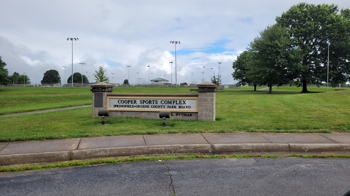

2300-2700 E Pythian

If you're a sports lover, you may already know this park. Cooper Park has 14 outdoor soccer fields, indoor and outdoor tennis courts, a **five-field lighted baseball complex**, an indoor soccer field and a mile and a half of track.

Even if sports aren't your thing, there are trails, picnic shelters, a pavilion and a playground.

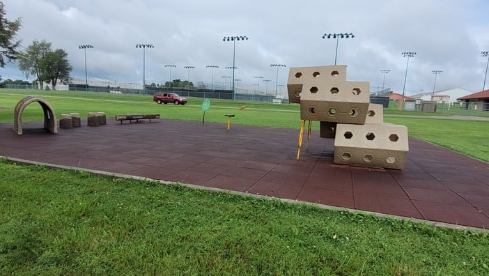

### Silver Springs

1100 N Hampton

This park is nestled in the city near OTC and Drury University. As the name suggests, there's a spring on site that flows into Jordan Creek.

It's a good place for a **stroll along the rock-lined creek**, and the wide-open spaces make room for a picnic blanket on what was once known as Old Fairbanks Pasture.

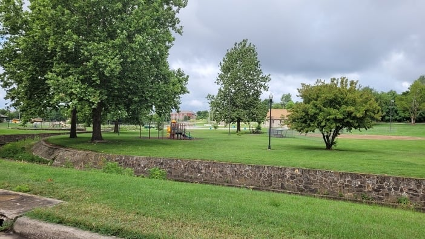

The park has a playground, basketball courts, a baseball field and **horseshoes**. When was the last time you played horseshoes at a park?

[Silver Springs Pool](https://www.parkboard.org/464/Silver-Springs-Pool) is also on site and open during the warmer seasons.

### Tom Watkins

2100 W High St

One reason Tom Watkins Park makes our list is its **disc golf course**, an 18-hole course. If you haven't tried disc golf, get out there and do it.

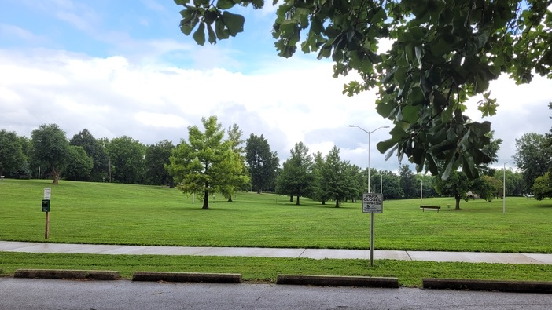

You can also enjoy the park for its wide-open spaces and its playground. The **wooded area** keeps the park nicely hidden from the main roads, but if you follow the address above, you'll find it easily.

## Southeast Springfield

### Lake Springfield

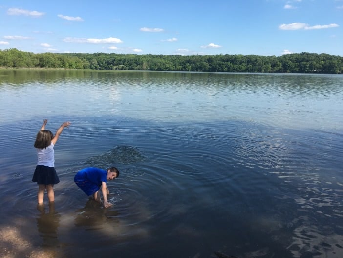

5324 S Kissick Avenue

There's no way to fit everything Lake Springfield Park offers into one article, so here are the highlights. You can read more on the [park website](https://www.parkboard.org/lakespringfield).

The first is the lake. The park's 158 acres include more than a mile of **lake shoreline**. Go up to the boathouse to rent kayaks, canoes or stand-up paddleboards, bring your pole and pick a **spot to fish**, or dip your toes in along the shoreline.

The park also has miles of trails, **bluffs**, acres of woods to explore and plenty of wildlife to spot. The playground sits atop the hill with a view of the valleys and the lake.

### Living Memorial

4323 S Nature Center Way

Fun fact: President Harry Truman dedicated Living Memorial Park in 1958 in honor of America's veterans.

Outdoor enthusiasts usually pass this 10-acre park on the way to the Springfield Conservation Nature Center just down the road. Pretty much every Springfield local has passed it, since the James River Freeway runs by its north side.

Next time you're in the area, stop and explore. It has **trails**, a pavilion and an amphitheater. It's a good spot for a picnic lunch before you head to the nature center.

### Oak Grove

1538 S Oak Grove Ave

Oak Grove is one of the few Springfield parks with a **disc golf course**. The course is quite a challenge, and the trees scattered through the park add to the difficulty.

The park has **10 acres** to stretch your legs, plus basketball goals, a small playground and a community center.

### Sequiota

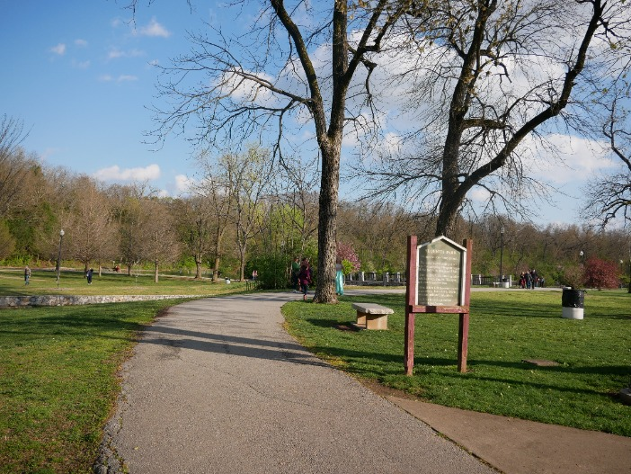

3500 S Lone Pine Ave

Sequiota Park is probably one of the most popular parks in Springfield, for good reason. It's close to [Galloway Village](/galloway-village-springfield-mo/) and has a section of the [Galloway Creek Greenway](/galloway-creek-greenway-trail-in-springfield-mo/) running through it.

The park has something for everyone: trails, a pond, waterfalls, playgrounds, a pavilion, picnic spots, streams and **huge iconic rocks**. **Sequiota Cave** is on the park's property and is home to the endangered gray bat. See our full guide to [Sequiota Park](/sequiota-park-springfield/).

## Springfield Park FAQs

### How Many Parks Are in Springfield MO?

With [more than 100 public parks](https://parkboard.org/Facilities), the Springfield area has plenty to explore. You can find tennis courts, pickleball courts, playgrounds, pools, disc golf courses and more, so there's no excuse not to get outside.

### What Is the Best Park in Springfield?

It's hard to pick one. Some of the parks we keep returning to:

- Sequiota
- Meador and Nichols (for the pickleball)
- Lake Springfield
- Ritter Springs
- Rutledge-Wilson Farm Park
- Jordan Valley
- Phelps Grove
- Nathanael Greene
- Doling
- Tom Watkins Park, for the disc golf course

### What Parks in Springfield Have Disc Golf?

Tom Watkins Park, McBride Park and Oak Grove Park all have disc golf courses. They're spread around town, so nobody has to travel far to play.

### What Springfield Parks Have Pickleball Courts?

There are many places to [play pickleball in Springfield](/pickleball-in-springfield-mo/). Parks with courts include Nichols Park on the north side, Meador on the south side and Chesterfield's community center. Check the guide for current details.

## It's Never Too Late to Have an Adventure

Have you visited any of these parks yet? If not, maybe this is the nudge you need to get out and enjoy Springfield's green spaces.
