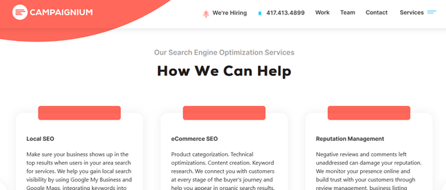
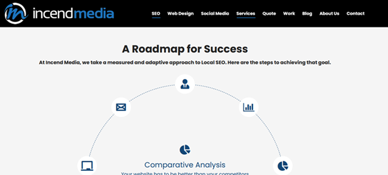
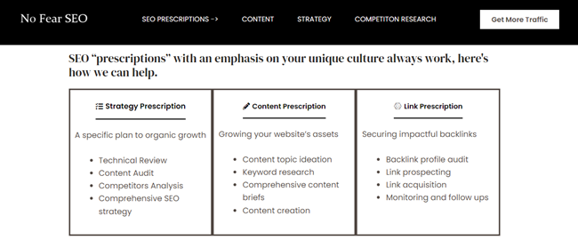
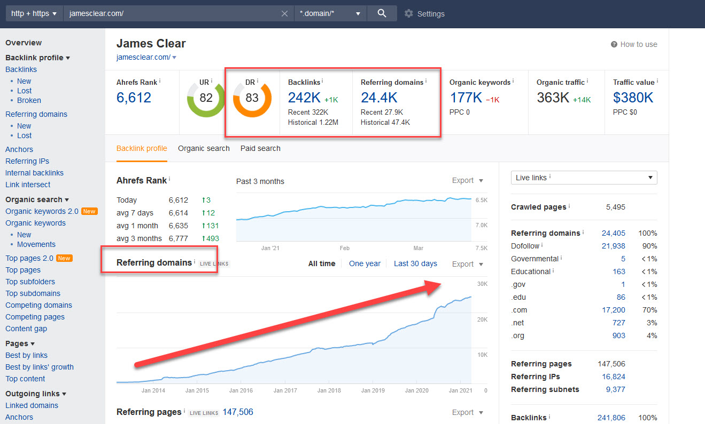
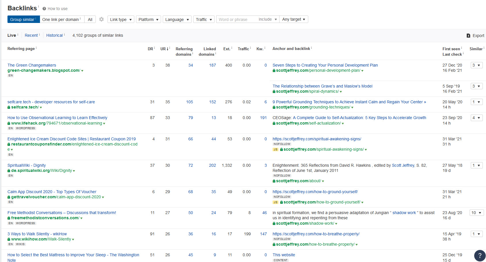
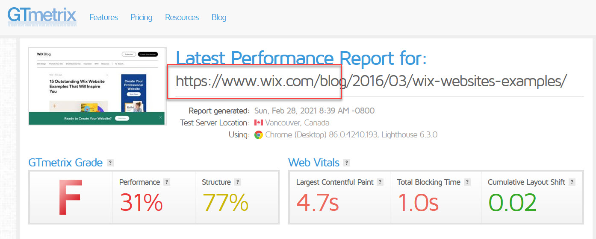

Are you looking for an SEO company that can help your business grow online? Springfield has no shortage of strong options, which can make it tough to decide which one fits your business.

This list covers Springfield, MO's top locally owned SEO companies, to make the decision easier.

In this article:

- First, the top SEO companies.
- Next, if you're interested, what SEO is and how we chose these locally owned agencies.

Here are three SEO companies in Springfield, Missouri, listed alphabetically, that can help your business increase organic traffic and sales.

## Campaignium

Campaignium believes being different is good, and its SEO offerings make that clear.

With a large focus on keywords and content, Campaignium aims for reliable ranking improvements in a way that stays safe with Google.

The agency also works on technical SEO and uses backlink strategies to build your domain authority, which helps rankings.

You can learn about their [SEO services here](https://www.campaignium.com/services/seo/).

## Incend Media

Another reliable choice for SEO services in Springfield is Incend Media.

Incend Media has been in business since 1995 and is based in 417.

Their SEO process begins with an audit of your business and your competitors. From there, they build a plan to start beating your competition.

You can see their offerings on the [Incend Media SEO services page](https://incendmedia.com/strategic-reach/seo-services/).

## No Fear SEO

No Fear SEO takes a different approach: no contracts.

They create content campaigns to boost traffic, and backlink campaigns when your website or specific pages need a push. Each effort focuses on specific deliverables with a clear end point.

You can learn about their no-contract [SEO "prescriptions" for Springfield here](https://nofearseo.com/springfield-mo-seo-company/).

## The Importance of SEO for Your Website and Business

SEO is one of the most confusing but necessary marketing services. It's confusing because there are so many nuances and layers to understand, and it can seem impossible to master without an expert. Listening to a few minutes of a live Google Q&A shows how complex it is.

It's also necessary, for a few reasons:

- You are close to invisible online if you're on page two of Google for your buying phrases.
- Traffic from searches on Google, Bing and other engines tends to come from people actively looking for what you sell.
- Organic traffic from search has staying power.
- Search engines are a primary way people [discover new products and services](https://datareportal.com/reports/digital-2020-global-digital-overview).

Reach out to one or all of the SEO companies above and start getting more leads and sales from Google and other search engines.

## What Is SEO?

SEO stands for search engine optimization. It involves finding keywords (the words and phrases people type into Google) and using content, and often backlinks (mentions of one website on another), to rank web pages at the top of page one instead of buried on page two, three or four.

Solid SEO is a lot of work, and it costs real money.

Content for SEO, mainly blog articles, is a key part of getting more traffic, improving rankings for important pages and building a site's authority on the web.

Beyond content, SEO includes backlinks, keyword research, internal link planning and a long list of technical items such as redirects, structured data, canonicals, robots.txt and page speed. [Semrush has a good overview](https://www.semrush.com/blog/technical-seo/) of the technical side.

Then there is local SEO. It shares many nuances with standard SEO, but it focuses on "near me" and location-specific search phrases on a website and on tools such as your Google Business Profile.

Because SEO is a high-value skill with real risk, such as wasted time or money, here is how we evaluated these companies.

### How We Graded the SEOs

First, we analyzed the health of each SEO company's own website.

A healthy website often shows a steady, consistent climb in "referring domains," the number of websites that link back to it. Each of those links is called a backlink.

Here's an example of what a healthy site typically looks like:

We checked each company's own backlinks and also went through a few verifiable SEO clients.

Here's an example of a healthy site's backlinks:

Each website on the left links to blogs and guides on the site on the right.

Multiple industry-relevant domains link to specific pages on this site. The backlinks mostly use natural language as the anchor text, the words on the page that hold the link. That is a typical sign of earned backlinks, which are the most beneficial kind.

### Website Speed as a Ranking Factor

We also looked at how fast each company's website loads. Speed is an [important Google ranking factor](https://ahrefs.com/blog/google-ranking-factors/) and an indication of how well they can improve your site's speed.

### Auditing Their Clients

To audit their clients' results, we looked at reviews and backlinks, using the same tools described above to grade the quality of the SEO work.

## To the Top of Google and Beyond

Now that you know about some of the best SEO companies in Springfield, the next step is to reach out.

Each of these locally owned businesses would be glad to hear from you and discuss your needs. Pick up the phone, fill out a contact form or schedule a consultation with one or all of them.

If you're also building your local presence, see our guide to [small business success](/small-business-success/), and our list of [Springfield citation services](/best-citation-services-in-springfield/).
