There is a lot to see and do in Springfield, MO. This guide starts with the bucket list, the top attractions in Springfield you should experience at least once. Next come local, unique things to do, followed by food favorites that rarely make the national review lists.

Pick a few and plan your next adventure.

Looking for something more specific? These guides go deeper:

- [Top Things to Do With Kids in Springfield](/best-kids-activities-in-springfield-mo/)
- [Top Walking and Hiking Trails in the Springfield Area](/best-hiking-and-walking-trails-in-springfield/)
- [Best Parks in Springfield MO](/best-parks-in-springfield-mo/)
- [Best Springfield Date Night Ideas](/best-date-night-ideas-in-springfield-mo/)

## 1. The Bucket List: Top Attractions in Springfield MO

### Bass Pro

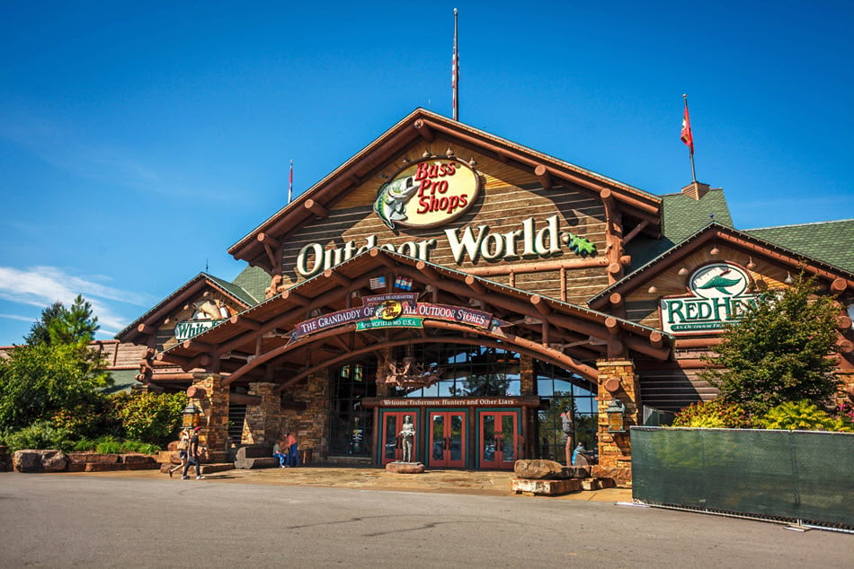

Photo by Heidi and Matt at [Freedom Photography](http://freedom-photography.com/).

Just driving up to the original Bass Pro in Springfield will make you say wow. Walk in any door and you have entered an experience you will not find anywhere else.

Enormous aquariums, fireplaces, statues, mounted animals, boats, knife shops and even museums fill more than 500,000 square feet of shopping, history and fun.

Do not assume this is only for outdoor enthusiasts. Along with golf clubs, hunting gear and other sporting goods, you will find unique jewelry, sunglasses, clothes and more.

You have to go at least once. And if you live in Springfield, think of Bass Pro first the next time you need outdoor gear or gifts.

### Busiek State Forest and Wildlife Area

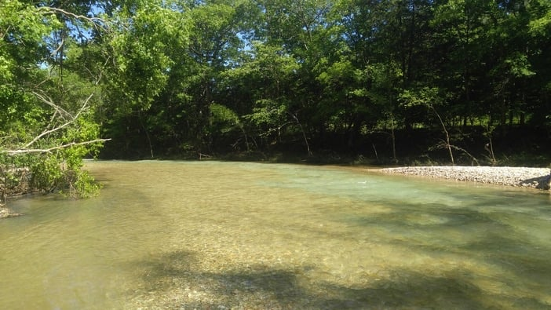

Want a short drive and a break from the stress of everyday life? The 2,500 acres at [Busiek State Forest and Wildlife Area](/busiek-state-forest-and-wildlife-area/) are waiting.

With trails, streams, camping grounds, a gun range and more, you can step into a different world about 30 minutes from Springfield.

Go for some alone time in nature, or hold hands with your partner or kids on one of the trails and take plenty of pictures.

### Mizumoto Japanese Stroll Garden

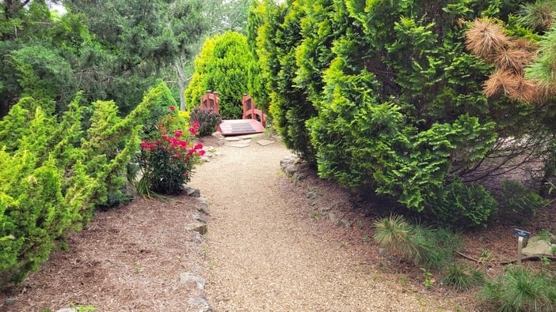

The Mizumoto Japanese Stroll Garden is a great way to spend a few hours or more. There is something new around every corner, so exploring never gets boring.

You will find ponds, streams, gazebos, flowers, plants and trees at the [Japanese Stroll Garden at Nathanael Greene](https://parkboard.org/261/Mizumoto-Japanese-Stroll-Garden).

Check the Park Board page for current hours before you go.

### Lambert's Cafe

Lambert's Cafe is a good destination for anyone who loves Southern or country cooking. But that is not really why people go.

With generous portions, side dishes called "pass arounds" and hot rolls tossed to customers (often by high school baseball players), it is a restaurant unlike any other.

And when we say tossed, we mean it. These are not casual underhand lobs. Fastballs fly across the large dining rooms, unless you ask for a gentler delivery.

The food and the fun make [Lambert's Cafe](https://throwedrolls.com/) a memorable stop.

### Fantastic Caverns

Ever wanted to explore a cave but never had the chance?

Fantastic Caverns is America's only ride-through cavern, so cave exploration is open to everyone. You see the formations without leaving the jeep-drawn tram, and a guide drives the whole way.

Because you only need to sit down for the tour, it works well for kids and for family members with limited mobility.

See the [ride-through Fantastic Caverns tours](https://fantasticcaverns.com/) for current hours and ticket info.

### Moonshine, Spirits and Beer

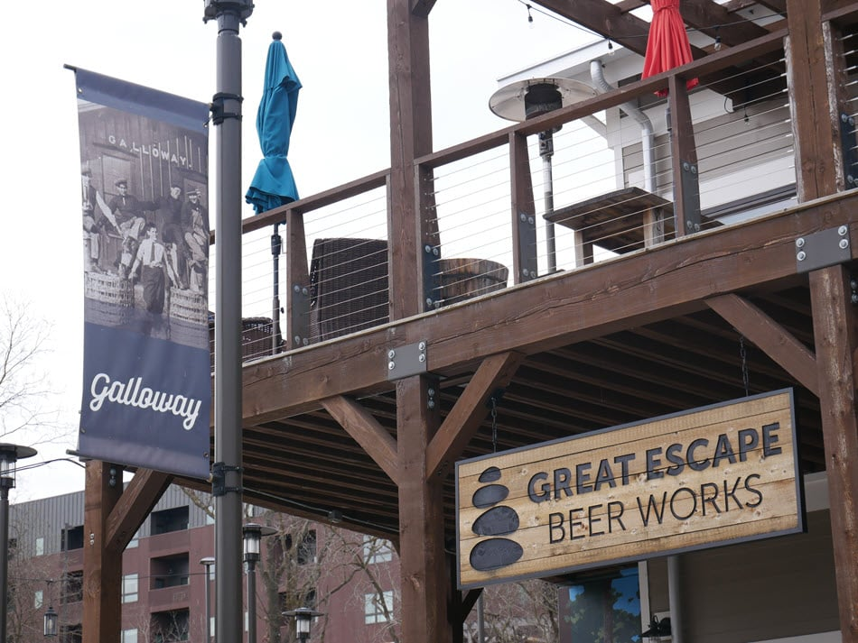

The Springfield area is home to more than a dozen breweries and distilleries. Along with the places that craft drinks locally, there are supply shops and even coaching so you can become a maker yourself.

You can browse the full list of [Springfield breweries](/best-breweries-in-springfield-mo/).

To look over rows of malt, hops and brewing supplies, [The Home Brewery](https://www.homebrewery.com/) by Lambert's in Ozark is one of the largest and oldest in the area.

For making your own drinks and enjoying some right away, [Copper Run Distillery](https://copperrundistillery.com/), about 30 minutes south of Springfield, offers drinks to enjoy on the spot and options to create your own for later.

### Pythian Castle

With escape rooms, castle tours, princess events, murder mystery dinners and more, Pythian Castle is a sight to see. Its history is just as interesting.

The [Knights of Pythias](https://en.wikipedia.org/wiki/Knights_of_Pythias) built this Late Gothic Revival castle in 1913. In 1942, during World War II, it became a military prison that held captured German and Italian prisoners of war in Springfield.

The U.S. military sold the property in 1993, though the laundry room is still owned by the U.S. Army.

Check [pythiancastle.com](https://pythiancastle.com/) for upcoming tours and events.

### World's Largest Fork

The giant fork in Springfield is a fun photo stop.

The Giant Fork is a 35-foot-tall stainless steel sculpture that stands in Chesterfield Village in southwest Springfield.

Visit this local icon, take your photo next to it, and read how to find it in the [history of the giant fork](/largest-fork-springfield-mo/). It is a bit hidden, so the directions help.

### Silver Dollar City

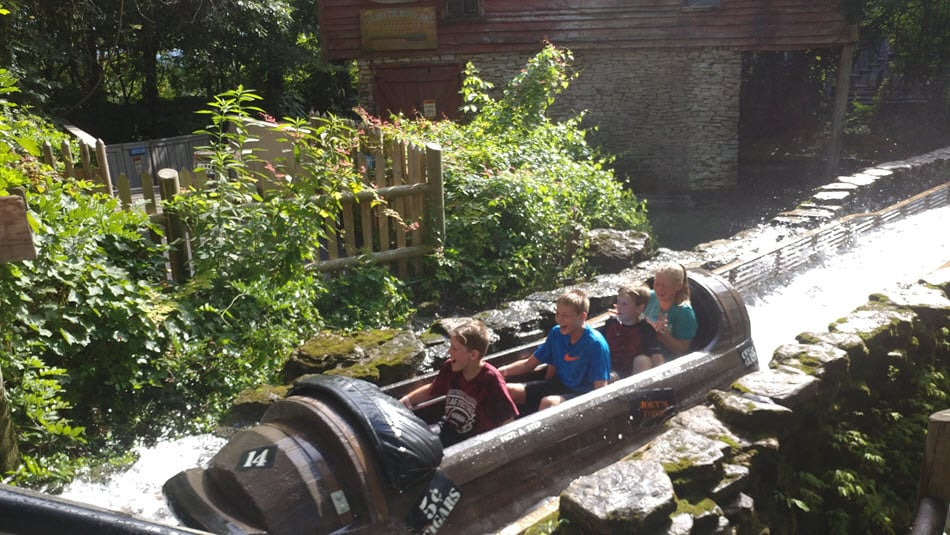

Looking for a getaway? Silver Dollar City is a good fit for families, couples and friends of all ages. With [more than 100 attractions to choose from](https://www.silverdollarcity.com/theme-park), there is something for everyone.

You can spend hours on live shows, record-breaking coasters, glass blowing, homemade taffy, turkey legs, music and rides like the Time Traveler.

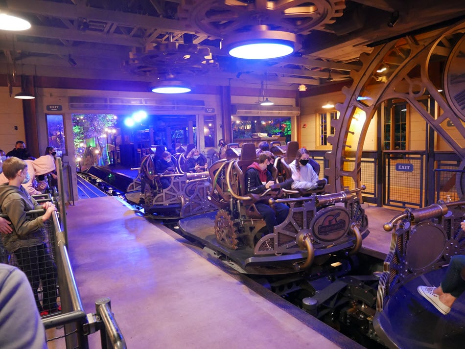

If you need downtime after all that excitement, head to the [Silver Dollar City campground](https://www.silverdollarcity.com/campground) for plenty of space away from the crowds.

Coasters, 1880s-style festivals and shops are all waiting at [Silver Dollar City](https://www.silverdollarcity.com/).

### Wonders of Wildlife

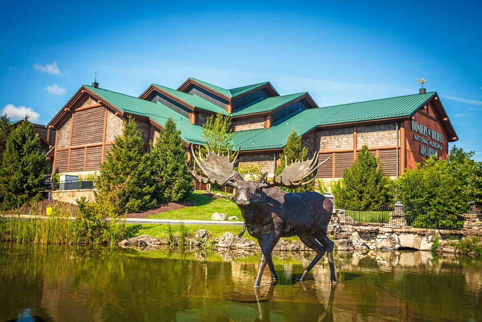

Photo by Heidi and Matt at [Freedom Photography](http://freedom-photography.com/).

Wonders of Wildlife is not your average zoo. It is an interactive, educational wildlife park with more than 1.5 million gallons of freshwater and saltwater habitats and live animals from 800 to 1,000 different species.

The 350,000-square-foot museum and aquarium is even larger than the Smithsonian's National Museum of Natural History.

Visit [their website](https://wondersofwildlife.org/) to plan your trip.

## 2. Unique Experiences Hiding in Plain Sight

### Galloway Village

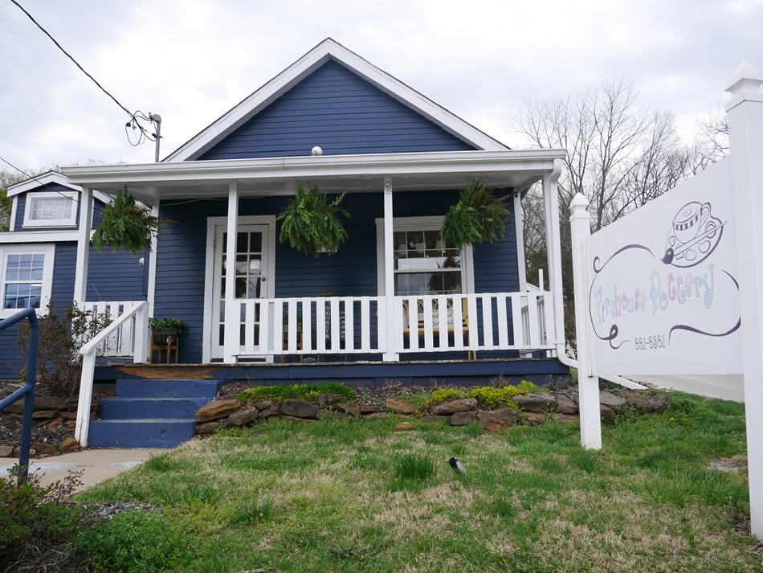

Looking for something new to do in Springfield? Galloway Village is a good place to find unique shops, local breweries, spas and more. It also has outdoor activities like hiking trails and parks, with plenty for families, date nights or relaxing alone time.

See the list of [unique experiences only in Galloway Village](/galloway-village-springfield-mo/), or just drive to the [general area on Google Maps](https://www.google.com/maps/@37.1491862,-93.2389255,16.25z) and start looking.

### Askinosie Chocolate Factory (and Tour)

A real chocolate factory in Springfield, MO? Yep.

Askinosie is also making a positive impact. The company buys cocoa directly from farmers in origin countries such as Ecuador, Tanzania, the Philippines and Amazonia. It also teaches students about making world-changing decisions through programs like [Chocolate University](https://chocolateuniversity.org/about/).

You can see how chocolate is made by hand, and get samples, on one of the [factory tours](https://askinosie.com/pages/tour-our-factory).

Or learn more about the bean-buying process and the [chocolates they make by hand](https://askinosie.com/).

### Get Out and Explore Nature

Need to get outside, smell the flowers and do some grounding? Of course you do.

Springfield has an abundance of nature trails, and the city has done a good job of keeping nature within a few minutes' drive of almost anywhere in the area.

Learn about some of the best [Springfield walking and hiking trails](/best-hiking-and-walking-trails-in-springfield/).

### Springfield Sculpture Walk

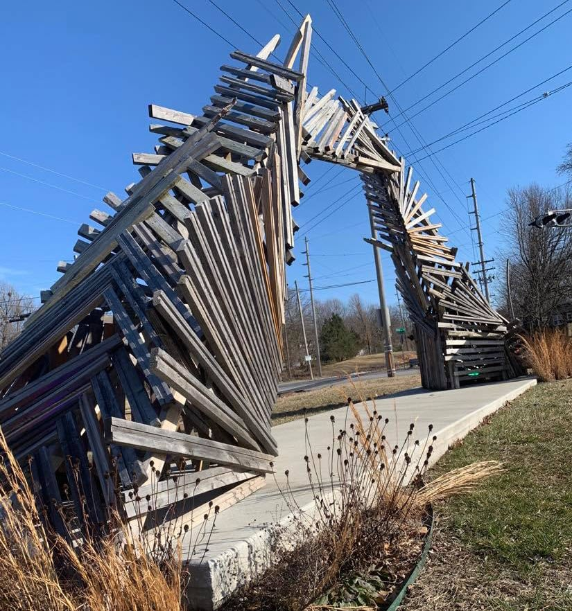

Want to see unique art without paying? The "museum without walls" puts one-of-a-kind sculptures all over Springfield, free to see.

It is a cool thing to do and also a way to explore art, culture and the city all at once.

Find locations on the [Sculpture Walk map](https://sculpturewalkspringfield.org/map/), or read more about the [Sculpture Walk in Springfield](/sculpture-walk/).

### Explore Creating

Want to make something this week? You can make something special for yourself or someone else at one of the many workshops in Springfield.

From glass blowing to painting, pottery, woodworking and more, here is a list of [creative classes in Springfield](/art-classes-in-springfield/) to get you started.

### Go Dancing

Dancing is a fun way to get in shape. It is good for heart health, flexibility, balance and weight management, and it makes for good memories on your own or with friends.

Find [dance classes, lessons and workshops](/dance-classes-springfield-mo/) around Springfield.

### Smallin Civil War Cave

Looking for a new adventure? Smallin Civil War Cave has stalactites, stalagmites and a natural spring with clear water.

The tour suits families with kids and adults who want something different from the usual tourist attraction. Expect photo opportunities and plenty of history, including the story of the Osage people.

Learn more about visiting at [Smallin Cave](https://www.smallincave.com/).

## 3. Local Foodie Favorites You Should Know About

### Andy's Frozen Custard

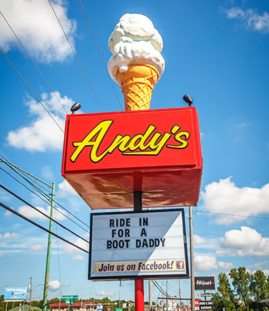

When Hannah Dollar Vale saw the big custard cone at Andy's on North Glenstone, she knew Springfield was where her heart belonged.

If you have not tried [Andy's Frozen Custard](https://www.eatandys.com/), get on it. The shop started in Springfield and has been spreading across the country for good reason.

Concretes (packed with fruit, nuts or candy bars), jackhammers (a concrete with hot fudge or other toppings "jack hammered" in the middle), sundaes, splits, shakes, cones and malts are a trip back through the flavors of childhood.

There are several Andy's locations around Springfield.

### Cafe B-29

Cafe B-29 is a good pick for a date night, a family outing or time with friends. Walk in and the memorabilia on display invites you to reflect on the service given in World War II.

The menu has something for everyone, from burgers and sandwiches to catfish and salads. Their Jalapeno Popper Burger is one of the few burgers to win the people's vote at a [World Food Championship qualifying event](https://worldfoodchampionships.com/qualifying-events).

Head to [Cafe B-29](https://www.cafeb29.com/), just south of Springfield, for an experience unlike any other.

### Casper's

[Casper's Diner](https://www.caspersdiner.com/) is a real dive joint and the oldest diner on Route 66. It is at [937 S Glenstone Ave](https://www.google.com/maps/search/?api=1&query=Casper%27s+Diner+937+S+Glenstone+Ave+Springfield+MO).

The food is reasonably priced and the decor is eclectic. Casper's is known for its chili, which you can order as a meal on its own or smothered over fries.

If you like good food at a fair price and want something different from your usual dining out, put it on your list. Check their site for current hours before you go.

### Local Food Trucks

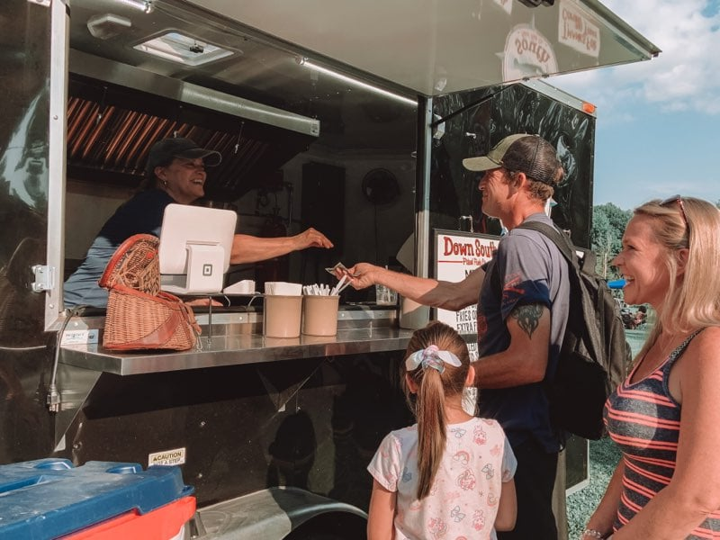

Food trucks deliver some of the best local food, and they are mobile, tasty and fun to find around Springfield.

For unique, locally created food, read about our favorite [food trucks in Springfield](/best-food-trucks-in-springfield-mo/).

### Early Bird Breakfast Pub

What beats a great breakfast? A breakfast served in a pub.

The atmosphere is one of the best parts. It works for relaxed or serious conversation, and the creative menu, solid coffee, craft beer and other drinks make it a winner any day of the week.

Find [Early Bird on Facebook](https://www.facebook.com/EarlyBirdBreakfastPub/), or stop by near Glenstone and Sunshine at [1717 E Cherokee St](https://www.google.com/maps/place/Early+Bird+Breakfast+Pub/@37.1784522,-93.2637057,15z/data=!4m5!3m4!1s0x0:0xaaf025987b1a99da!8m2!3d37.1784522!4d-93.2637057).

### Hurts Donut

[Hurts Donut Company](https://www.wannahurts.com/) makes some of the boldest donuts around. Creations with cotton candy, fruity pebbles and bacon toppings pull together childhood favorites in one bite.

The original glazed donut can please any sweet tooth with its simplicity, too.

### Incredible Food and Fun (formerly Incredible Pizza)

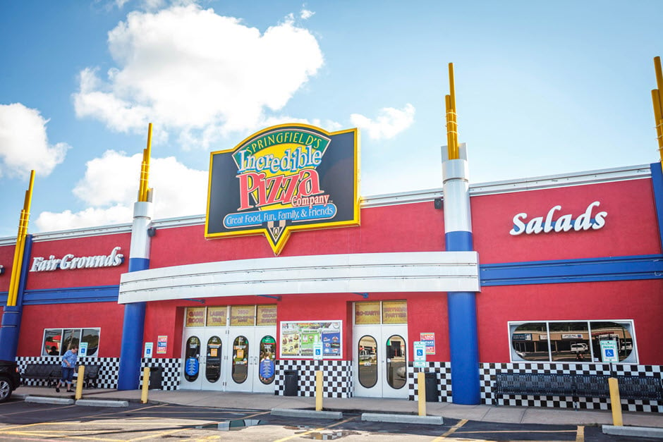

Looking for a place to spend the day with the family? Incredible Food and Fun, formerly Incredible Pizza, pairs an arcade and games with a buffet of pizza, pasta, chicken fingers, fries and more.

See [their website](https://incrediblefoodandfun.com/) for the Springfield location, hours and current attractions.

### Pineapple Whip

Pineapple Whip offers many flavors, but the original pineapple whip is by far the most popular. It tastes like summer in a cup.

They have kept the original recipe the same since 1974, and it hits the spot on a hot summer day.

Springfield loves it so much that Tie and Timber, a local brewery, has used it to make a [Pineapple Whip Beer Float](https://www.facebook.com/tieandtimberbeerco/photos/a.241321632945410/1157739247970306).

You can find Pineapple Whip at several locations in Springfield.

### Pizza House

Pizza House is a family-owned restaurant in Springfield that serves thin-crust pizzas with fresh ingredients. It has been serving pizza since 1958.

It sits on historic C-Street, so you can discover other things that make Springfield unique while you are there.

Learn more about [Pizza House's pizza and atmosphere](/pizza-house-springfield-mo/).

### Millsap Farm Pizza Night

Pizza night at Millsap Farm is a good way to spend an evening in Springfield.

The Millsap family has hosted events and served food in Springfield since 2007, and pizza night is one of the best. It often sells out.

Expect pizza, live music and good company. Read more about the weekly [pizza nights at Millsap Farm](/pizza-nights-at-millsap-farm/).

### The Original Cashew Chicken

In the 1960s, David (Yin Wing) Lee created cashew chicken to win over Springfield diners who were not yet ready for authentic Cantonese cuisine.

Cashew chicken is a Chinese-inspired, deep-fried chicken dish served in a light brown sauce made from chicken stock, soy sauce, oyster sauce and milder spices.

Most Chinese restaurants in Springfield offer some version. To try something as close to the original as it gets, visit David Lee's family restaurant, [Leong's Asian Diner](https://www.leongsasiandiner.com/).

## What's on Your List?

Now it is time to get out there and make some memories. Whether you want to see the whole region or just explore Springfield a little more, we hope this list gives you ideas.

Is there a favorite we missed? [Reach out](/contact-us/) and let us know.
