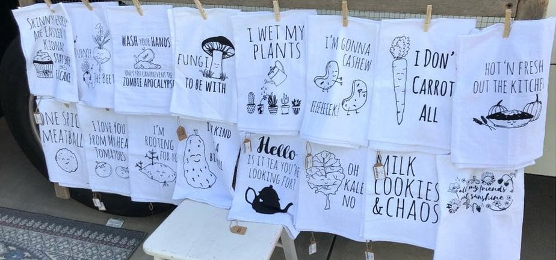
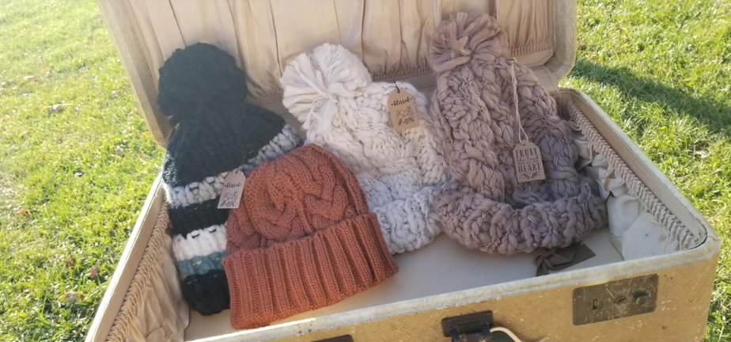

How does a beat-up old truck become a stylish fashion shop on wheels? With imagination and hard work.

Bree's Little Closet, a fashion truck in Springfield, has a pretty cool history. It went from an ugly little thing sitting at a police impound to a money-making mobile boutique. The background may surprise you, and the ending is a good one.

## Love at First Sight

Some people may have thought it was a challenge too big to tackle, but not Brianna and Tina Barnett, who are both entrepreneurs and creative visionaries. What would become a mobile boutique started out as anything but.

Brianna and her mother Tina bought the truck at auction after it had been sitting at a police impound lot for some time. The truck has a shady past: the man who previously owned it was a bit of a thief, but those days were long over.

When Brianna and Tina first saw the truck, they saw what only true entrepreneurs would see: the perfect place to start a business. With a love of fashion and some inspiration, they were determined to make the dream real.

## From Ratty to Spectacular

When they bought the truck, they knew a lot of work was ahead before it could become the fashion truck it became. From the interior to the exterior, the work was extensive. It needed much more than a touch-up.

With help from friends and family, they rolled up their sleeves and turned a truck with a not-so-nice history into a handsome fashion truck.

They added fixtures to hold their collections and redid the interior with decor, ceiling tiles, wood flooring and even antique doors before finishing it with a decorative logo on the side. After all that effort, the truck looked like the shop they had pictured. They named it Bree's Little Closet.

### The Fashion Truck Is More Than Just a Beauty

What stands out about this fashion truck is not only the transformation but the creative vision behind it. A passion for fashion and a desire to turn a business idea into reality drove Bree's Little Closet.

It is a great example of what you can do with an idea, determination and a little help from friends.

Bree's Little Closet now also has a storefront, and the truck can be booked. Visit [breeslittlecloset.com](https://breeslittlecloset.com/) to check them out.
