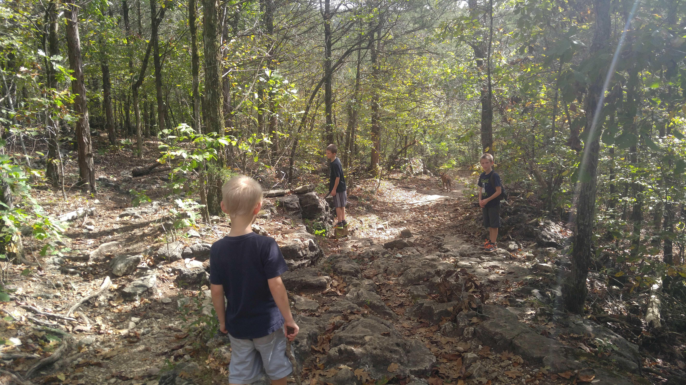
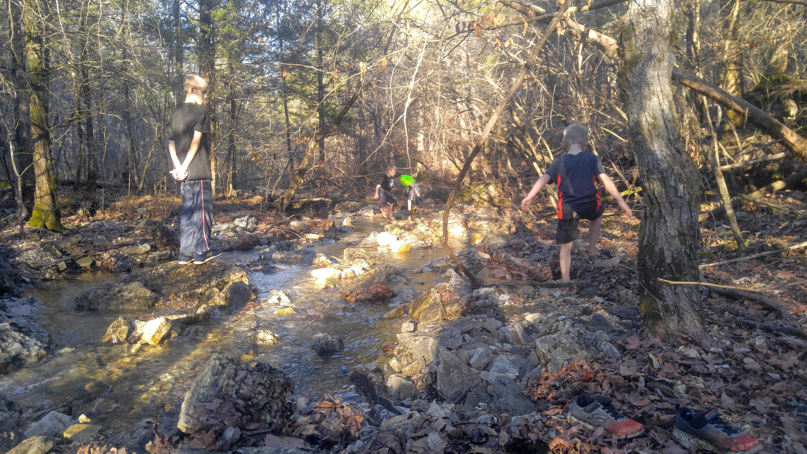
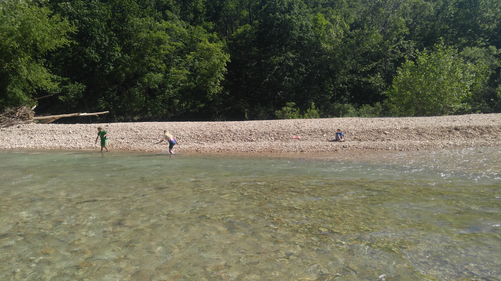

Busiek State Forest is one of our favorite places in the 417 area. We have spent many days there with kids, extended family and friends, playing in the creek or hiking one of the many trails. It is also a regular spot for a quick morning or afternoon walk with the dog, and often one or all five kids come along.

Busiek is a great getaway because it feels secluded in the woods, yet it is only about 12 minutes from our house. There are not many places where you can do that.

The area is miles of rock-lined creek. Depending on the time of year, the water can be high enough for decent water play or close to nonexistent. Keep that in mind if you plan to hike or bike, because every trail crosses the creek at some point, and some cross it several times.

Busiek is just off Highway 65, almost halfway between Springfield and Branson. It has 18 total miles of trails for hiking, biking or horseback riding, an unstaffed shooting range and 9 primitive campsites.

From the highway, turn east and follow the road down the hill to a fork. To the left are the camping areas, nice spots to play in the water and 3 of the 6 trails. To the right are the shooting range and the other 3 trails.

**Note:** Busiek has no amenities of any kind.

No place is for everyone, but Busiek offers a wide variety of experiences. Families with young kids can spend the day playing in the stream and throwing rocks. Casual hikers and horseback riders can get into the woods for a while. Avid mountain bikers and hikers can plan a full day or two of adventure.

## Plan your visit

The Missouri Department of Conservation manages the area. Its [Busiek State Forest and Wildlife Area page](https://mdc.mo.gov/discover-nature/places/busiek-state-forest-wildlife-area) has current conditions and area information. You can also call the Southwest Regional Office at 417-895-6880 for conditions, trail status and camping permits.

## The trails

We have hiked all of the trails at Busiek, some more than others, dozens of times.

There are 6 trails total: three west of the highway and three to the east. All are enjoyable, but the west side trails are our favorites. The one downside is the shooting range, but you get out of earshot quickly, and you know you are getting close to the end when the gunshots start to be audible again.

The trails used to be a little confusing, but in recent years they have become well marked with paint on the trees and maps at the forks of the trails, thanks to a local Eagle Scout.

The variety of trails, and the option to combine them, makes for many different outdoor experiences.

During dry months, the streambed is more dry gravel than stream. During wet months or after hard rains, there is a decent creek and some muddy, wet spots on the trails. In spring you will likely want waterproof hiking boots. When it has been dry, a pair of tennis shoes will typically do.

### East side trails

- Red Trail: 3.6-mile loop
- Yellow Trail: 4.33-mile loop
- Blue Trail: 2.1-mile loop

#### Red Trail

The Red Trail offers fairly easy hiking, but there is a creek crossing and some rugged terrain. After heavy rain the trail can be muddy and the creek more difficult to cross.

If you just want a short stroll, you can walk to the old cemetery and back to the lot, which many people do. The Carter Cemetery is one of the best features of the Red Trail. It is near the top of a hill, about a half-mile walk from the parking lot. Established in 1891, the small, inactive but maintained graveyard has 29 grave markers.

Going counterclockwise from the east parking lot, the trail begins with a crossing of Woods Creek and then settles into an easy stroll, though the terrain gets quite rough in places and there are no really dangerous surfaces.

Going clockwise, the trail begins with a nice even walk until you reach the Woods Creek crossing. Shortly after, it gets rough and starts to climb. Whichever way you go, you will cross the creek. The water can get knee deep there, but it is lower most of the time.

We recommend going counterclockwise your first time, but you can decide that.

Overall, the Red Trail is the easiest and best trail for the casual hiker or for anyone with young kids in tow. It is the trail we walked for years with our own.

#### Yellow Trail

The Yellow Trail extends from the Red Trail, so you begin the same way from the parking lot, and the two overlap whether you go left at the fork on the Red Trail or straight on the Yellow and loop back around.

This trail includes a couple of hard, rough climbs on stone-covered trails. There are three crossings of the creek and no bridges, so be prepared to get wet when the creek is running.

From the parking lot, cross the bridge to the trailhead. At the fork, go right and continue until you reach a creek. Cross the creek and pick up the trail downstream. Follow the trail until you reach a fork with a signpost. Go right to stay on the Yellow Trail. Keep going until you reach another fork. This is where the Yellow Trail joins the Silver Trail, and it is where people get lost. When in doubt, go right.

The trail then heads down toward the second water crossing. After you cross the creek, the trail heads back up to the top of a ridgeline, where you will find panoramic views of the valley you just climbed out of. The trail ends near the historic graveyard, a great place to stop and explore.

You can also start from the parking lot, head south across the newly constructed bridge and climb the switchback to the first node, where Carter Cemetery sits. The trail meanders through the woods in an east-southeast direction before turning south. About a quarter of the way through, there is a Yellow Trail shortcut. At times the water may be up and you must look for a ford to cross. Generally the water is very low.

If you choose to cross the water, you can continue along the full length of the Yellow Trail, approximately 4.33 miles, or take a cutoff along the creek to circle back to the trailhead.

The Yellow Trail is not much harder than the Red Trail, just longer. If you are up for more than the short Red Trail hike, it is a great option.

#### Blue Trail

The Blue Trail (it used to be called the Silver Trail) is a lightly trafficked loop of roughly 2 miles that forks off the back of the Yellow Trail.

The parking lot with direct access to the Blue Trail is off Highway A, the first road south of the main Busiek entrance. It is easy to miss the turn from Highway A, so watch closely. A short distance from Highway 65 there is a dirt road to the left that looks like part of someone's driveway. Once you are there, you can tell it is the right road.

Starting at the South Trailhead, the Blue Trail is a steep, fairly challenging loop up one side, a short walk along a ridge and right back down. It has loose gravel and can get quite muddy in places after a good rain. There are a couple of skinny streams to cross.

You can also reach the Blue Trail by following the Yellow Trail all the way back. The Yellow and Blue trails overlap toward the south trailhead.

All in all, we like the Blue Trail for a less crowded, shorter hike. It has really nice scenery from the top, particularly in the months when leaves are not blocking the view.

### West side (gun range side) trails

As mentioned, the west side trails have become our favorites. You will hear gunshots at the beginning and end of your hike.

- Purple Trail: 3.6-mile loop
- White Trail: 4.43-mile loop
- Orange Trail: 5.71-mile loop

#### Purple Trail

The Purple Trail is a great choice for a really enjoyable shorter hike. It is steep in places and has several creek crossings, but it is fairly easy going.

From the parking lot, cross the bridge and enter the trailhead just behind the shooting range. After about a mile, the Purple Trail splits off from the White Trail. There is a long, challenging climb. At the top, the trail curves right and follows the ridgeline for more than a mile, then descends the mountain on a series of switchbacks and ends back at the parking lot.

You can also take the trail counterclockwise. Either way is enjoyable, and the switchbacks are an easier climb than the trail going up the other way.

The switchbacks in the glade area have beautiful wildflowers at certain times of the year and are often wet and muddy.

We really love the Purple Trail. Like the Red Trail on the east side, it is the trail we hiked for years with young kids. Only in recent years have we ventured onto the White and Orange trails.

#### White Trail

The White Trail is one of our newer favorites. It forks off the Purple Trail and is a beautiful loop with all types of terrain.

There are some fairly difficult climbs, many areas can be quite muddy and there are stream crossings.

One thing we enjoy about the White Trail (our dog in particular) is the dozens of armadillos. It is also one of the less-hiked trails, so it can feel a little more peaceful, and there are good places to stop and play in or enjoy the water.

The White Trail is perfect for a slightly longer, more secluded and still beautiful hike or ride.

#### Orange Trail

The Orange Trail is the farthest to the west. You reach it by taking the Purple or White trail from the parking lot.

In our experience it is the most secluded of the trails, and it suits more serious hikers and mountain bikers. There are steep, rough climbs, a little cave area the kids like to play around, occasional dripping waterfalls and many beautiful sights.

Whenever we have enough time and want to feel deep in the woods just 12 minutes from our house, the Orange Trail is the top pick.

## Camping at Busiek

Busiek offers 9 spots for primitive, no-amenities camping along the creek, close to the parking lot on the east side of Highway 65.

A permit is needed. You can get one through the [Southwest Regional Office](https://mdc.mo.gov/discover-nature/places/southwest-regional-office) at 417-895-6880, and the [Busiek page on the Missouri Department of Conservation site](https://mdc.mo.gov/discover-nature/places/busiek-state-forest-wildlife-area) has current area details.

## The shooting range

West of Highway 65 along Camp Creek, Busiek has an unstaffed paper-target firearms range. It has been open daily during daytime hours, with a weekly closure for maintenance. Check the Missouri Department of Conservation page before you go for current hours.

## Busiek water play

The water at Busiek is very clear because the creek bed is almost entirely gravel, and it is home to crawdads, minnows and other fun creatures.

We have spent countless hours at our favorite swimming holes. There is the place where we race sticks with Grandma, the area our kids named Mermaid Rock, a spot near the parking lot to jump off a tree trunk into a shallow pool, the vine ropes and more.

All of our kids spent hours throwing rocks into the creek as toddlers, and a kid or two became a champion rock skipper during our visits to Busiek.
