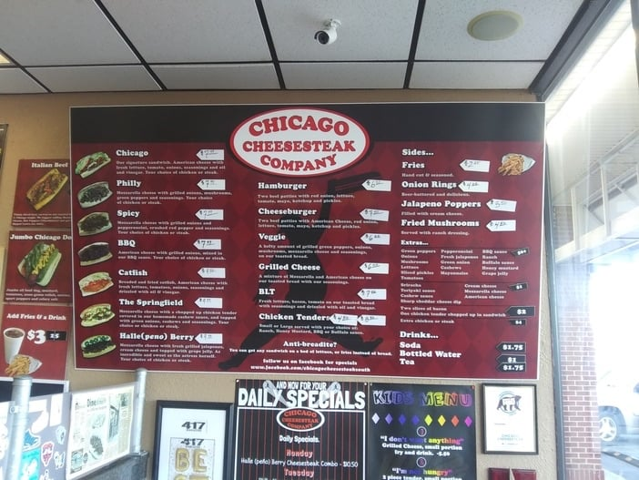
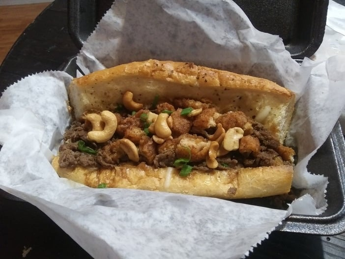

Philly cheesesteak is an anti-guilty pleasure of mine. That means I feel no guilt and all pleasure when I eat it.

But what about a cheesesteak that isn't from Philly? What about our own Chicago Cheesesteak Company, right here in Springfield, Missouri?

I've eaten there many, many times, and I finally decided to share my take. Let's talk cheesesteak.

## An Introduction to The Chicago Cheesesteak Company in Springfield, Missouri

If you've never eaten here, there are two locations in Springfield:

- The original shop, downtown at 319 1/2 E Walnut St. Call ahead before you go to make sure it's open.
- The southern location, at 303 E Battlefield Rd in the Battlefield Plaza.

I've always gone to the southern location. Still, a sign at the downtown spot poking fun at the national sandwich chain across the street was a fun touch.

### The Environment

Walking into The Chicago Cheesesteak Company has always been a refreshing experience for me. It reminds me of an old-school pizza place, except they're selling cheesesteak and burgers instead of pizza.

When I was a kid, my dad took me to all kinds of these old-school places back in Illinois, where we lived while I was growing up. He played music on weekends with a group of old-timers. When I got to tag along, he bought me a hamburger pizza and a Coke, and I listened in, dreaming about the day I'd get to play bass or drums on those same stages.

So the decor works for me. You walk in and get the sense that this is a down-to-earth spot where you can get good food and relax. It's not overdone, and you'd feel as comfortable in a business suit as in workout clothes.

## The 411 on Cheesesteak in the 417

For those who aren't as committed to food history as I am, a "Chicago beef" sandwich is traditionally made with hot roast beef on a roll. A Philly cheesesteak is made of thin slices of ribeye cooked on a griddle.

That's what I find interesting, because the style of cheesesteak at The Chicago Cheesesteak Company is closer to Philly than to Chicago. I'm not sure which cuts of meat they use, and I'm no expert, but to me it looks and tastes a lot like ribeye.

They offer several options, and I haven't tried them all.

On my most recent trip I ordered the Springfield, a cheesesteak with Springfield-style cashew chicken toppings added on top of the grilled meat.

### The Springfield

This wasn't my first time eating this sandwich. I'm usually a purist when it comes to cheesesteak, but The Springfield is a strong sandwich, and it brings real bragging rights to the 417. I think it would hold up in Philly.

The breaded chicken, cashews and green onions go well with the toasted bread and grilled meat. It's savory, with a good blend of flavors. The cashews contrast with the hearty meat, and the bread is toasted so it's a little crispy without feeling dry. The chicken is cooked well, too.

The fries are a little different. I like to dip them in ketchup or ranch, depending on my mood, because I find them a little dry on their own. But I finish the whole bag every time and order them every time, so you know I like them.

They give you a big bag of fries, and they use spices that make them different. You won't find fries quite like these anywhere else in Springfield.

## In Conclusion

I used to make my way to Chicago Cheesesteak Company at least once every two weeks. Sometimes I dined in, usually I took it to go, and every time it was a good experience.

I'm no cheesesteak expert, but as far as the 417 goes, they're the best I've had. If you have a favorite cheesesteak spot in town, send it our way through the [contact page](/contact-us/) and we'll try it out.
