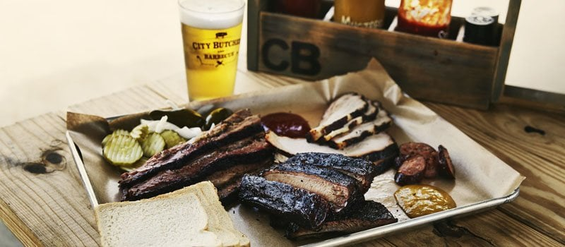
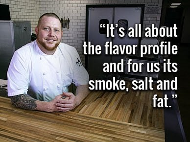
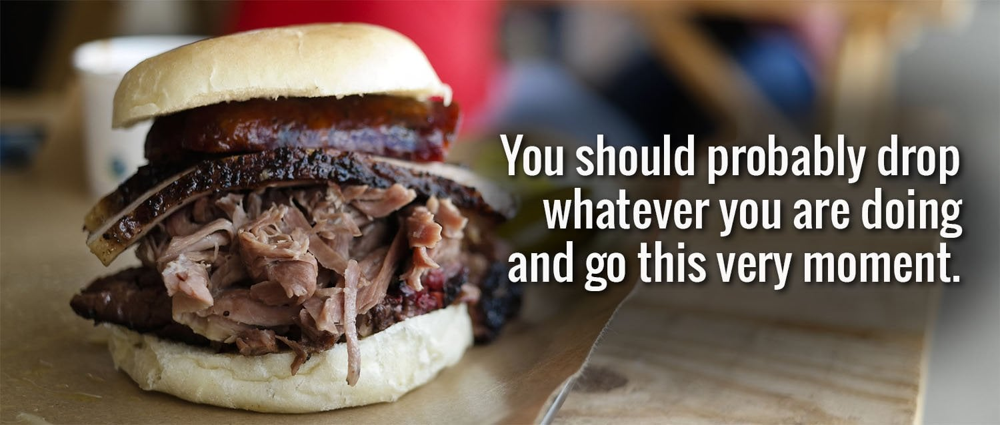

## Is Missouri Ready for Texas Barbecue?

Born in Texas, raised in Springfield. Springfield has its share of people from other parts of the country. Pick a region, and you probably know someone from there who now calls Springfield home. One good thing about that is we can eat some of the best food in the country without driving to another state, let alone another city.

Cody Smith, a founder of City Butcher, is on a mission to spread the good news of Texas barbecue, one smoky, succulent bite at a time. Being close to Kansas City, Springfield has its share of barbecue joints. But KC-style barbecue is all about the sauce, while Texas barbecue is all about slow, wood-smoked beef.

## Expect a Line

City Butcher has been known for running out of meat. Other barbecue joints in town have suggested City Butcher just doesn't make enough food. So is "sold out" clever marketing, or is something special going on?

I don't know how to run a restaurant, so I can't say whether more meat would end the sell-outs. I do know I have never eaten at City Butcher and been alone. It's rare that the crew isn't all-hands-on-deck busy, and there's usually a line. Like most people, I'm happy to wait in almost any line to get my share of burnt ends.

Because popular items can sell out, call ahead for hours at (417) 720-1113 and plan to go early.

## No Frills, but Who Needs Frills Anyway

City Butcher is in the Kickapoo Corners shopping center. It doesn't need a big, fancy, standalone building to sell barbecue. In fact, it doesn't need anything fancy. They trust the meat to be good enough that you won't be distracted by bric-a-brac.

When we visited, there were unfinished cement floors, simple but well-made wooden benches and a few pictures on the wall. Most of the budget went toward function. There was an impressively long, ice-filled beer cooler that could comfortably hold a Fiat. The fixin's at the condiment station were free and included chopped onions, pickles and bread.

## No Bad Choice

Brisket is the king of Texas barbecue, and you can judge a barbecue joint by its brisket alone. City Butcher's brisket is aromatic and moist, but the best thing on the menu is the burnt ends.

Choose any of the specialty sandwiches without worrying about missing out, because you'll be back enough times to try everything. When we visited, I recommended starting with the Sweaty Texan (brisket and hot links) or the Pig Bird (pulled pork and smoked turkey). Check their menu for what's currently offered.

All that smoky flavor will leave you thirsty. There's a beer cooler on hand, so you can pick something cold to pair with your barbecue.

The quality shows in the time and effort that go into every detail of the meal. City Butcher is likely to become one of your favorite places in Springfield.
