**Note:** Google's screens and menus have changed since the screenshots below were taken, and the product is now called Google Business Profile (it was formerly Google My Business). The steps and the thinking behind them still apply, but button names and menu locations may look different when you sign in.

Setting up your Google Business Profile is a critical part of local SEO. Get it right the first time with this in-depth guide.

If you want to rank higher in local searches, or make sure customers can find you when they need what you offer, this guide is for you. We will walk through setting up a Google Business Profile so people can find and connect with your business online, no matter where they live or what device they use, in two steps:

1. [Create and verify your Google Business Profile](#how-to-set-up-your-google-business-profile)
2. [Optimize your Google Business Profile](#how-to-optimize-a-google-business-profile) for more free traffic

The links above jump to the section for each step.

Here is how to get found more and potentially show up in what is called position zero on Google: the very top of the page, above any website.

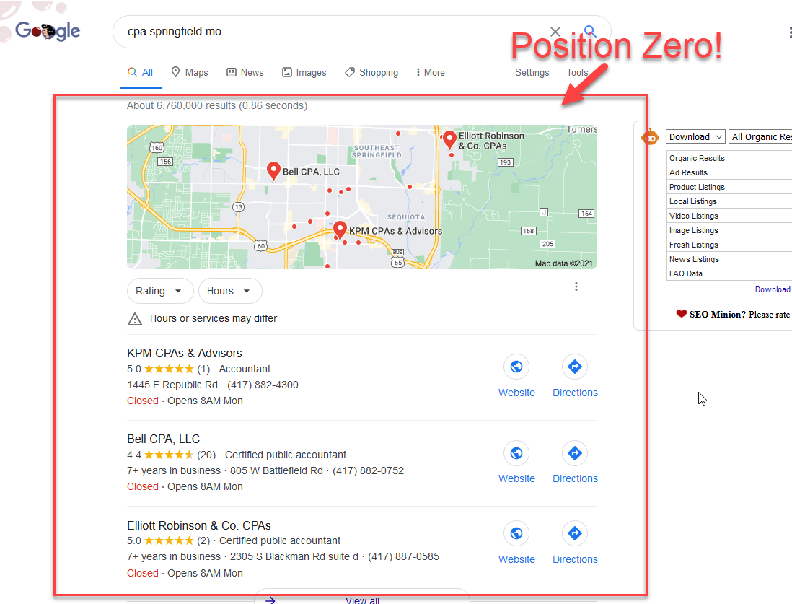

Ready? Let's dive in with the most important step.

## The Most Important Step

The step that matters most is clearly defining your business name, address and phone number.

This is called your "NAP," and it needs to match on Google, your website and every other mention of your business on the web.

If it does not, mixed signals will keep you from ranking high on Google and many other search platforms. It sounds simple and obvious, but many businesses miss this step, and it [negatively affects rankings](https://moz.com/learn/seo/local-search-data-us).

Step zero is to write down:

- **Business name.** Does it include an abbreviation at the end? No abbreviations? LLC? Anything else?
- **Address.**
- **Phone number.**

If you have been in business longer than a few months, you may have profiles that Google, TripAdvisor and other business review sites created automatically and that may need correcting.

You can typically find these by searching your business name and checking the first few pages of Google results.

Once you have a concise business name, address and phone number written down, you are ready to get cleaned up, listed and ranking on Google.

**Note:** If you have already received your postcard from Google, skip ahead to [optimizing your Google Business Profile](#how-to-optimize-a-google-business-profile).

## How to Set Up Your Google Business Profile

Step 1 is to visit [google.com/business](https://www.google.com/business) and click the "Manage now" button.

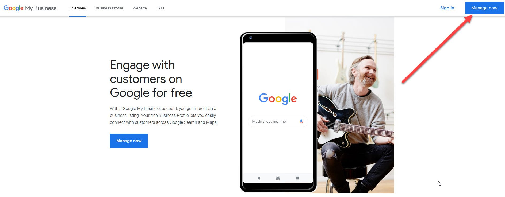

Next, search for your business by entering your company name.

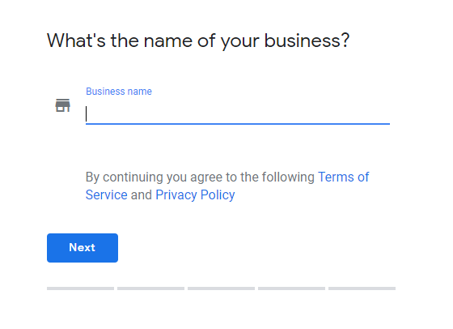

If your business does not populate automatically, click "Add your business to Google."

You will then be asked to add or confirm your address. Check the box "I deliver goods and services to my customers" if you make deliveries, then enter how far you are willing to travel.

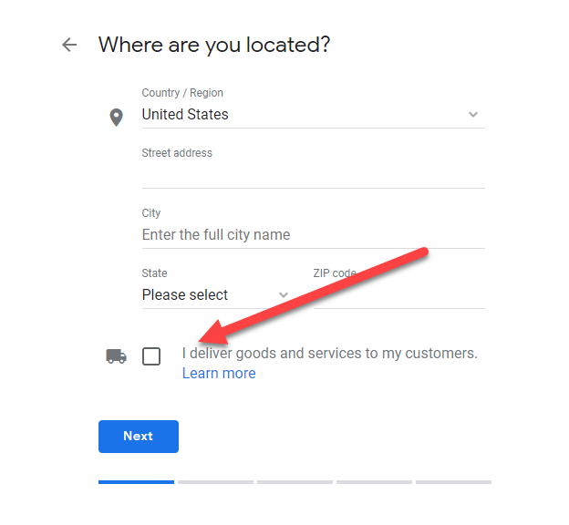

**Reminder:** Write down what you enter and confirm here for your address. Jot it on a sticky note and pin it to your wall, or save it somewhere you can find it later.

Next you will pick a business group, which is called a category, or the primary field your company works in.

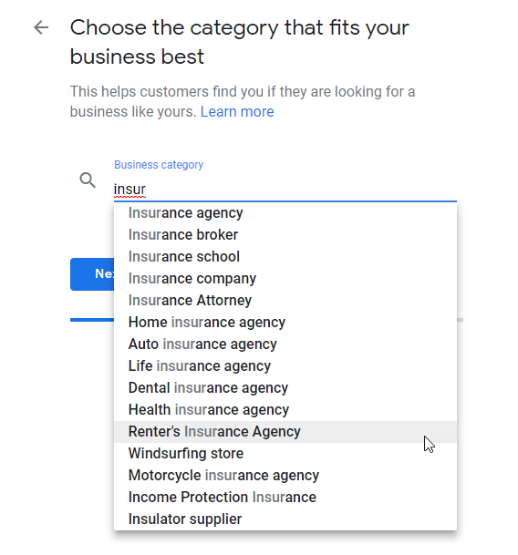

Categories are "keywords" or "topics" relevant to the products and services you offer. Your goal is to rank your business for the product and service phrases people type into Google every day.

This is how you introduce your brand to potential customers who are searching but do not know you yet. They know they need insurance, pizza or a CPA, but they do not know you are the solution. This is some of the most valuable traffic you can get.

To find the best category for your business, start typing a few letters of your business type or a product or service you offer. Later we will add more categories. For now you are looking for your "bread and butter" category.

For example, for a Thai restaurant, type "Rest," the start of the word restaurant, and you will see many of the restaurant categories.

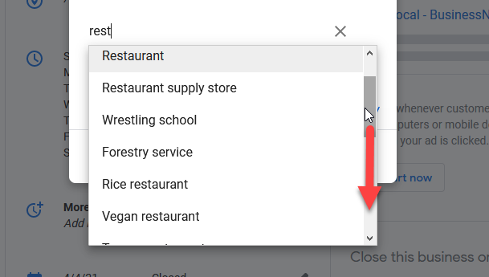

**Note:** Relevancy and customer experience are king to Google.

A Thai restaurant is obviously a restaurant, but specificity is key for your primary category. Choose a short phrase like "restaurant" as your primary category only when a more specific phrase is not available.

When choosing, ask yourself: "When I rank number one for ______, my business will improve overnight. What is that specific phrase?"

"Thai restaurant" does not show for me when I type "rest," so typing "thai" instead is how to get the specific phrase to appear.

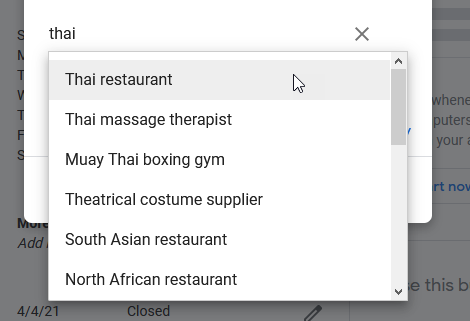

Next, only verified local businesses can manage their profiles. Google verifies you in several ways, and for many businesses that means a postcard with a verification code mailed to the physical address of your business.

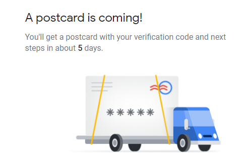

Next, complete the first stage of your profile by adding your hours, a business description and similar details.

You can finish most of your business profile before the verification postcard arrives. Verification secures your access to the profile so you can respond to reviews, change hours and make other ongoing updates.

**Note:** After you receive your postcard and enter the verification code, you can ignore every phone call telling you your Google listing is not verified.

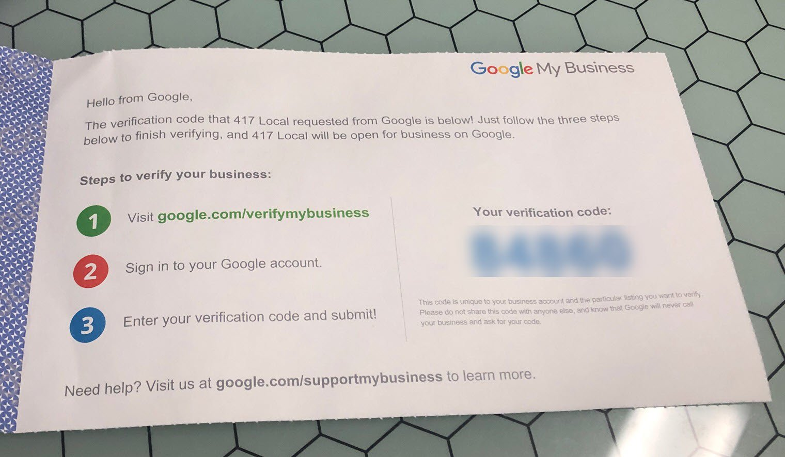

When you reach Google's option to create a website, you can pass for now and add one later. If you are ready to invest in a site of your own, see our guide to [small business websites](/building-small-business-websites/).

There are a few more simple things you can do to level up your profile with additional categories and more.

## How to Optimize a Google Business Profile

After you have started the verification process, a few things will upgrade your profile for SEO and conversions:

- Upload optimized images
- Create additional categories
- Add attributes
- Set up bookings, products and services

Here is how to do each.

### Add High-Resolution Images

Google profiles get more visual every year, and images play an important role in making yours stand out. The number of images on your profile may also be a ranking factor.

At a minimum, you want a logo and a cover photo. Your logo shows in Google results next to your name, and your cover photo is what most people see first and what entices them to click.

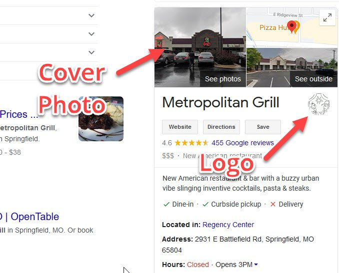

Google has recommended a square logo (720 x 720 pixels, though it can be as small as 250 x 250) and a 1,024 x 576 pixel cover photo, in JPG or PNG format with a file size between 10 KB and 5 MB. Check Google's current photo guidelines, since requirements can change.

Before you upload photos, know this: Google reads everything, and words help Google understand what you want to convey.

For that reason, never upload images with a filename like image126748943.jpg. Nothing in that name tells Google what the photo shows. Google wants to show the most relevant results.

Always rename image files on your computer or phone to describe exactly what the photo is before uploading, such as yourbusinessnamelogo.jpg or your-business-name-logo.jpg. Some people go further and add keywords to the filename, like business-primary-category-logo.jpg.

This rule applies to every image you want people to find through search. Help search engines know what they are showing, with specifics and no vagueness.

To start adding photos, click Photos in the left-hand menu.

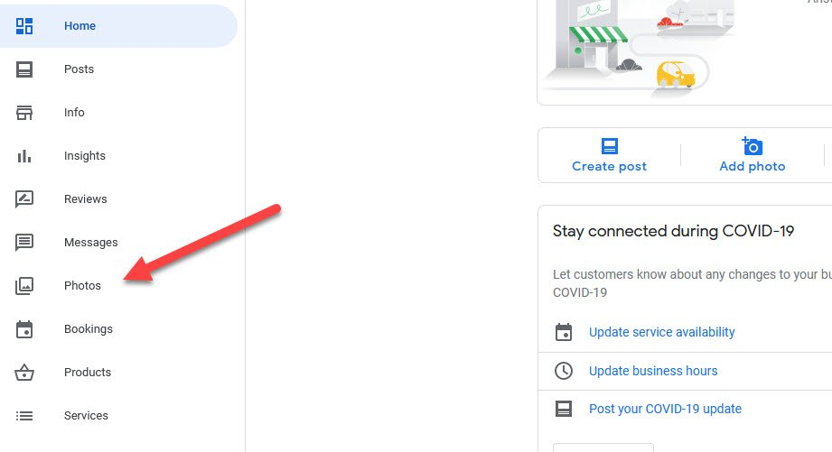

In the overview section, click "Choose photo" under Logo.

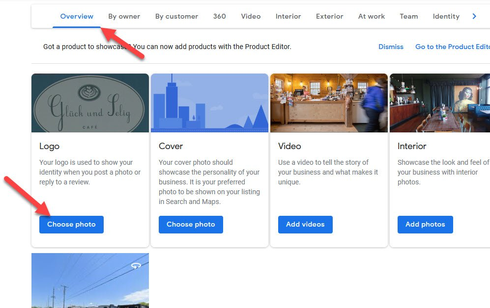

Drag a photo into the drop space or select one from your device, then click "Set logo."

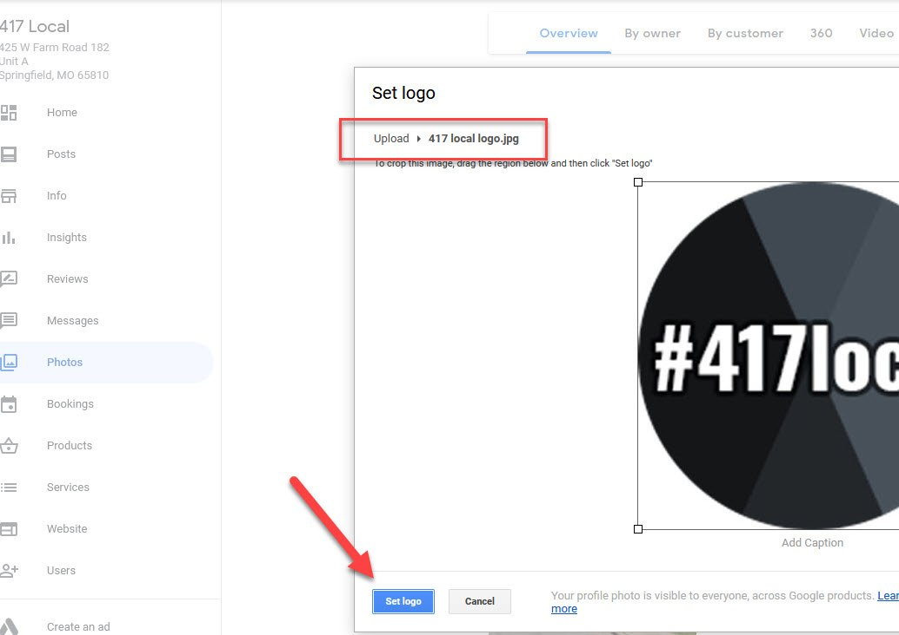

Next is the cover photo. It is front and center when people land on your profile, so make it a good one.

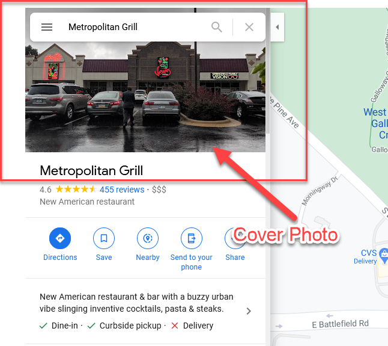

Click "Choose photo" under Cover, upload an image (with an optimized filename), and click "Set cover."

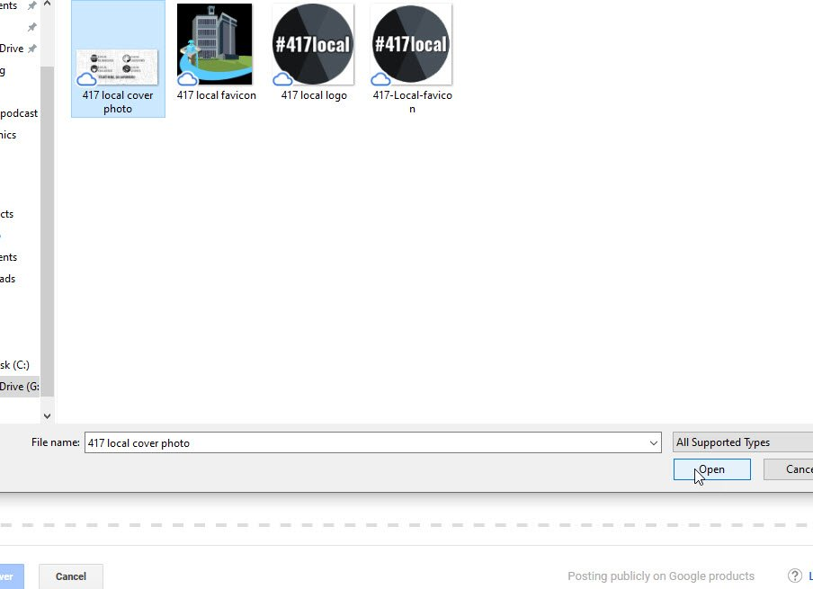

If you run a restaurant, spa, or another business where atmosphere matters, upload photos of the inside of your business. You can add an "about us" video here too.

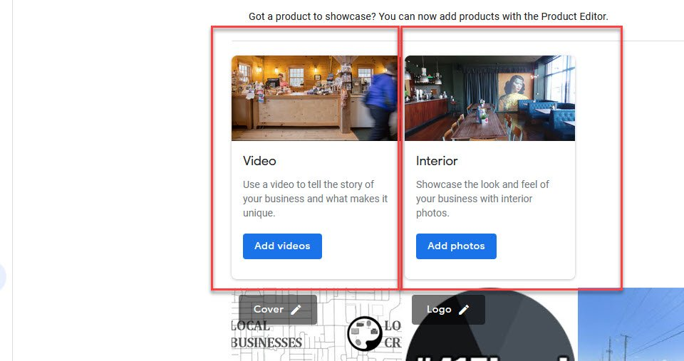

### Add Additional Categories to Rank for More Search Queries

You likely offer more than one product or service. The additional categories section is where you tell Google about your other offerings and rank for more searches.

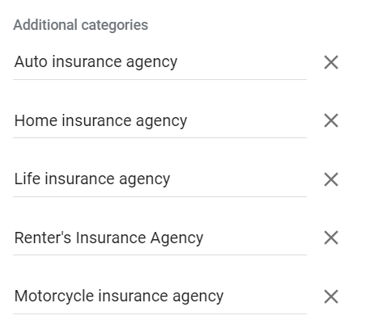

That means more free traffic. To get to your categories, open the "Info" section in the left menu.

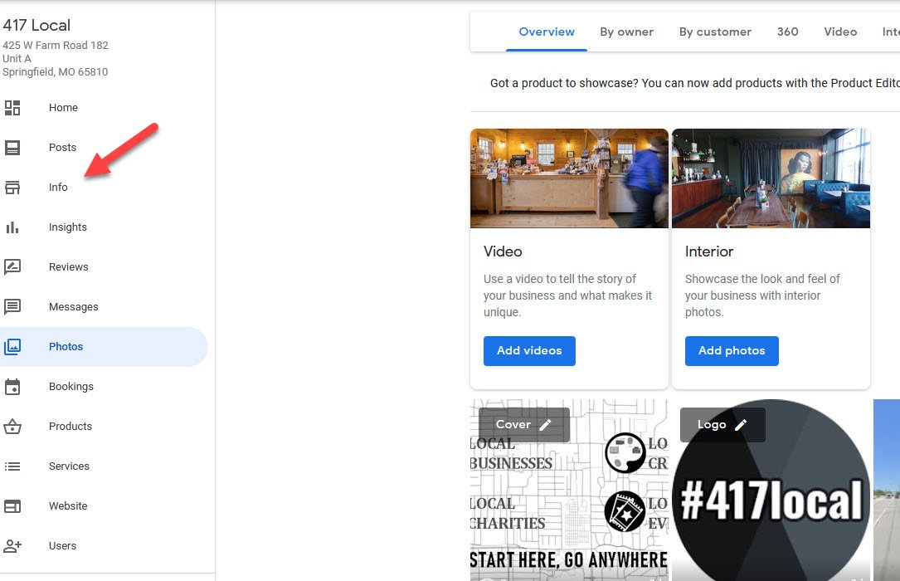

Under your business name, click the pencil next to the category to edit your categories or add more.

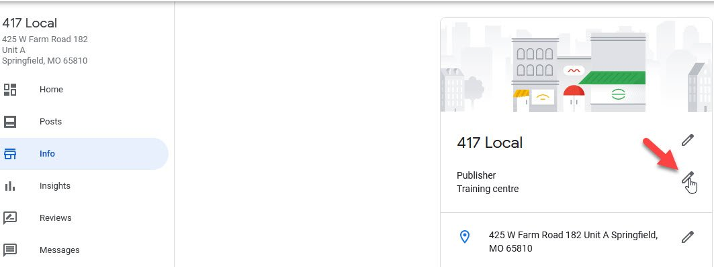

Then click "Add another category."

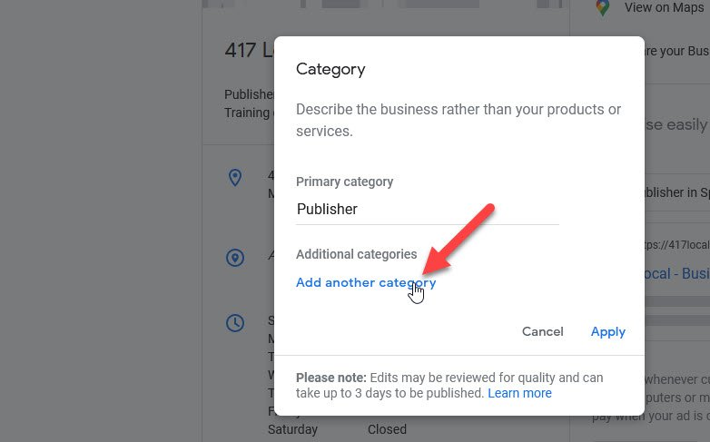

There are lists of every [Google Business Profile category](https://pixelcutlabs.com/blog/google-my-business-categories/), but typing a couple of letters of keywords specific to your industry is more straightforward.

**Note:** Google gets smarter every year. You do not need to spell out "restaurant" or "South Asian restaurant" if your primary category is "Thai restaurant." Google knows Thailand is in South Asia and that a Thai restaurant is a restaurant.

Google [says it this way](https://support.google.com/business/answer/7249669?hl=en): "if your primary category is 'Pizza restaurant,' Google may show your business in someone's local search results when they search for 'Restaurants,' 'Italian restaurants,' or 'Pizza.'"

However, if the restaurant also sells gifts or groceries from Thailand, that is another business "bucket" outside the typical restaurant offering. It would make sense to add "Asian grocery store" or "Asian household goods store" as an additional category.

Burgers are a different topic from pizza, health insurance is outside commercial insurance, taxes are different from accounting, and website design is different from SEO. These are examples of when to use additional categories to tell Google about the different products and services you offer.

Fill in your category list thoughtfully rather than stuffing it, and you will be in good shape.

**Note:** Categories are typically keywords, the search phrases people put into Google. The [SEO agencies on this list](/best-seo-in-springfield-mo/) can help you rank for these valuable searches with your website too.

Next up:

### Add Attributes

Attributes are helpful details about your business, such as accessibility, safety and health practices. They are always important, and they matter to a lot of customers.

To find attributes, open the Info tab, scroll to the "From the business" section and click the pencil.

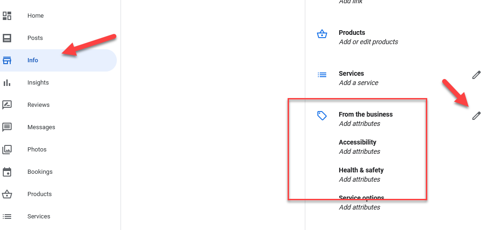

Select the attributes that apply to your business and click Apply.

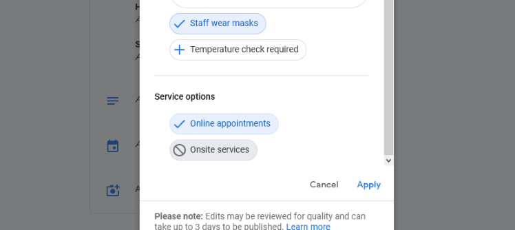

### Bookings, Products and Services

Business details, verification, images, categories and attributes are the fundamentals of every business's profile. Depending on what you offer, bookings, products and services may also be relevant.

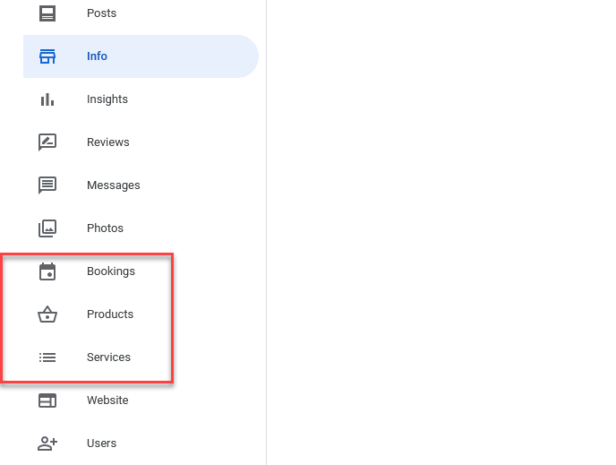

#### Bookings

Bookings are valuable if you take reservations for dining or other appointments, or sell tickets to events. You can learn more about [setting up bookings](https://support.google.com/business/answer/7475773?hl=en).

#### Products

Products let you showcase the physical products you offer. Think of it like a website menu: you are trying to quickly convey what you offer and entice people to click and buy.

You do not set up purchasing on Google. After you add product details, you provide a link to where shoppers can learn more or buy.

#### Services

Like products, the services section is where you showcase the services you offer. If you are a dentist, pest control company, marketing agency, CPA or similar, you should have access to the services section, where you can list your specific offerings.

## What to Do Next

After you have worked your profile from top to bottom and verified your business, your Google profile is set up. If you want a website, build one of your own rather than relying on a Google-built page.

The ongoing work of improving your profile's ranking involves getting more reviews, responding to reviews and posting updates. Basically, being social.

Do not set and forget this valuable digital real estate that Google gives you for free. Update your hours for holidays, post updates, and when people say hello, say hi back. It is courteous to the person who reviewed you, and future viewers see those responses on your profile.

By your side in helping you crush it,

Josh
