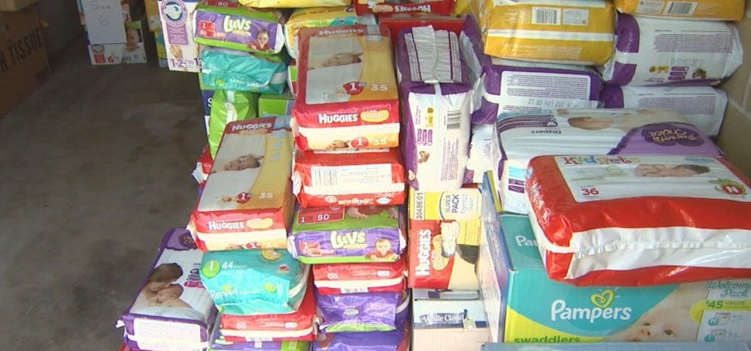
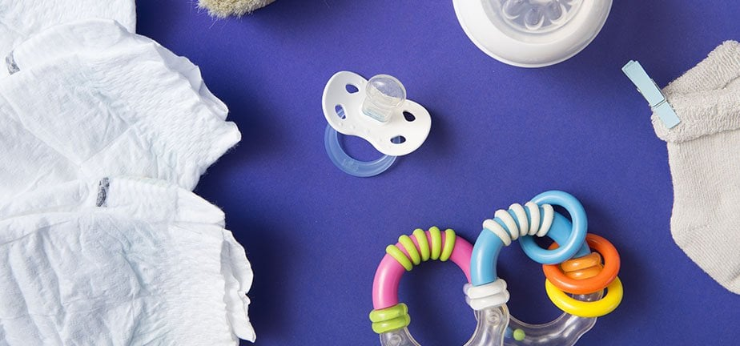
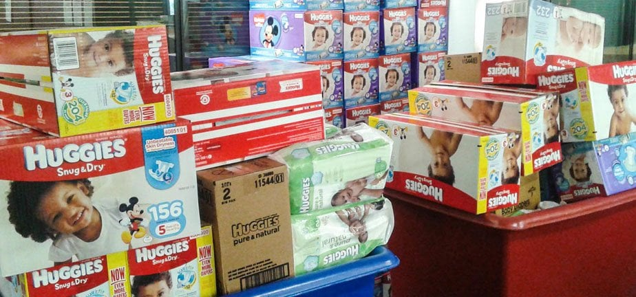

Roughly one in three families with young children in the U.S. struggles to afford enough diapers, a figure widely cited by diaper banks. That means in many neighborhoods, a baby is waiting in a wet or soiled diaper because a parent can't buy the next pack.

It's a reality few people are aware of, and it's the problem Diaper Bank of the Ozarks works to solve.

## Why Diapers Matter

When a baby can't be changed often enough, the consequences go beyond discomfort. Skin rashes, infections and inflamed skin are common risks for babies kept in wet diapers too long.

Parents feel the weight too. Not being able to meet a baby's most basic need leaves many feeling guilty and helpless.

Diaper Bank of the Ozarks works to close that gap, and it relies on community support to keep going, for babies across the Ozarks and beyond.

## Programs From the Diaper Bank of the Ozarks

The Diaper Bank has offered several programs, all with the same purpose: meeting the daily needs of families who need diapers for their babies, and more. Programs have included:

- Disposable diaper distribution in Greene County through partner agencies.
- A rural county distribution program that reaches families across the Ozarks through partner agencies.
- A diapers-for-daycare program.
- A cloth diaper loan program.
- A Baby Hub program with educational resources for families and activities for children during class time.
- A period products program, distributed through partner agencies.

Programs and eligibility change, so check the Diaper Bank's page for what's currently available.

## The Diaper Bank Is More Than a Storage Room

Poverty is a real factor for many Springfield families, and diapers are one of the most expensive baby necessities. The Diaper Bank supplies clean disposable and, in some cases, cloth diapers to families who need them.

The diapers go to partner agencies that serve single parents, financially struggling teen parents and grandparents raising babies on a fixed income. Since 2012, the Diaper Bank has distributed millions of diapers to local families.

Today, Diaper Bank of the Ozarks is a program of Crosslines, the outreach arm of the Council of Churches of the Ozarks.

Every diaper provided to a family gives hope, which can be just as rare as a pack of diapers for people in a tough spot.

## How to Help

If you had a baby, you wouldn't let her cry for hours in a soiled diaper. No baby should have to, whether she's yours or not.

You can help by donating money or diapers, or by volunteering to repackage diapers and prepare orders. See the [Diaper Bank of the Ozarks page](https://ccozarks.org/programs/diaper-bank) for donation details, drop-off information and current needs.
