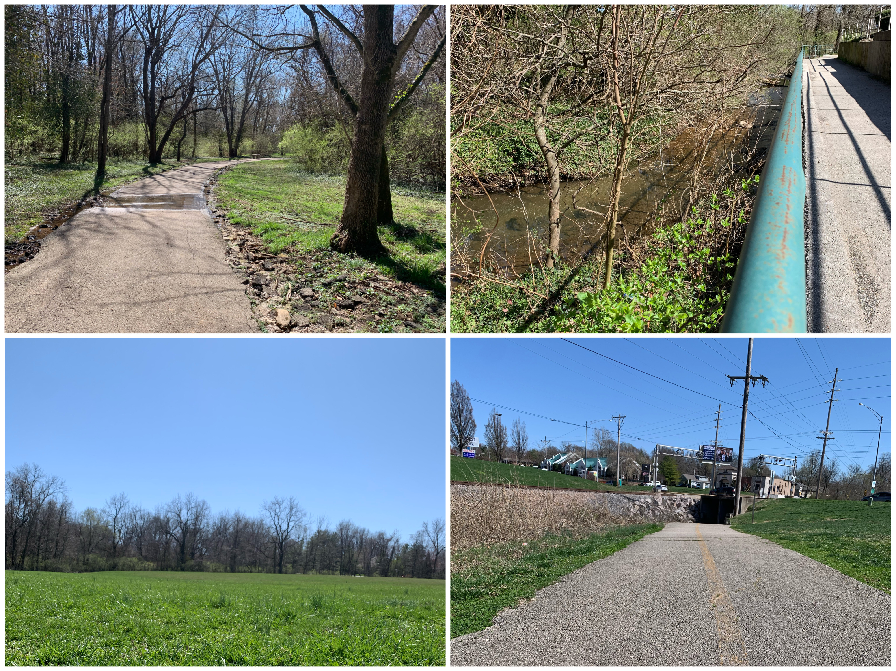
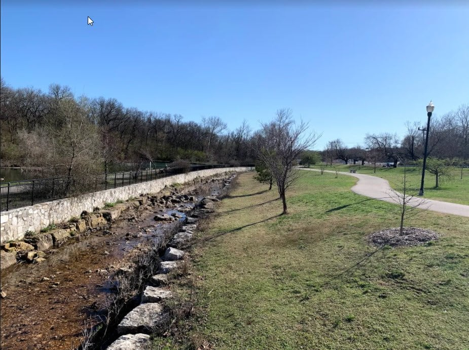
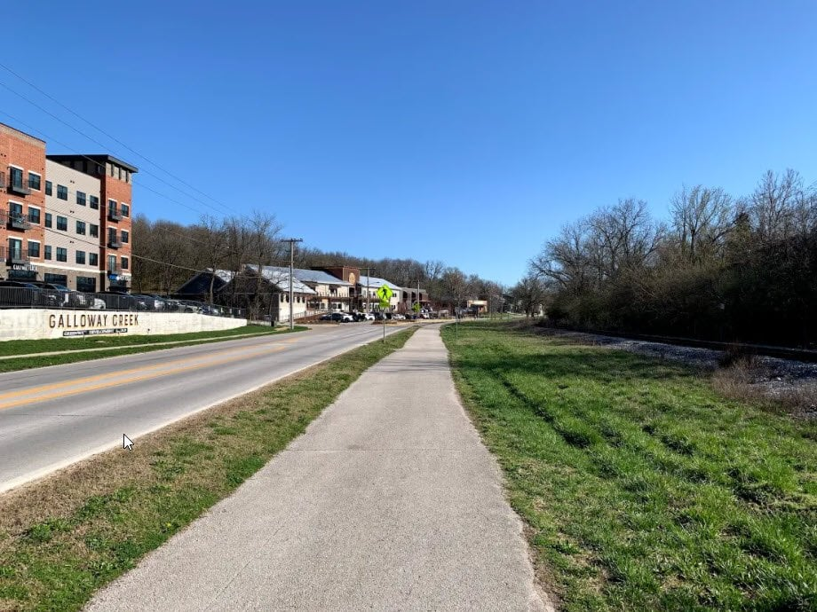
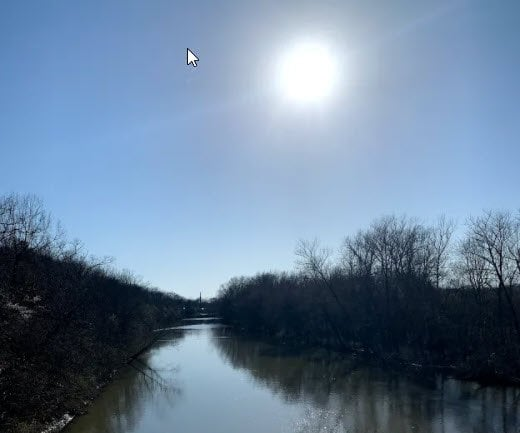
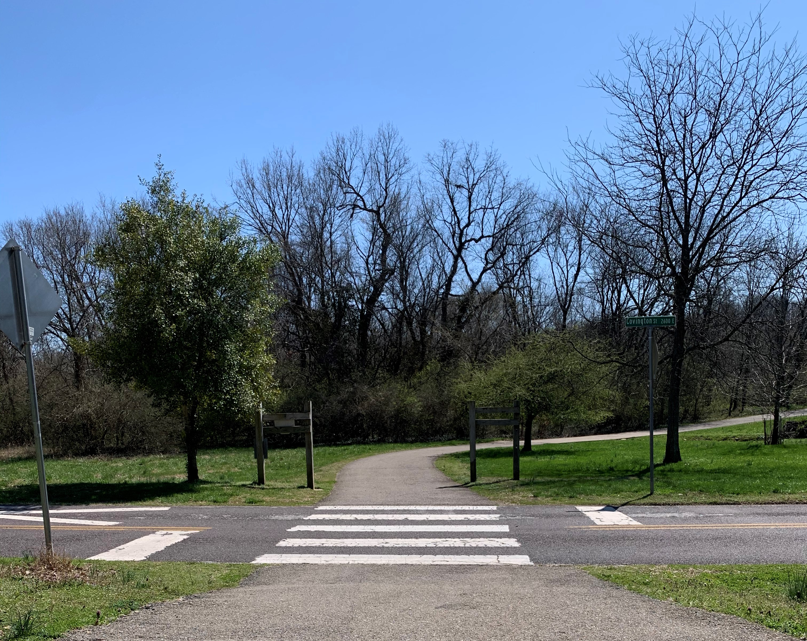

There are so many beautiful trails to explore in 417 land.

When the weather is nice, one of my favorites is Galloway Creek Greenway. I'm sure you have (or will have) your own reasons for loving the miles of trail. Here are mine.

Parts of the trail close for repairs from time to time, so check [Ozark Greenways](https://ozarkgreenways.org) for current closures and conditions before you head out.

## The Contrast of Scenery

You get a bit of everything while strolling or rolling along Galloway Creek Greenway.

- Surrounded by nature and forgetting you're in the middle of the city? Check.
- An urban feel as the trail goes under and over major roads and railways? You got it.
- A beautiful park with a cave, pond and waterfall? Yup.
- Passing right by the pet cemetery, for those who like the offbeat? Absolutely.
- A gorgeous view of the James River? Right on this trail.

What more could you want?

## Sequiota Park

The Galloway trail runs right by Sequiota Park.

Take a quick pit stop and enjoy the multiple playgrounds, the huge rocks leading to the cave, the rolling stream and the peaceful little waterfalls.

If you're lucky, you might even get to visit with the geese that frequent the pond in the center of the park.

## Galloway Village

A few minutes down the trail from the park is a historic spot that used to be a popular stop on the Gulf Line Railway in the late 1800s.

Even though the area has changed over the years, Galloway Village is still a popular place to visit. You can browse shops, grab a bite or get a local brew in [Galloway Village](/galloway-village-springfield-mo/).

If you want a longer break from the trail, you could stop in at Acacia Spa for a rest or get creative at Firehouse Pottery.

## The Bridge Over the James River

Come on. How gorgeous is that?

## Paved the Whole Way

This might not be what everyone wants if you're after an adventurous, off-the-beaten-path feel.

But a paved trail is great when you just want a relaxing bike ride or walk. It makes for smooth riding and easy strolling.

## Get Out There

Have I convinced you yet? Even if you don't agree it's the best greenway in Springfield, I'm sure you can agree it's a great one.

Check out the [map of the Galloway Creek and James River greenways](https://ozarkgreenways.org/workspace/media/uploads/galloway-creek-and-james-river-greenways-4-19.pdf), then get out there and enjoy.

Want more outdoor ideas? See our list of the [best things to do in Springfield](/best-things-to-do-in-springfield-mo/), or read about [marble hunting](/marble-hunting-springfield-mo/) in the area.
