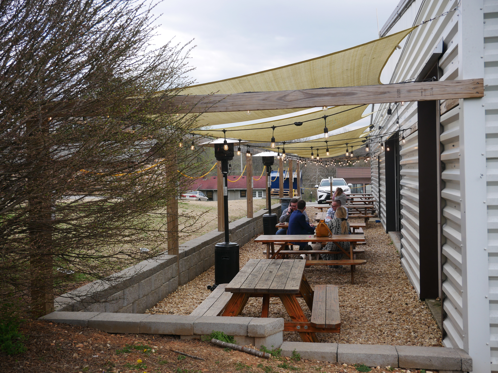
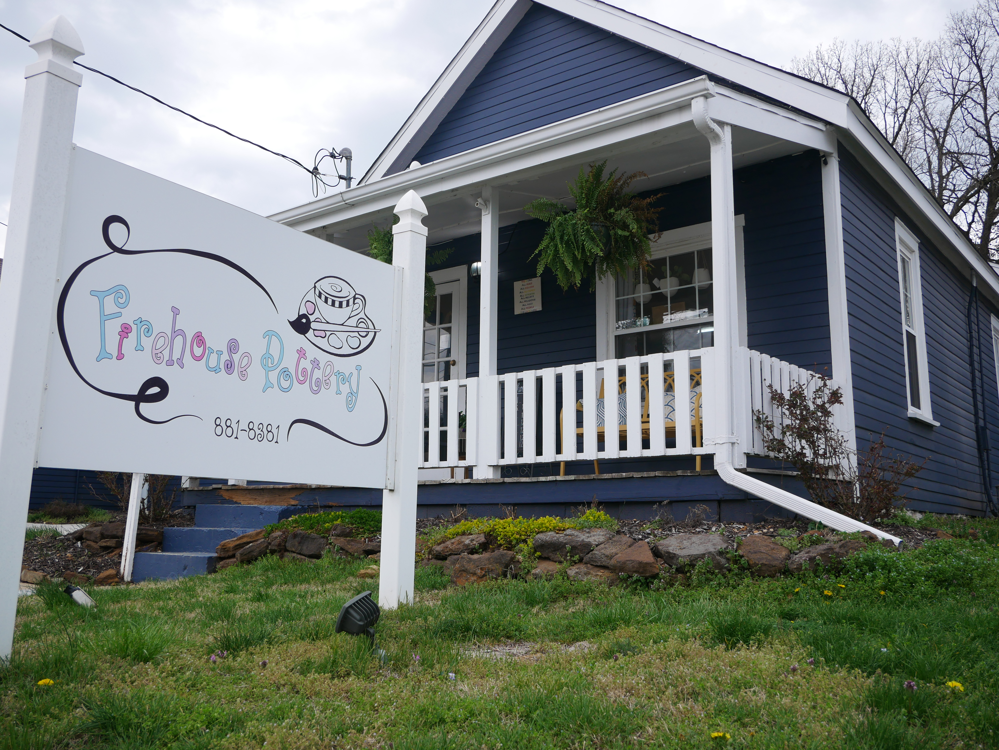
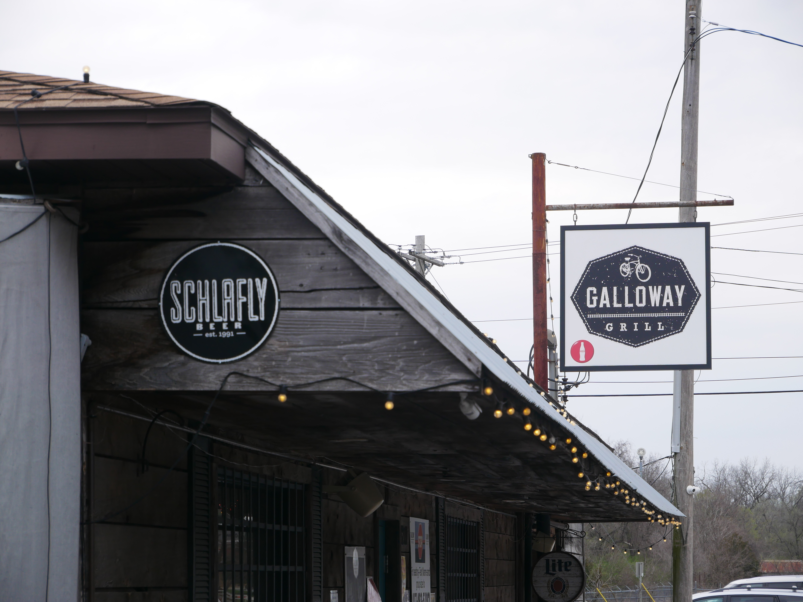
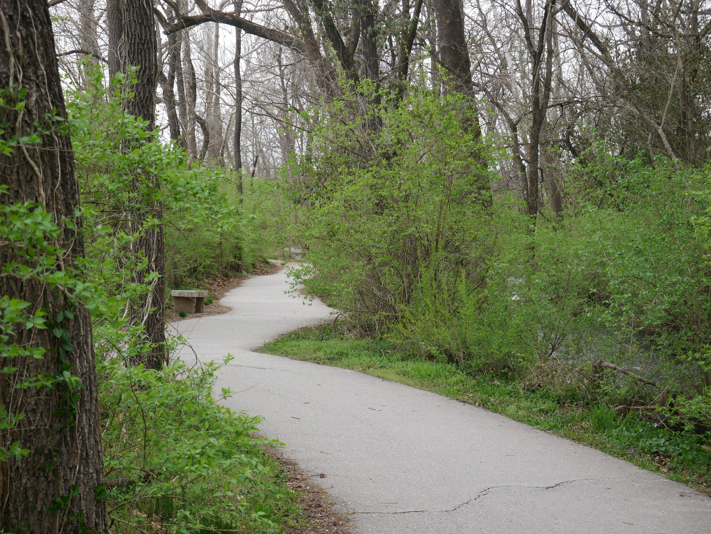
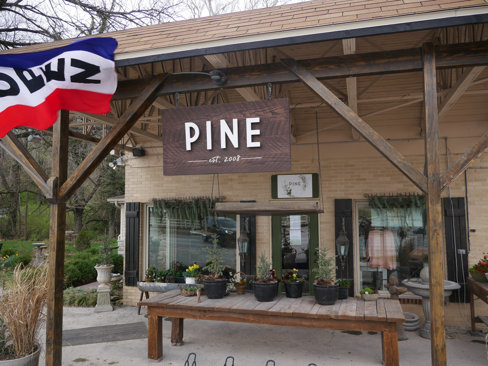
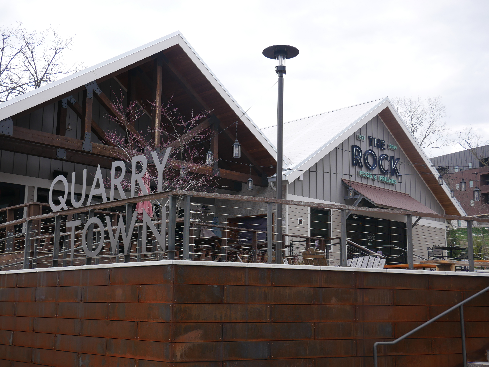
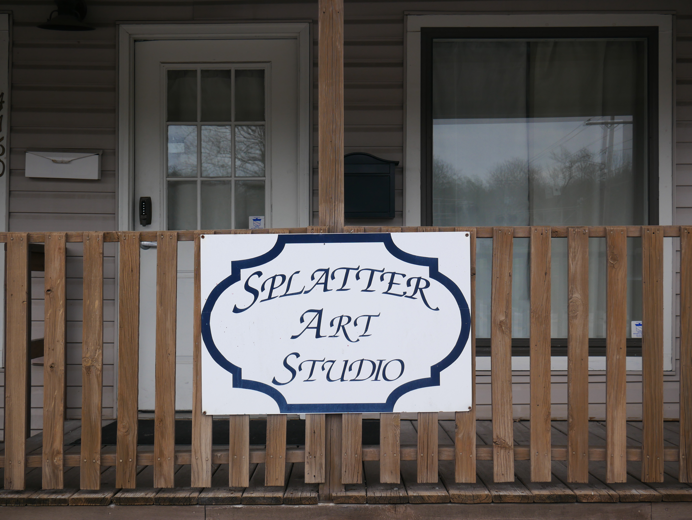

Welcome to Galloway Village in Springfield, MO.

It is one of the few quarter-mile radiuses where you can grab a cup of fresh-brewed coffee, feed the ducks, take a walk in nature, try aerial fitness, get creative with some art, and then celebrate the day with food and brews unique to Springfield.

Check out what this picturesque part of Springfield has to offer and make a day of it. New to the area? Here is a [map showing how to get to Galloway](https://www.google.com/maps/place/Galloway,+Springfield,+MO+65804/@37.1367149,-93.2554724,14z/data=!3m1!4b1!4m5!3m4!1s0x87cf7b17e0a9c411:0x1e21046a3fc7ba5!8m2!3d37.1367167!4d-93.2379628).

## 4 By 4 Brewing Company

Across from Sequiota Park, [4 By 4 Brewing Co.](https://www.4by4brewingcompany.com/) is a great stop for local brews, including local kombucha.

The atmosphere is low-key, the kind of place to spend an afternoon or evening playing the board or lawn games, relaxing on the patio or chatting with friends.

The brewery is also family-minded, which makes it a good place to bring the kids after time at the park or a walk or bike ride on the [Galloway Trail](/galloway-creek-greenway-trail-in-springfield-mo/).

## Firehouse Pottery

[Firehouse Pottery](https://www.firehousepottery.com/) is a good drop-in for a creative afternoon in Galloway.

Stop in, choose from the pottery pieces and glazes, grab a drink and paint. The finished piece is ready to pick up within a week.

It makes a fun outing with a friend, your kids or on your own. Firehouse Pottery is also one of the local art studios in our list of [art classes in Springfield](/art-classes-in-springfield/).

## Galloway Grill

Craving a burger and an ice-cold beer after your trail ride? Try Galloway Grill.

It has good food, fair prices, a full bar with local drafts and liquor, and an "everyone is welcome" atmosphere.

See their [menu and other info](https://www.gallowaygrill.com/).

## Galloway Creek Greenway Trail

Galloway Creek Greenway is a walking, running and biking trail that runs north to south through southeast Springfield.

It begins at Pershing Middle School on Seminole Street, just east of Lone Pine Avenue, and runs south through Sequiota Park and Galloway Village to the Springfield Conservation Nature Center, ending at the James River bridge. The trail also connects to the James River Greenway and James River Water Trail.

Follow [this map](https://ozarkgreenways.org/workspace/media/uploads/galloway-creek-and-james-river-greenways-4-19.pdf) to enjoy the scenery right through town.

## Great Escape Beer Works

[Great Escape Beer Works](https://www.greatescapebeerworks.com/) started in Galloway on Lone Pine Ave and has since moved to a larger brewery and taproom at 6021 W US Highway 60 in Republic, MO. The original Springfield spot has closed.

It is still one of the standout local breweries in the area, with a beer for every season. It is worth the drive from Galloway when you want to extend a Springfield beer day. For more, see our list of [Springfield breweries](/best-breweries-in-springfield-mo/).

## Pine

Pine is a Galloway store with unique gifts and clothing, and there is usually something new and personal on the shelves. The owner is attentive and engaging, and the space is one of a kind.

Call ahead to confirm hours before you go, and find it on [Google Maps](https://www.google.com/maps/place/Pine/@37.1433345,-93.2400326,18z/data=!4m12!1m6!3m5!1s0x87cf7bd9bd2f9b03:0x49922595c6c4ffff!2sGreat+Escape+Beer+Works!8m2!3d37.139536!4d-93.237603!3m4!1s0x87cf7b3e332e1f47:0x6f0dab90cfa77182!8m2!3d37.1433572!4d-93.2390745).

## The Rock

The Rock is a restaurant in Quarry Town in Galloway Village, with traditional favorites like pizza, burgers, wings and tacos and lighter options like cauliflower crust pizza and tuna tacos. It has a comfortable, casual-upscale feel and a patio for eating or having drinks with friends.

Call to confirm hours and the current menu, or check [their website](https://www.therockmo.com/).

## Splatter Art Studio

Splatter Art Studio is a not-for-profit with a mission to empower your creative endeavors and relationships.

They challenge the myth that you are not creative, with classes and student stories to prove it. See one drawing student's progress in just one week in this [8-week basic drawing course post](https://www.splatterartstudio.com/blog/2021/3/30/everyone-can-learn-to-draw-8-week-basic-course).

With a regular class and workshop schedule, you can likely stop in on your next trip to Galloway. Check the [Splatter Art Studio site](https://www.splatterartstudio.com/) for the current schedule.

## Springfield Aerial Fitness

You have not experienced everything yet, and this is one fitness program worth trying.

Springfield Aerial Fitness aims to push your boundaries and help you build a strong, disciplined body that moves with control through the air and on the ground. They teach aerial, pole and circus arts to adults and children.

They host birthday events, bachelorette parties, team-building activities and group trips, and offer group fitness classes and small-group private instruction. The feel inside is classy, a bit like stepping into a movie.

Learn about their [offerings and programs](https://www.sgfaerialfitness.com/).

## Black Lab Coffee Co.

Black Lab Coffee Co. is in Galloway Village directly across from Sequiota Park, in the space that was Springtown Coffee Co.

It is a handy stop for a morning coffee before the trail or a break after time at the park. Check their social pages or Google listing for current hours and menu.
