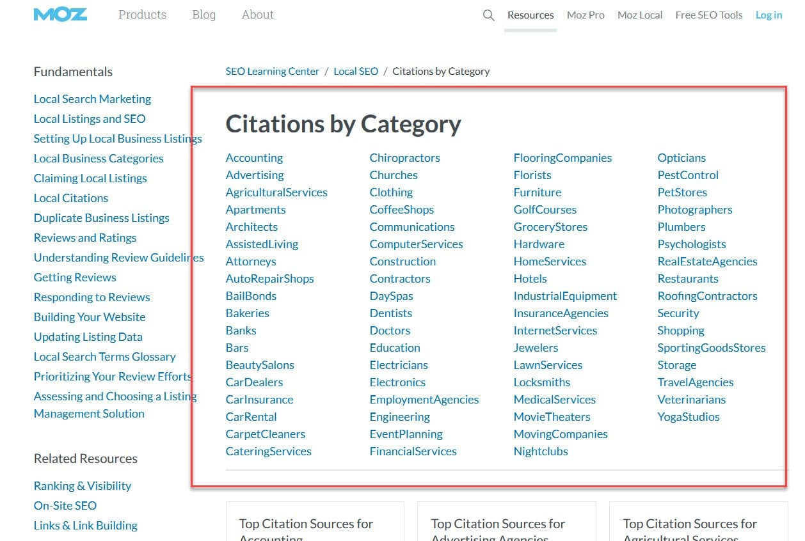
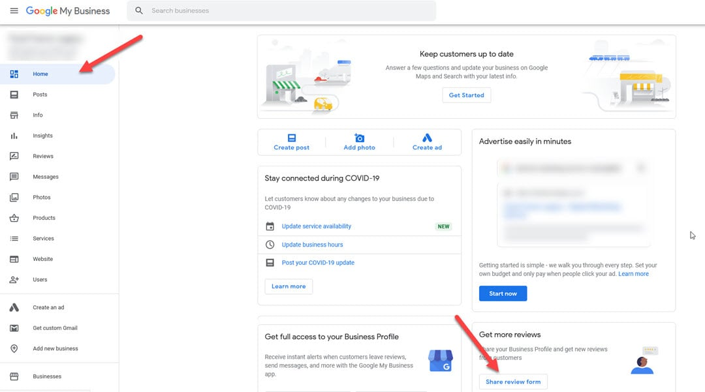
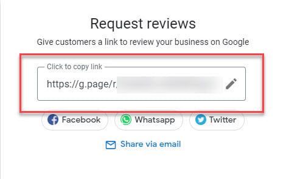
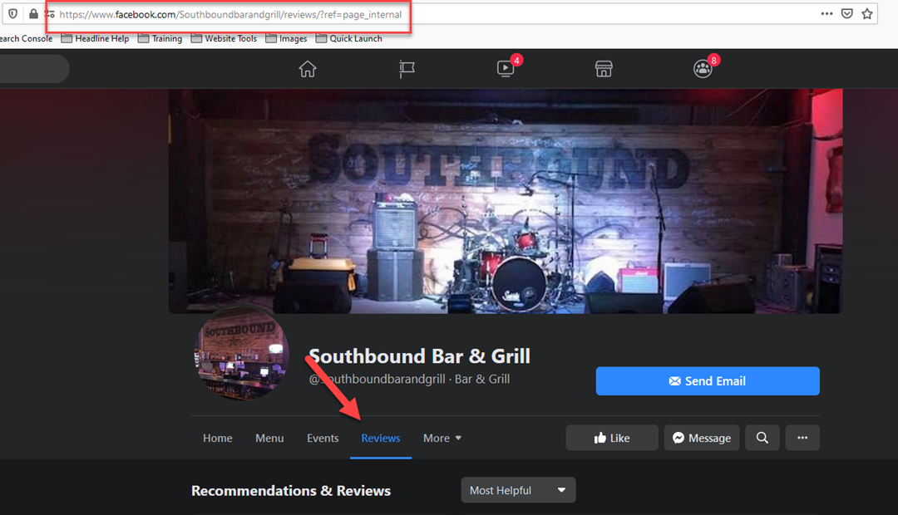
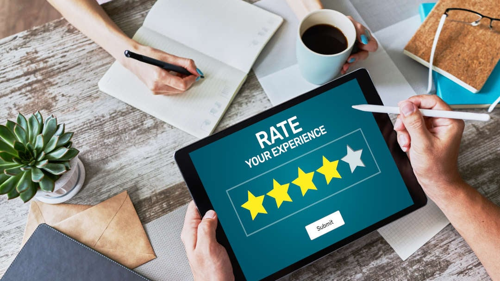

Most review tips online repeat the same old advice: ask every customer face to face, and they will remember when they get home.

Sound familiar?

This guide walks through how to build a reviews system that earns more (and better) reviews for your small business than the standard "ask."

We will cover the most important review platforms, how to get direct links from those sites into an email campaign or landing page, and some simple ways to use the physical space around your business to collect more reviews.

Being proactive is the key.

Ready? Let's dive in.

## 1. Focus on the right review platforms

A few key platforms deserve your focus. Google, Yelp, Facebook, TripAdvisor and others each play a different role depending on your type of business.

Where should you place your focus? Start with [this citations list from Moz](https://moz.com/learn/seo/citations-by-category). Not every site on it is a review platform, but it is a short list of websites where your business needs to be mentioned and look great to earn more free traffic and sales.

Unfamiliar with citations? A citation is a mention of your business on the internet. Citations matter for SEO and for your overall presence online. They are a simple fundamental to knock out, and you can find more quick marketing wins in our [small business success guide](/small-business-success/).

Then the question becomes how to get more reviews on these platforms. You create direct review links.

## 2. Get direct review links

Almost every review platform lets you create and share a direct link that takes a customer straight to the place to leave a review for your business.

This matters because you need to make it easy and convenient for customers to leave a review, and you need to ask them to do it right away. When a link lands in the exact spot to leave a review, there is as little room as possible for people to get lost and forget.

Google Business Profile lets you create this review link from your profile.

**Note:** If your Google Business Profile is not optimized yet, our guide shows you [how to create and optimize a Google Business Profile listing step by step](/create-google-my-business-listing/).

Once you are signed in to your profile, look for the option to get more reviews or share a review form. Google changes the menus and labels from time to time, so follow whatever the current name is for sharing your review link.

A popup appears with a link. Place the link in an email or anywhere else on the web, and your fans can leave a review on Google right away.

**Note:** If you do not see the copy link option, try Chrome. The link does not always appear in every browser.

Besides Google, you can create direct links on most other review platforms by visiting your profile on that platform and clicking the option to leave a review.

Hold off on sending these links just yet, and we would discourage sharing them on social media. Do this first.

## 3. Build a reviews landing page

A landing page is a specific page that has one goal: to funnel visitors toward one exact action. A reviews landing page has two parts: the reviews and the landing page.

First, a heads-up. This tactic has been around for years, and many of the businesses that are beating you are likely doing it. It takes effort, but it is powerful.

The page's single goal is not to sell more services, send people to your menu or get them to follow you on Instagram. It is to funnel people to leave a review for your business.

The page can also give people with a bad experience a private way to reach you. That matters because if your average rating is below four stars, [more than half of potential customers](https://www.brightlocal.com/research/local-consumer-review-survey/) will not do business with you.

**A word of caution:** Platforms such as Google do not allow businesses to selectively ask only happy customers for reviews, or to discourage unhappy customers from posting. Use your landing page to invite every customer to share feedback, offer an easy way to contact you directly, and link everyone who wants to post publicly to the review platform.

The second goal is to send customers to the platform that needs a boost or fresh reviews. This is where the platform list from step one comes in.

Phase one is to build a solid reputation on Google, which is the most important. Point your review buttons to your direct Google review link so customers can leave a review easily.

After you have recent reviews (a decent number over the past few weeks) and a rating above four stars on Google, you can point the link to another platform that needs more reviews for your business. Spread your reviews around the platforms that matter for your business.

Remember to switch the link back to Google after a week or two. You always need recent reviews on Google for more sales and better rankings in Google Maps.

### How do you build a landing page?

You need a landing page tool. These range from a few dollars a month to hundreds of dollars a month, so check current plans and pricing before you commit.

The least expensive route is a marketing tool you already have. Here are a few ideas:

- Your email marketing software may include landing pages in your plan. Aweber is one option that includes them, so check its current plans.
- Your website platform may let you build landing pages without menus. If you are on WordPress, there are many free and premium landing page builders. Elementor offers a free version, and Thrive Suite is a simple option with split testing.
- If you want to level up, standalone tools like LeadPages and Clickfunnels are options. Clickfunnels can also send automated emails and texts to drive traffic to your landing page, which is the next step in this system.

Check current plans and features for each of these tools.

How do you get people to your landing page?

## 4. Create a reviews campaign

To get more reviews, you need to ask more than once. Often it takes three or four times. How do you ask that many times without pestering people? With an email drip campaign.

Using an email platform such as Aweber, ConvertKit or another small business tool, load a batch of the email addresses you have for your customers, around twenty or so, and write a few emails asking how your service was.

Why only a couple dozen at a time? Because you do not want a hundred reviews this week and none the next. That looks like you asked a group of friends to post nice reviews.

Send an email every other day or so to your past customers asking clearly and briefly for feedback on your service.

Two tips improve the campaign:

- Space reminders a few days apart.
- Cancel the reminders after someone clicks your review link in the email. Most good email tools can automate this.

Your first email may land in an inbox at a bad time, so set up second and third emails for a couple of days later, at a different time, to bring your request back to the top of the inbox.

Cancelling the extra emails after a click is important. They likely did what you asked, and it is no fun to be asked to do something you have already done.

Use the review landing page link in your emails so that you can spread reviews across your important platforms.

## 5. Review your value

Besides asking paying customers for reviews, you probably deliver more value than you realize.

You may already offer free classes, training or workshops, or contribute at Chamber of Commerce and other local networking events.

Each of these events is an experience of transformation from your expertise. You helped people on their journey toward getting healthy, getting financially fit, learning marketing or music, improving their home, and thousands of other possibilities.

That is exactly what your products and services do. Education is a product, and value received is an experience.

Add the people who attend to your email sequence, hand out your review landing page URL at the event, or find another way to ask them for an online review.

## 6. Use your physical real estate

QR codes, flyers, receipts and other paper methods that you can print on, hand out or leave in stands around your place of business are a few ways to use your physical real estate.

You can even put a link to your review landing page on your business card.

Personalized letters are another good option because they stand out among the other mail people receive.

That leads to the last way to improve your reviews.

## 7. Create the best experience

This is the easiest way to get reviews. It is not a guarantee for every business type, such as retail, but it can be effective.

In addition to good food, your favorite restaurants provide an experience. The CPA who turned your business around will probably be invited to your funeral. The marketing coach who made it all make sense is someone you want to see at happy hour.

You will get beaten on price by global competitors with deep pockets every time. When you build [a culture of experience](https://www.inc.com/andrew-thomas/the-hidden-ratio-that-could-make-or-break-your-company.html) in yourself and your business, great reviews tend to follow.

On the flip side, when you deliver a bad experience, you may not be able to respond before a negative public review appears. Unhappy customers may be writing it on their phones before they leave the parking lot.

There is a compelling reason to deliver a great experience: by commonly cited estimates, a happy customer tells 3 people, while an unhappy customer tells 12 on average, and [as many as 20 or more](https://customerservicemanager.com/customer-service-facts/).

Create the best experience you can, and you will have more happy customers.

## Improve and adapt

As with success in life and business, a good review system is tuned over time. The most important step is to start.

Any action beats putting it off for another week, month or year. Generate your direct review links, create your landing page and begin automating the system.
