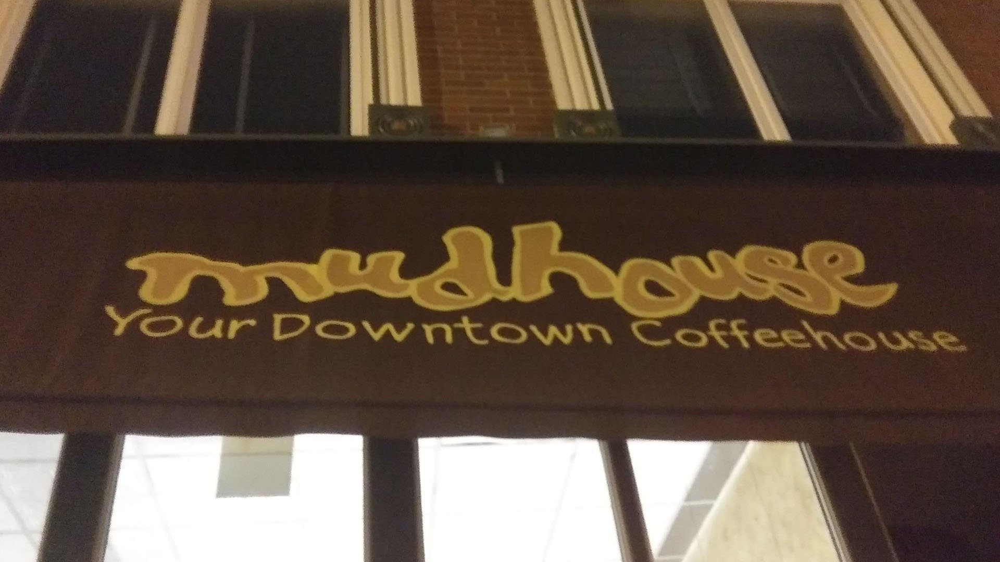
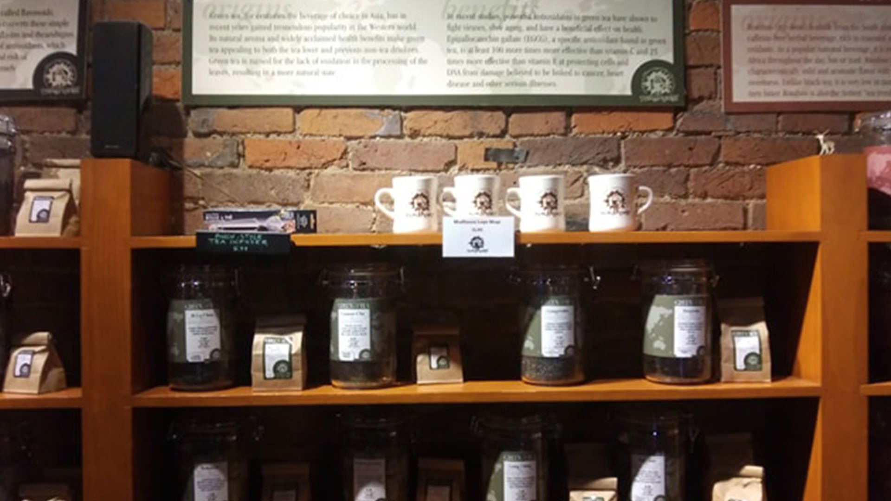
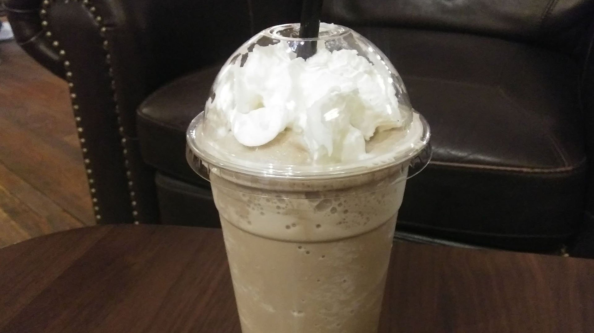

"Soy Chai Latte!!!"

The barista's voice was upbeat as my two children (11 and 8) and I strolled in through the heavy, old-fashioned glass door at the front of the building.

Mudhouse Coffee, at 323 South Ave. in Springfield, is in the heart of what true locals call downtown. It's nestled in a long line of connected storefronts along South Avenue, and you could walk right past it if you're looking down at your phone.

This is a personal review from a visit on a Saturday evening in February 2020. Menu and prices change, so see the [current Mudhouse menu](https://mudhousecoffee.com/menu).

Even if you did walk past, you'd likely still know by the smell that you'd passed something interesting.

## The Mudhouse Smells Like No Other Business in Springfield

To me, the inside of the Mudhouse always smells of strong coffee, with hints of cocoa.

Quiet music plays in the background. That cold Saturday, it sounded like slow 90s-style alt rock. The music blended with the steady churn of the coffee grinder behind the bar. The noise level was just loud enough to hold a decent conversation without shouting, which gives a subtle air of privacy we usually only notice when a public place suddenly goes silent.

"Two Raspberry White Mochas!!!" the barista shouted, setting them on the bar as I walked up to order.

He was a well-dressed young man with a short beard, friendly and professional, with a college hipster look about him. (That's probably a stereotypical thing for a 33-year-old like me to say, but hey, I'm an edgy guy.)

I scanned the menu, which was attractively written on a few blackboards in colored chalk. In the frozen drink section, I found what was described as their version of a frozen mocha.

That's when I realized I had found my quarry.

## The Frozen Mudpuddle Was the Drink for Me

I ordered my drink, plus a hot cocoa for my 8-year-old daughter. Then we turned to finding a place to sit, which was a challenge at 5:45 on a Saturday evening.

The inside of Mudhouse Coffee is charming. Interesting artwork covers most of the walls, including some striking photos of people getting paint splashed on them. Every time I stop in for a coffee, I spend at least five minutes looking at those.

There's also a set of shelves where they sell teas and coffees to take home.

An array of tables, chairs and couches fills the space. The lighting is gentle, mostly from quaint old lamps and hanging fixtures giving off a soft incandescent light. There's a glow to the place that makes it feel like a real local coffee shop.

A shelf of games is available for customers to play. My daughter snagged a deck of cards and was thrilled to find her odds of getting a game of Go Fish out of me were high. (She beat me at both Go Fish and Slap Jack before the evening was over.)

### My Frozen Mudpuddle Was Finally Ready

Our drinks were ready within 10 minutes.

We grabbed them and headed back to a comfortable couch and chair with a coffee table. I heard the barista shout the next order: "Soy Lavender Iced Mocha... With Almond Milk!!!"

But my mind was already on the glorious cold creation in my hands.

My first sip was lovely. It was ice cold and creamy. The sugary flavors of mocha and coffee blended well. It was surprisingly refreshing for a coffee drink, but it didn't taste light or watered down. It was full-flavored.

Honestly, it tasted like a real iced mocha, heartier than the ones you get from a fast-food drive-through.

I'm not sure you'd want to drink these every day, especially on a calorie-restricted diet. But it was good enough that the time between sips was predictably short.

I'd give it 4.5 stars out of 5, and this wasn't my first frozen-mocha rodeo.

## The Crowd Was Quiet, Polite and Interesting to Watch

A lot of people were on laptops, which isn't a surprise given the free Wi-Fi.

There were small groups seated around tables and couples on coffee dates. College students worked furiously on papers, headphones in, fueled by java and shutting out the world to meet deadlines.

Nearby, a biker in full gear came in and set his helmet on the table. About five minutes later, he welcomed a friend in a suit. A young woman with blue hair, dressed in black from head to toe, doodled little black hearts on a notepad. She occasionally picked up her phone, giggled and typed a reply.

All around me, people were enjoying their Saturday evening, as was I. It was warm, the coffee was good and the atmosphere was pleasant. It was just a good time.

## My Final Opinion of the Mudhouse and My Visit

All in all, I'd rate Mudhouse Coffee as one of my top three favorite coffee shops in Springfield.

They balance classic atmosphere in the seating area with modern professionalism behind the counter. The baristas know their stuff, get orders out quickly and have always been helpful and polite to me, even on days when I needed to talk through my order ideas to figure out what I wanted.

Would I go back? Absolutely. It's such a mainstay downtown that it never gets old for me.

It's also a place where I can take my kids and feel confident that nothing crazy will happen. It's a family-friendly environment, and that's a bonus.

And the coffee is really good. Let's not forget that part.

Looking for more local spots? Browse our [Food & Drink guides](/category/food-and-drink/).
