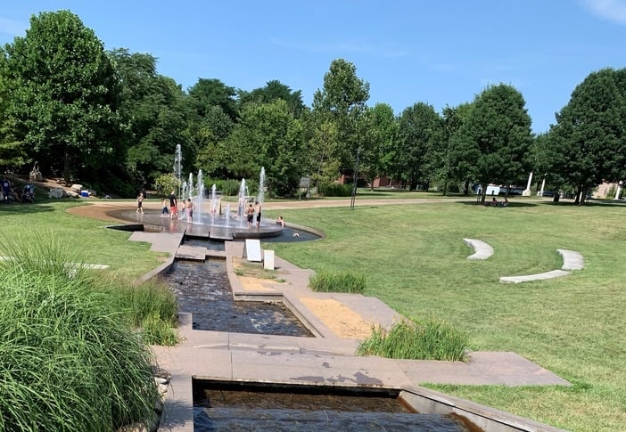
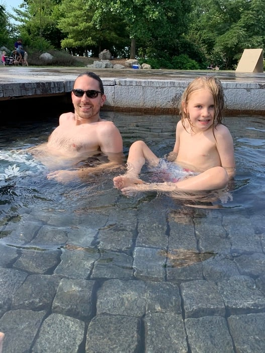
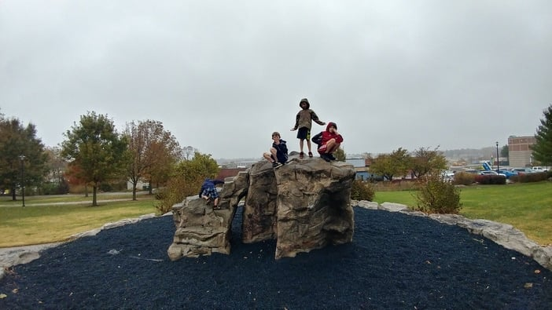
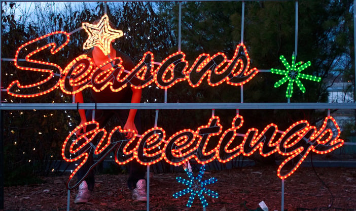
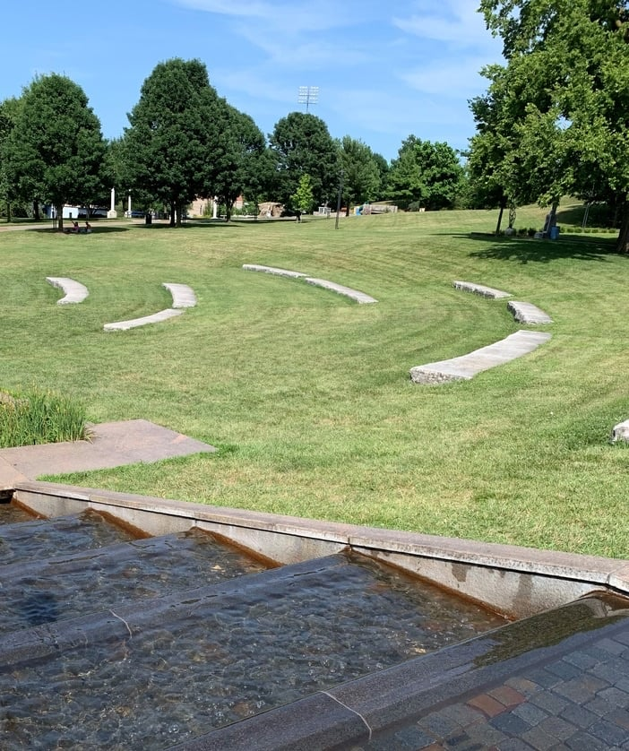

Jordan Valley Park is in downtown Springfield at [635 E Trafficway St](https://goo.gl/maps/4AdGDHHUAwKu8Duj6). It is one of our favorite [parks in Springfield](/best-parks-in-springfield-mo/) and a great place to visit in every season.

## Summer

Summer may be the best season to visit Jordan Valley Park, because that is when the fountains are on.

The fountains invite you to splash around and play at the bottom of the hill. Yes, you, too. Adults can have fun in the fountains. They typically run on summer afternoons, so check the [Park Board](https://www.parkboard.org/) for current fountain times.

Leading up to and around the fountains is a man-made stream where you can wade and cool off on hot summer days.

## Fall

The scenery in the Ozarks is magnificent in the fall.

You can take in some of that beauty at the park. The Jordan Greenway runs through Jordan Valley Park, and this section of trail is surrounded by trees whose leaves turn shades of every fall color.

When you want a walk in the crisp air, head over to the park.

Fall also brings a lot of festivals to 417 land. During them you will often find concerts at the park, which has a natural amphitheater.

## Winter

Most people do not think of visiting parks in winter. Anyone else get grumpy stepping out into the frozen tundra that comes to the Ozarks?

But Jordan Valley Park is still a good place to visit in winter, as long as you are bundled up.

During the holiday season, the park has put out lighted displays for everyone to enjoy. They are worth the cold walk and a quick picture.

The park has also been a spot for New Year's Eve celebrations at the bottom of the hill, so check local event listings for this year's plans.

## Spring

With 12 acres to stretch out on, this park is a good spot to spread a blanket for a spring picnic.

The park is at its prettiest in spring as the trees begin to bloom.

In the pleasant weather, take extra time to walk up the trail to the kinetic man sculpture, learn about the Springfield Wagon, or find a few sculptures in the park using the [Sculpture Walk map for Jordan Valley](https://www.parkboard.org/DocumentCenter/View/3425/Sculpture-Walk-JV-Map?bidId=).

## Go See for Yourself

Whatever the season, take some time to enjoy Jordan Valley Park at [635 E Trafficway St](https://goo.gl/maps/mtBi5PQ72YGak2e9A). You'll thank us later.
