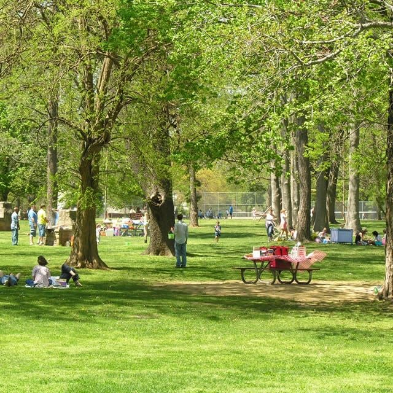

## Phelps Grove Park

Once farmed by John and Mary Phelps, Phelps Grove Park was established in 1914 and has been making history ever since. It was one of the very first parks the park board established in Springfield.

Phelps Grove Park holds events throughout the seasons, including memorials, performances and other activities, and it is a popular location for personal celebrations. In this [top Springfield park](/best-parks-in-springfield-mo/) you will find room for both recreation and leisure. It is one of the only local parks where you can find hammocks attached to the trees during the warm seasons.

Visitors can connect with nature under the many mature trees, use the charcoal grills or the stone pavilion with seating, or just play. Phelps Grove also has its own tennis court, a playground and a paved trail that circles the park. The park is pet friendly, with water fountains and restrooms available.

### Did you know?

Directly next to the park is the Springfield Art Museum, which was once the site of a lake and waterfall belonging to Phelps Grove Park until the late 1920s. The Springfield Art Museum is closed for renovation and aims to reopen by 2028. You can read more in our guide to [the Springfield Art Museum](/the-springfield-art-museum/).

Another interesting piece of the park's history is that it was the site of the city zoo until the mid-1920s. The city then bought the Dickerson Park land where the zoo is today.

Visit [parkboard.org](https://parkboard.org) for more information on the park's history and events.
