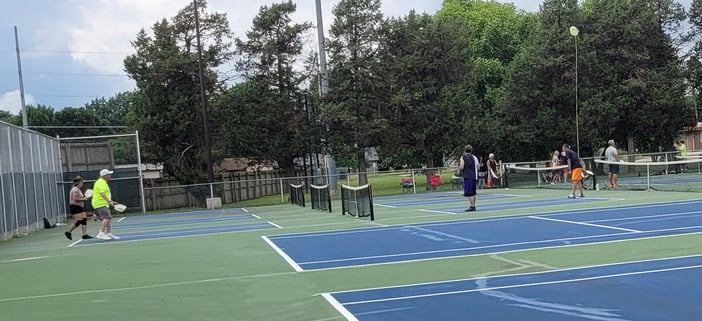
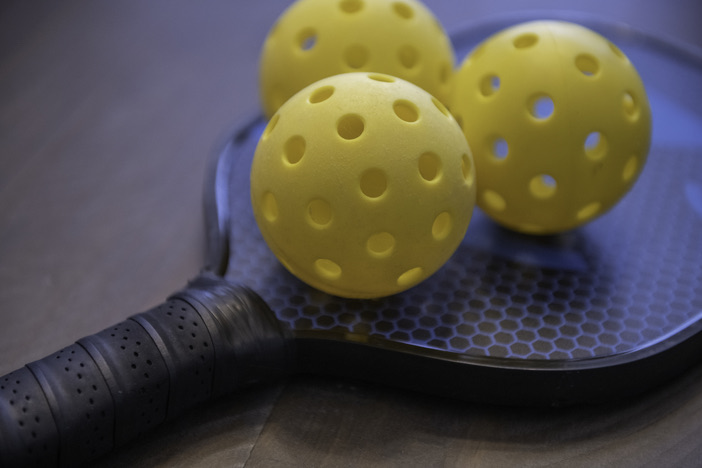
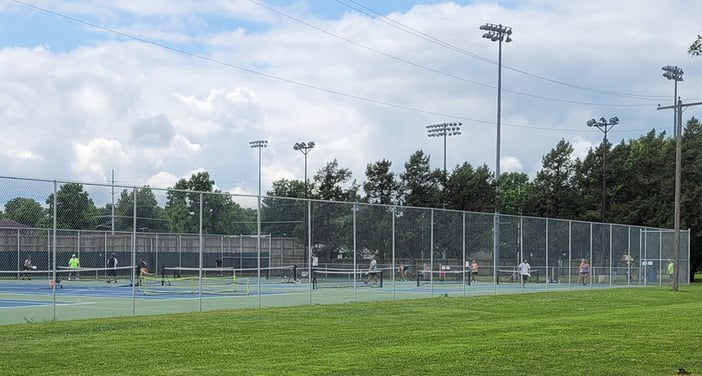

Have you heard of pickleball?

Yes, you read that right. Pickle. Ball.

It is a fun sport that keeps growing in popularity in 417 land. Pickleball is one of the top free outdoor activities in Springfield, and it is an affordable thing to do indoors too, any time of year.

But let's not get ahead of ourselves. The game is simple to pick up, easy for all ages and abilities, and takes very little equipment.

So you have no excuses. Go check it out.

**Note:** If you already know the basics, jump to the [parks and places to play pickleball in Springfield](/pickleball-in-springfield-mo/#where-to-play-pickleball-in-417-land).

Let's dive in.

## What is pickleball?

First of all, the game has nothing to do with pickles. Most of the group that created the game back in 1965 say it was named after one of the creators' dogs, Pickle, who used to fetch the balls off the court. Simple as that.

If you combine tennis, badminton and ping-pong, you have a pretty good picture of pickleball.

You play on a badminton-size court with a modified tennis net. The only equipment you need is a paddle, which looks like a giant ping-pong paddle, and a Wiffle ball-type ball.

Sounds easy enough, right?

## The rules of pickleball

Once you have your basic equipment, you will want to know the rules.

Pickleball can be played as singles or doubles, and the rules are the same for both. The game is simple, but there is a specific order and way of serving, basic scoring and the two-bounce rule.

USA Pickleball, the sport's national governing body, has a basic overview on its [What Is Pickleball page](https://usapickleball.org/what-is-pickleball/) that is a quick read for getting started.

Ready to start?

You can pick up a pickleball net kit and set up at almost any park in Springfield, but there is an easier way to play right now.

## Where to play pickleball in 417 land

The Springfield-Greene County Park Board has made sure you have local places to play.

If the weather is nice, head to [Meador Park](https://www.google.com/maps/place/Meador+Park/@37.1656347,-93.2708144,17z/data=!3m1!4b1!4m5!3m4!1s0x87cf64a7897ceb53:0x9ea83952f484db71!8m2!3d37.1656304!4d-93.2686257) on the south side of Springfield or [Nichols Park](https://www.google.com/maps/place/Nichols+Park/@37.218524,-93.3189916,17z/data=!3m1!4b1!4m5!3m4!1s0x87cf6247d6919971:0x9c17ef0f13524e03!8m2!3d37.2185197!4d-93.3168029) on the north side for a game on the free outdoor pickleball courts.

If you want to play indoors, try the Chesterfield Family Center, Dan Kinney Family Center, Doling Family Center or O'Reilly-Tefft Gymnasium. Fees vary for the indoor courts, and a membership to the center may change what you pay, so check with the Park Board before you go.

For drop-in times, clinics and current court information, see the [Park Board's pickleball page](https://www.parkboard.org/pickleball).

## Go try it

There are a lot of benefits to trying your hand at pickleball. It is a fun, engaging form of exercise, it is easy to jump right in and almost anyone can do it.

The next time you have a little free time, give pickleball a try. You will thank us later.
