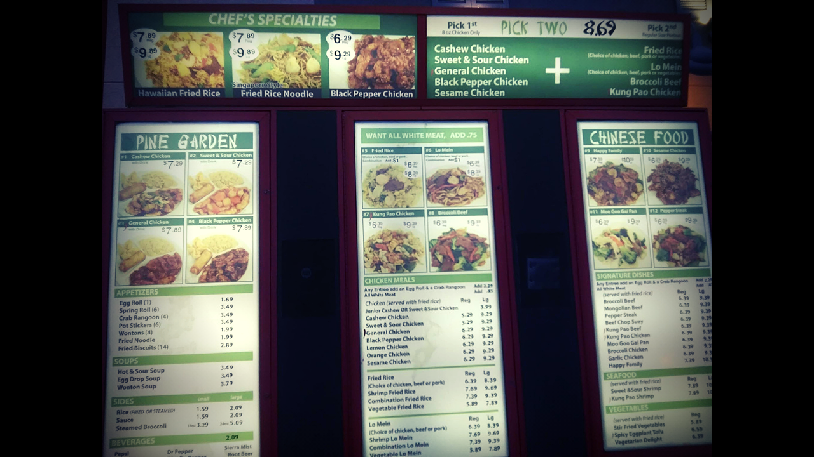
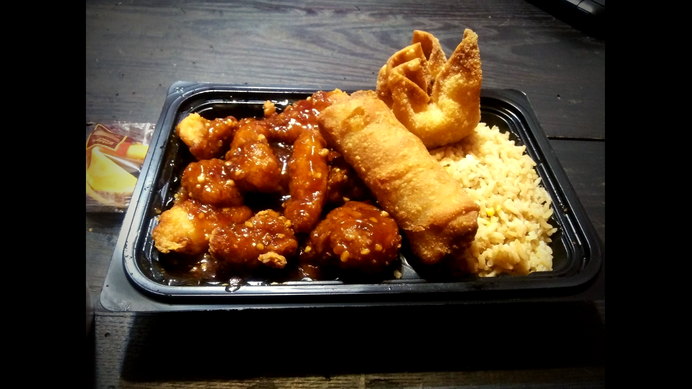
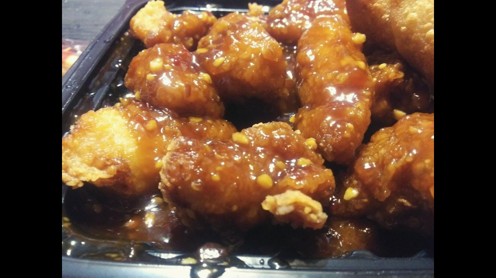

Pine Garden Chinese restaurant is at [1725 W. Sunshine St. in Springfield, Missouri](https://www.google.com/maps/place/Pine+Garden/@37.182937,-93.3184837,17z/data=!3m1!4b1!4m5!3m4!1s0x87cf6394f57567e9:0xf39f7c928d69e70d!8m2!3d37.182937!4d-93.316295). That matters, because it put dinner within a short drive of my kitchen table: I could grab my General Chicken and be eating it in 20 minutes flat, as long as I didn't catch bad traffic.

Naturally, this place had been on my radar ever since I moved to Springfield. (Scoping out restaurants in the neighborhood is my first order of business in any new area. Don't pretend it isn't yours.)

But strangely enough, it took me over a year of living here to give it a try. In March 2021, I finally took the plunge.

Here's a review of my Pine Garden experience. Menus and prices change, so check with the restaurant for what's current.

## Placing My Order

Pine Garden is a surprisingly large building with a big, comfortable parking lot. Aesthetically, it reminds me of a larger fast-food restaurant.

The menu has everything you'd expect from a Chinese restaurant in Springfield, MO, plus a few extras you may not expect.

Normally I'd have gone with the Cashew Chicken (this is Springfield, after all). But that night I was feeling a little spicy, and the General Chicken caught my eye.

The specials are affordably priced.

The General Chicken special comes with a drink, an egg roll and a crab rangoon, and it was under $10 when I visited in March 2021. I was all in.

My order was processed and handed over quickly, with no dilly-dallying. I want my food hot and I want it fast, so I was pleased with the service. Top-notch so far.

But what about the taste? That's arguably the most important part, so let's dive in.

## How Does Pine Garden Do on Taste?

I'm no stranger to Chinese food. I've eaten my fair share of General Chicken. When I pulled the lid off this meal, I was looking at pretty standard stuff.

There's a lot of Chinese food in Springfield that is good but not necessarily original, if you know what I mean. From the looks of it, Pine Garden was shaping up to be that kind of place: you get the General Chicken you know and like, not something out of the ordinary.

That isn't a bad thing. Sometimes you want the General Chicken you know, and sometimes you want something more original. It's all good.

### Testing Pine Garden's General Chicken

First impression: the first bite was really good. The chicken was moist, and the General sauce was a little sweet and a little spicy. It had a kick I liked.

I'm a big fan of the sweet version, but I also enjoy it with some heat.

- **Fried rice:** Solid and well flavored. I like to dip my chicken into the rice and get the sauce mixed in.
- **Crab rangoon:** Crunchy, with plenty of cream cheese inside and that sweet rangoon taste. Pretty standard, and definitely good.
- **Egg roll:** Very crispy outside and flavorful inside, probably pork or chicken with some veggies. It tastes like most egg rolls you get around here, and it seemed more likely frozen than homemade.

Portions were great for the money. The whole meal, drink included, came in under $10 on my visit.

## Conclusion

All things considered, I'm a fan. It isn't my favorite spot, since there are other Chinese restaurants I prefer for a more original flavor.

But with its place on the west side of town, Pine Garden is an option I can count on for a quick in and out, and the food is delicious. This is classic, standard Springfield, MO Chinese food, the way you like it.

Be careful with the General Chicken if you're not into spicy food, because it packs a bit of a kick that sneaks up on you after a couple of bites.

I'm not complaining. I'll be going back, probably more than I should.

Looking for more places to eat? Browse our [Food & Drink guides](/category/food-and-drink/).
