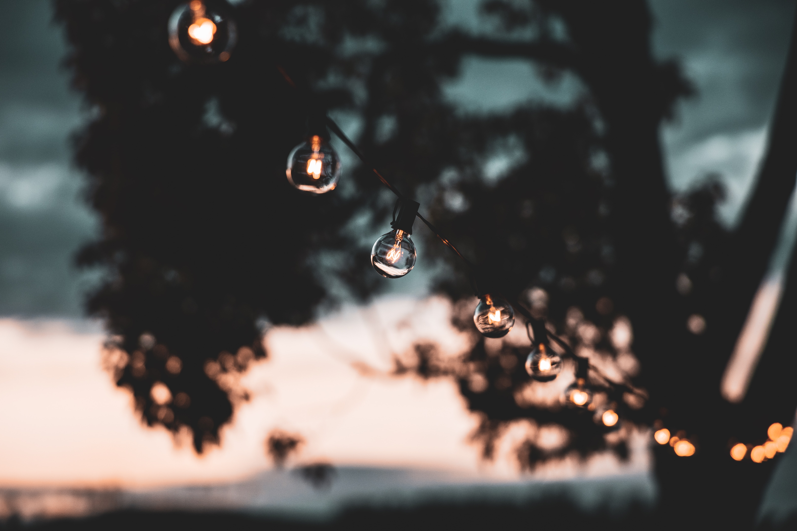

Have you ever had a night so magical it felt like something out of a movie?

I get that feeling every single time I attend a Pizza Night at Millsap Farm. The magic is almost impossible to describe, but I'll try.

Dates, hours and reservation details change by season, so check the farm's [Pizza Club page](https://www.millsapfarms.com/pizza-club) before you plan your visit.

## The Ambiance

Millsap Farm does a great job of making you feel welcome the moment you step onto the farm.

The gathering area is nestled in a little bit of woods, which gives it an intimate feel. String lights overhead make it feel like an enchanted forest.

As you get closer, you'll hear the hustle and bustle of the family and team making pizzas, the murmur of guests socializing and, best of all, live musicians invited to make the night more special. I've been to plenty of pizza nights, and the music never disappoints.

The Millsap crew also makes sure you have a seat, with plenty of picnic tables and seats by the fire. If you prefer, bring your own picnic blanket or camping chair.

## The Community

The community atmosphere at Millsap's pizza nights is what community should be. No one is a stranger here, just friends you haven't met yet.

The chatter is almost hypnotic as new and veteran guests start conversations. Children run around together just outside the gathering area, laughing and quickly making new friends.

The tables are meant to be shared with anyone who needs a seat. After you grab your slice, don't be shy about sitting at the first open spot you see. Get ready to make some new friends.

## The Pizza

Maybe you think I should have started with the pizza. It is "Pizza Night at Millsap," after all, not "Gather in a Cool Place with Cool People Night at Millsap."

But as good as the pizza is, it takes second place to the ambiance and community the farm has created. That's saying a lot, because the pizza is great.

The Millsap family and their team work hard to make the best pizzas they can. Toppings include fresh, organically grown produce harvested right from the farm, along with local meats, cheeses and sauces.

Once the pizzas are made from scratch, they go into one of the farm's New Mexico-style horno wood-fired earthen ovens to cook to perfection. They come out hot and are served buffet style, so you can try each combination to your heart's (and stomach's) content.

## How to Go

The best way to know everything about Millsap's Pizza Nights is to experience one for yourself. According to the farm, pizza nights run nearly every Thursday evening from May through October, and the meal is prepared by members of the pizza club. Pizzas are served buffet style, and the farm says to bring your own drink, plus chairs or a picnic blanket since seating is limited.

You can get tickets and reserve through the farm's [Pizza Club page](https://www.millsapfarms.com/pizza-club). Carpooling helps, because parking is limited.

I'll see you at the farm.

Looking for more local food ideas? Browse our [Food & Drink guides](/category/food-and-drink/).
