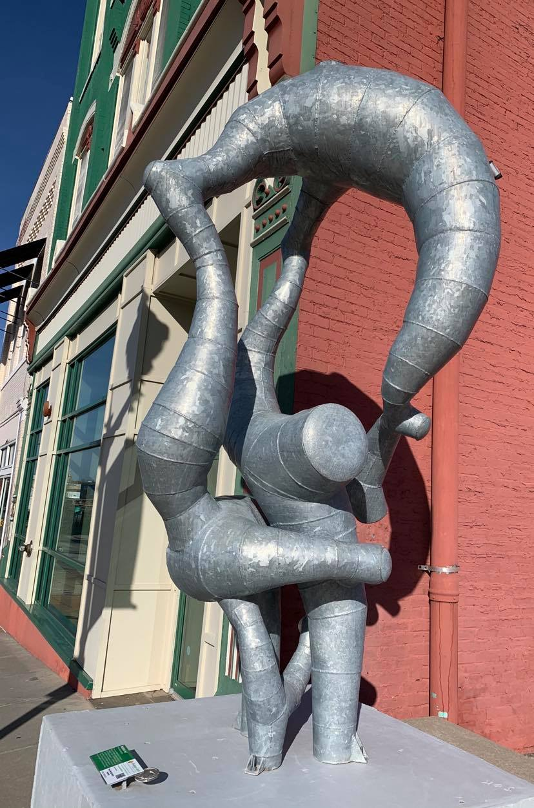
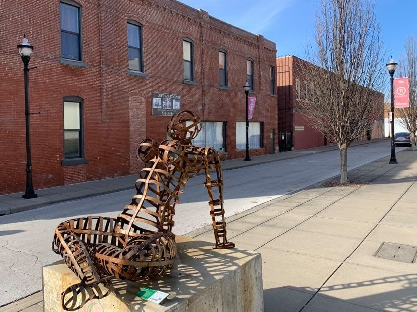

Do you like art? Do you like art that is also free to enjoy? How about art that is free to view, available all year round, and can be seen from the comfort of your car or on a leisurely stroll?

Yep. We have that. It is called Sculpture Walk Springfield.

## The What

Sculpture Walk Springfield is a collection of sculptures placed throughout Springfield that you can visit for free. The organization calls it "a museum without walls."

Some generous people teamed up with a lot of supporters (you can be one by visiting the [support page](https://sculpturewalkspringfield.org/support-us-2/)) with a mission "to encourage the artistic transformation of Springfield through outdoor sculpture, thus enhancing our quality of life and promoting economic vitality."

The project first appeared on Springfield's streets in 2016 and is still going strong.

The sculptures are rotated out for new ones, with each collection in place from April to the following March, so there is almost always something new to see. Some sculptures are permanent. Others are around for a limited time.

## The Where

You can find the sculptures all over Springfield. The [interactive map](https://sculpturewalkspringfield.org/map/) shows the current sculptures, and you can find copies of the [printable map](https://sculpturewalkspringfield.org/printable-map/) around town.

Many of the sculptures are clustered in the center of Springfield, with others scattered farther out around town.

If you want to walk to see them, head downtown. If you would rather view them from the comfort of an air-conditioned car, that works too.

Sculpture Walk Springfield also offers [docent tours](https://sculpturewalkspringfield.org/tours/) and [kids' activities](https://sculpturewalkspringfield.org/kids-activities/) if you want a guided or family-friendly way to see the art.

## The When

The sculptures are on display all year round. Each annual collection is installed in April and stays in place until the following spring, so check the map for what is on view now.

Get out there, soak up some sunshine and get your art-peeping on.
