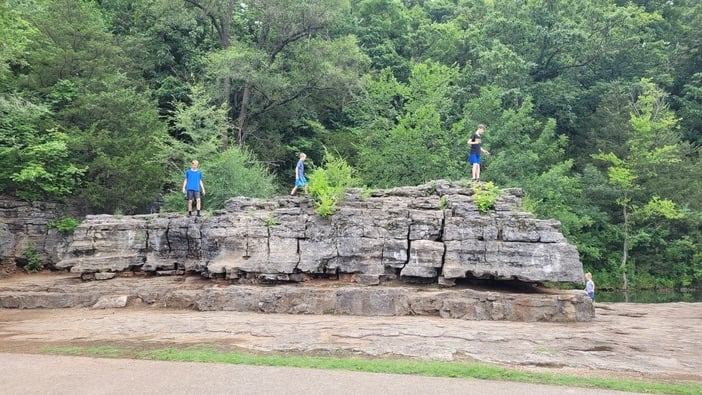
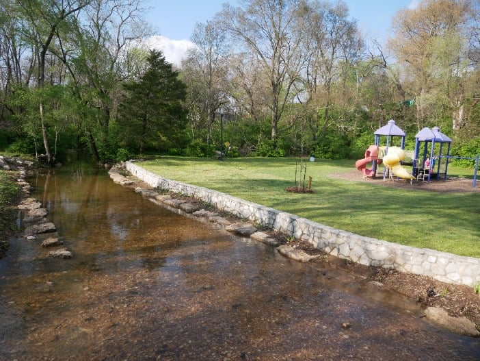
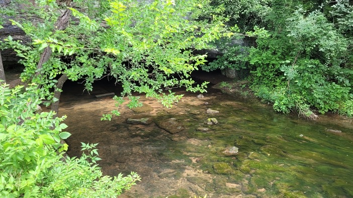
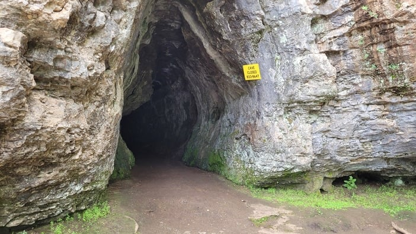

Sequiota Park is one of the [best parks in Springfield](/best-parks-in-springfield-mo/), with features like these:

- Drinking fountains
- Picnic pavilion
- Grill
- Restrooms
- Lake
- Playground
- Cave (closed to the public)
- Access to the [Greenway trail](/galloway-creek-greenway-trail-in-springfield-mo/)

It is in southeast Springfield, in the heart of [Galloway Village](/galloway-village-springfield-mo/), at [3500 S Lone Pine Ave](https://goo.gl/maps/uEyFmPv9KRjM23xL6). Here are a few reasons to add this park to your bucket list.

## The Playground

The playground at Sequiota Park is an explorer's paradise. Boulders scattered through the park give kids a fun way to discover new things while exercising on many levels, mental ones included.

Our family calls it the purple park, because much of the playground equipment is purple.

## The Park's History

Sequiota Park was a popular destination before it became a State Fish Hatchery in 1920. The park offered fresh water for swimming, fishing and boating, and it was a good spot for day trips, picnics and exploring.

Sequiota Cave is an iconic part of the park and serves as the entrance to a popular trailhead of the Galloway Creek Greenway Trail.

The cave is home to a migrating colony of gray bats, an endangered species. It is closed to protect them, so visitors cannot enter and explore on their own. Check the [Park Board](https://www.parkboard.org/) for any guided boat tours.

Please help preserve the bats by staying out of the cave.

## What Should You Do?

Instead of reading about Sequiota Park, get out and go. Walk around the pond, sit in the picnic pavilion, hop on the trail, play frisbee in the field or hold hands walking along the creek bed.

If you want to make a day of it, visit some of the [local businesses in Galloway](/galloway-village-springfield-mo/). Sequiota is the entrance to the gems directly across the street and further south along Lone Pine.
