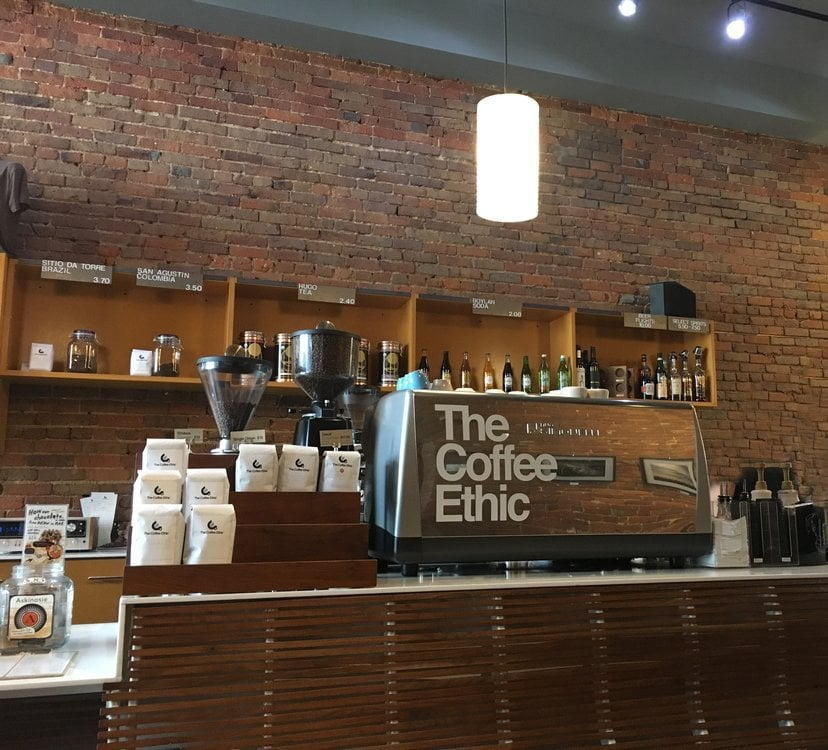
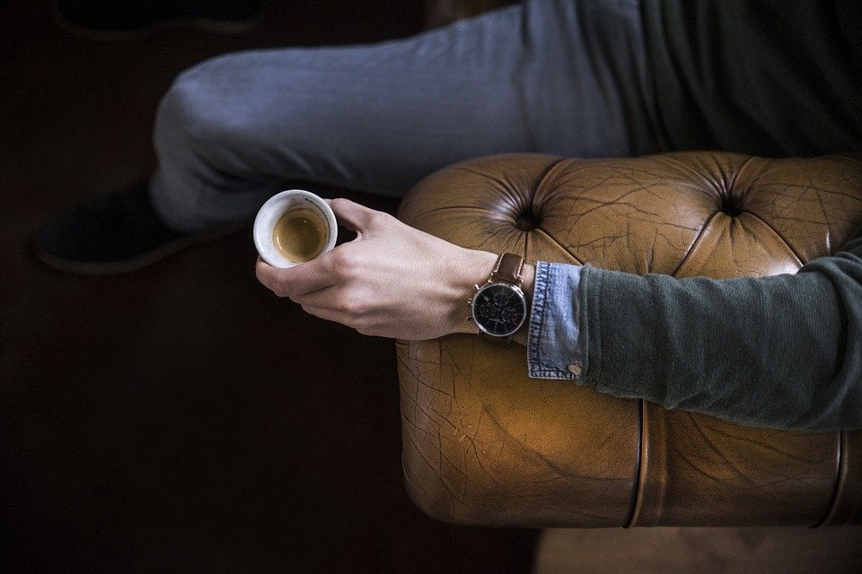

## The Coffee Ethic

Here in 417 Land, we are lucky to have many great coffee shops to choose from. I work as a freelancer from my computer, so coffee shops are where I do a good share of my work.

I was talking to my mom recently about how unique the 21st century coffee shop is. She says I am lucky to have so many great places to build community, drink good coffee, eat good food and get work done. "In my day, we didn't have coffee shops like today's coffee shops," she says.

The sitcom *Friends* showed a 1990s New York City coffee shop as a hub for gossip and culture, which tells a different story than my mother's, but that is a topic for another day. Either way, we are lucky to live in an era when coffee shops provide warmth, community and sustenance.

Because of my fascination with both the idea of coffee shops and the actual shops, I have visited almost all of the shops in the 417 area. Maybe I am not supposed to have favorites, but I do.

Springfield's The Coffee Ethic is the number one shop in my heart, and it gives me everything I want in a coffee shop. It has long been a favorite of mine, and I came here weekly for years. I became friends with the baristas and the other regulars. I meet friends here to catch up, I have business meetings here, I write here, and during finals week I essentially live here.

## Where to Find It

The Coffee Ethic is at 124 Park Central Square in downtown Springfield. Hours vary, so check [their website](https://thecoffeeethic.com/) or call before you go.

## The Space

The interior is warm and cozy, with brick walls covered in work by local artists, natural wood floors and wooden tables. The huge coffee roaster in the northwest corner fills the shop with the smell of roasting beans, which mixes with espresso and chocolate into a distinct, homey scent.

You can sit in a wooden chair at a table, on one of the benches against the brick wall, or on the leather couch that looks out on Park Central Square. When it is warm, you can sit outside on the patio.

## The Menu

Because I have been coming here so long, I have tried just about everything on the menu. The Coffee Ethic has traditional espresso drinks (I usually have a double cappuccino or the house coffee), teas, smoothies and alcohol. They also sell a variety of pastries baked in house.

My morning go-to is the blueberry muffin. My afternoon snack of choice is a no-bake cookie, since I have never managed to make them successfully on my own. Menus change, so ask what is new.

## The People

Every employee is friendly and helpful. As I said, I have made lifelong friends of many of the baristas. Despite the friendly faces, they are serious about their craft, and each of them is skilled at pulling a great shot of espresso and pouring latte art.

The warm community and the house coffee make this shop the best in town for me, and I recommend The Coffee Ethic to friends, family and readers.

I also apologize to the staff. They are probably all sick of my face.
