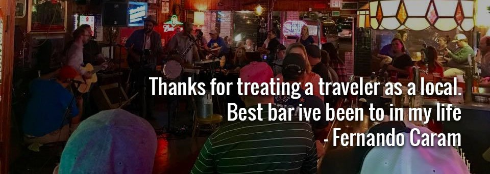

The Flea is at 637 S Kimbrough Ave in Springfield, MO. Check the bar's social pages for current hours before you go.

## A dive bar by any other name

If we meet by chance out in the big, wide world, picking up Himalayan salt at the health food store or a six-pack at the discount cigarette store, you have probably seen me in a shirt advertising one of my favorite bars in Springfield, The Flea.

The Flea is not a dive bar. It is a bar designed to feel like one. In real-world terms, that means decor that looks like it has been there for twenty-five years, even though the place has not been open that long. It has all the good stuff you want from a dive bar without the feeling that you need to wash your hair after you leave.

The first question to ask yourself is which night you want to be a regular. Past visits have included a lively open mic night, which is fun for anyone who likes good music and cold drinks, and a weekly pop-culture trivia night. The trivia is great: difficult enough to be a challenge, but easy enough that you can still make a showing after a beer or two more than you planned. I have won two T-shirts at trivia, and both are in heavy rotation.

Live music has also been a big part of the calendar, enough that you may accidentally learn to play guitar. That comes with a lot of responsibility, since Texas swing will not play itself. If the urge to pluck strings gets to be too much, step out onto the patio for a bit. Check The Flea's social pages for what is on this week, since schedules change.

## The patio

The patio is the beating heart of The Flea. Follow the conversations for a minute: movie debates, bracket talk, arguments over the best empire to ever rule the Earth. (Do not say the Romans. That is the obvious answer. Read a book once in a while.) Decide what kind of conversation you want to have before you show up.

## The drinks and the people

Say you started the night with your favorite drink, old faithful, but now you want to stretch your wings a bit. The bar has surprised us with specials before, and you never know what they will have on tap or in a creative cocktail.

What I can tell you is that whatever you order will be served by some of the friendliest people in the Ozarks. Unless you get out of line, and then you have no one to blame but yourself.

So when we see each other out in the world and you say, "Hey, man, cool shirt," I will probably answer, "Thanks. I think the last time I saw you was at The Flea."
