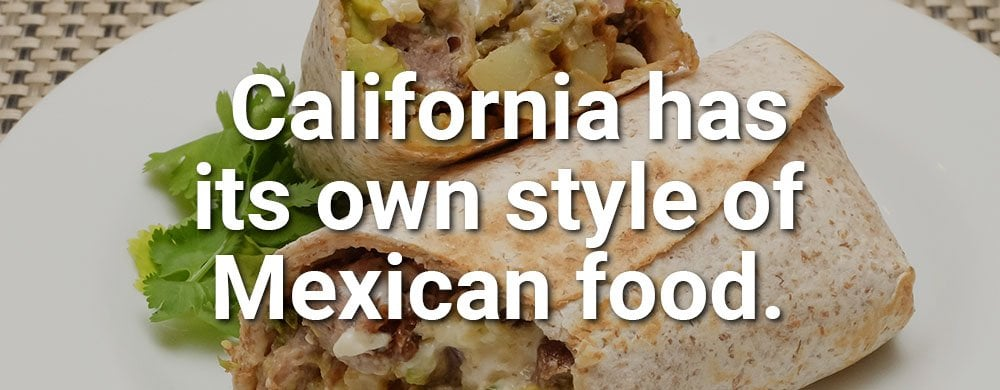
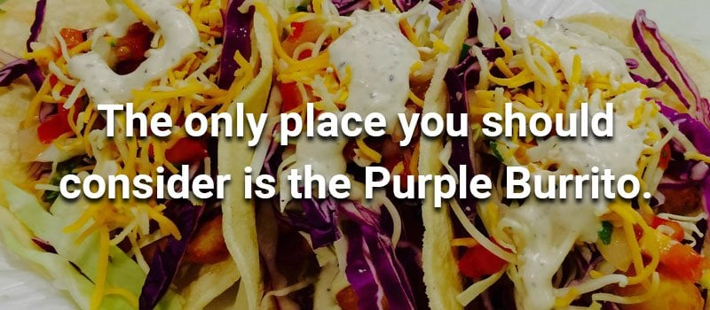

Springfield has almost as many Mexican restaurants as Chinese restaurants. A popular joke a few years back said that every time a Chinese restaurant went out of business, a Mexican restaurant opened in the same building, and vice versa. I don't know if I believe it, but it sure seems true.

So why do we need another Mexican restaurant? Two glorious words: California style.

California has its own style of Mexican food. The style most of us are used to is Tex-Mex, Texas-style Mexican food, which makes sense since we're closer to Texas than to California. But for transplants from the West Coast, there has always been a hole in our hearts for a style of Mexican we couldn't get in Springfield.

## What to Order

The Purple Burrito fixes that with fresh, California-style food. They have all the good stuff: crispy tacos, chile relleno, carne asada burritos, horchata and more. If you don't know what some of these items are, just think of them as comfort food. You can get something you know and love or try something you've never heard of. Either way, you'll be happy.

Their chicken chimichanga is crunchy perfection, and a fresh, crisp taco is hard to beat.

## The Atmosphere

The Purple Burrito delivers a relaxed atmosphere. Service is over the counter, but the floor is always clean and the salsa bar is always stocked.

Try watching your food get made. It's like watching a glass blower at Silver Dollar City. You'll be mesmerized, except this time you get to eat the product afterward.

The industrial decor makes me wonder whether they're being sincere or taking a jab at restaurants that take themselves too seriously. (Cough, Chipotle, cough.)

The Purple Burrito is family run, which is always a plus. If you talk to the owner, he'll remember you the next time you come in for a bite.

## Locations and Hours

There are several Purple Burrito locations around Springfield, so call ahead to confirm hours and which location is closest to you.

The next time you crave a fresh, crisp taco or the crunchy perfection of a chicken chimichanga, the Purple Burrito is the place to go.

Looking for more places to eat? Browse our [Food & Drink guides](/category/food-and-drink/).
