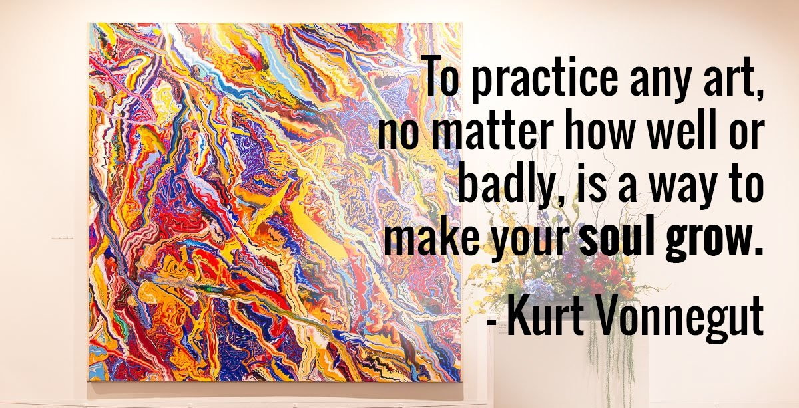

The Springfield Art Museum is closed for renovation and aims to reopen by 2028. Check the museum's website for the latest on its reopening and on any programs it is running in the meantime.

While you wait, here is why it is worth a visit once the doors are open again.

## To make your soul grow

We are going to borrow from the American novelist Kurt Vonnegut: "Practice any art, music, singing, dancing, acting, drawing, painting, sculpting, poetry, fiction, essays, reportage, no matter how well or badly, not to get money and fame, but to experience becoming, to find out what's inside of you, to make your soul grow."

The Springfield Art Museum is in the business of growing souls. Heavy, we know, but we think it is true.

The museum has paintings. Good paintings. It has all the stuff a museum should have, and it has other things too.

Things the museum has offered:

- Pottery classes
- American regionalism
- Sewing classes
- Metalwork and jewelry classes
- Asian porcelains
- Free admission

When a person or group has stored up goods or value, it is usually guarded, and access is rarely free. The only way to explain the museum's behavior with its collection is that the people there love art, and they want you to love art too.

This is not Los Angeles or New York. Our art museum is not a sprawling, six-story warehouse. We are a small to medium-sized Midwestern town, so finding any art museum here is a pleasant surprise. Finding such a well-curated one is a revelation.

## Not too artsy

If you are unsure, do not be too worried. Lots of things called art are anything but, and people who enjoy museums can tend to get a little artsy-fartsy, as one of our spouses puts it. The Springfield Art Museum is not like that. It has had displays featuring art from local elementary schools, and we have a lot of homegrown talent.

It is strange that as kids we love drawing, cutting, painting, coloring and all kinds of art, and then as adults we let it go. Why? So we can watch predictable sitcoms? The only art many of us see every day is bland corporate art designed not to offend anybody. We think it is worth getting back in touch with our younger selves and looking at something beautiful from time to time.

## Pair it with the park

The museum sits right next to [Phelps Grove Park](/phelps-grove-park/), another hidden gem. When the museum is open, go see something beautiful. Make something beautiful. Then walk out the doors and through the park to see another kind of beauty.

You have driven past it a thousand times without guessing at the treasure inside. The Springfield Art Museum is a treasure hidden in plain sight, and few people ever discover the abundance within reach. Will you be one of the people who does?
