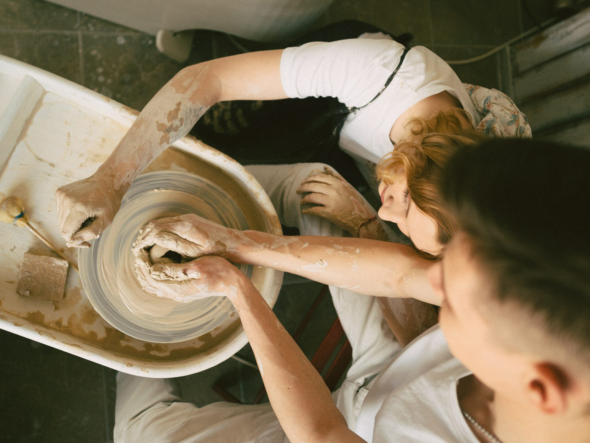
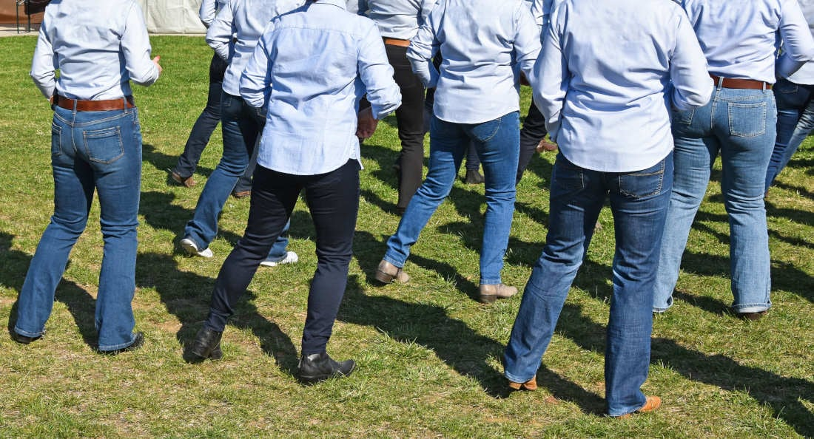

Love is in the air. Or hopefully it will be by the time February 14 rolls around. It is a great time to show a little extra love to that special someone. Or, if you are flying solo, show a little extra love to yourself.

We gathered a few ideas to make the day unique. Whether you are married, single or somewhere in between, 417 land has all kinds of fun in the month of love.

**Note:** Event dates change every year. Where a date is not listed, follow the link to check this year's schedule.

## Date night on the pottery wheel

If you are a product of the 80s, you probably picture that famous scene from *Ghost* when you think of romantic pottery throwing. We can already hear "Unchained Melody."

If getting your hands dirty with your date sounds fun, this one is for you. Art Zone in Nixa has hosted a Valentine's pottery date night where each person creates and glazes a piece of pottery on the wheel (and maybe recreates that *Ghost* scene).

Check [Art Zone's site](https://www.artzonenixa.com/) for this year's date and details.

## Chocolate walk

All the single ladies, and single men too, can get in on this one and treat themselves.

The little town of Fair Grove has held a Chocolate Walk around Valentine's Day. Stroll down historic Main Street and sample chocolate treats from the shops and merchants.

Find current information on the [Fair Grove Chamber of Commerce site](https://fairgrovechamber.org/).

## Line dancing

If you want to work off all that chocolate, get your boots on and show off your moves on the dance floor.

Midnight Rodeo has offered line dancing lessons for couples on some weeknights, with the lessons starting in the evening. That leaves plenty of time to wine and dine first. Stick around after the lesson to try your new two-step while the DJ plays line-danceable songs.

Check [Midnight Rodeo's Facebook page](https://www.facebook.com/midnightrodeomo) for current lesson nights and times.

## Cocktail making at Finley Farms

Finley Farms is a very romantic spot, with string-lit walkways, a quiet river running under a walking bridge and top-notch dining.

Take it up a notch by bringing your 21-or-older date to the Workshop for a couple's cocktail class. Past classes have paired specially chosen hors d'oeuvres with lessons on making three cocktails.

See [Finley Farms' happenings page](https://finleyfarmsmo.com/happenings/) to check whether a Valentine's class is scheduled this year and when.

## Beer, Wine, Cheese and Chocolate Festival

The three ways to any human's heart: booze, cheese and chocolate.

Bring your plus one (and an empty stomach) to eat and drink your way through some of the best indulgences 417 land has to offer. The 14th annual Beer, Wine, Cheese & Chocolate Festival is set for February 6, 2027, at the Ozark Empire Fairgrounds. It is for guests 21 and older, and tickets include samples of beer, wine, cheese and chocolate.

Get details and tickets on the [Ozark Empire Fair event page](https://www.ozarkempirefair.com/p/events/ozark-empire-fairgrounds-produced-events/beer-wine-cheese-and-chocolate-festival).

## Soulfire Marriage Conference

Even a great marriage has room for improvement. What is more romantic than a weekend focused on growing closer?

Soulfire Ministries in Ash Grove hosts a marriage conference, and the 2027 dates are on their site. Past conferences have included speakers, worship and workshops, with dinner and dancing on Saturday night.

Check [Soulfire Ministries' site](https://www.soulfireministries.org/) for the 2027 dates, details and tickets, then talk it over with your spouse.

## And much, much more

These are just a few of the Valentine's happenings in 417 land. Pick your favorite or find something else that suits you. Most important, take the time to celebrate some love.
