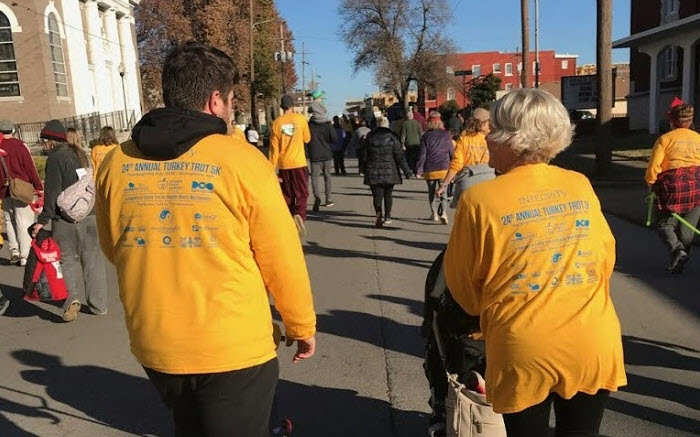

Does running entice you? Do you get a thrill from pounding pavement on a painfully cold late-fall morning? Does the thought of helping a good cause while getting a Thanksgiving tradition under your belt bring a smile to your face?

Then the Thanksgiving Turkey Trot 5K might be for you.

The Turkey Trot is a Springfield-Greene County Park Board event, held in downtown Springfield on Thanksgiving morning. This year's race is the 32nd annual, set for Thursday, November 26, 2026, at 8 a.m., rain or shine, according to the Park Board.

## Lace Up for the Turkey Trot

Register on the Park Board's [Turkey Trot page](https://www.parkboard.org/624/Turkey-Trot), where you can also find the race route and answers to common questions. Registration fees and options change from year to year, so check the page for current details.

Whether you run the whole 5K or walk it (if you don't enjoy torture), you're part of a Thanksgiving tradition in Springfield.

### What to Do Before Race Day

Packet pickup happens in person at the Springfield Expo Center the day before Thanksgiving and early on race morning. The Park Board lists exact hours on the event page.

It's also a chance to see other running enthusiasts, and to register in person if you haven't already.

## Where the Money Goes

Part of your registration fee supports two local causes:

- The [Springfield-Greene County Park Board Youth Recreation Scholarship Fund](https://www.parkboard.org/439/Scholarships), which helps local kids take part in Park Board programs.
- The Developmental Center of the Ozarks, which supports children and adults with developmental disabilities.

## Bring Food for Ozarks Food Harvest

Turkey Trot is also one of the largest one-day food drives of the year for Ozarks Food Harvest. When you pick up your packet, bring nonperishable food items to donate. The Park Board asks for a specific number of items each year, so check the event page for this year's request.

## Run, 417, Run

Whether you're running with a big group, joining a few family members or hitting the pavement alone, you're part of a great event benefiting 417 land.

So lace up, run off the Thanksgiving feast calories, and give yourself a well-deserved pat on the back.

Looking for more to do around the holidays? See our guide to [things to do in Springfield](/best-things-to-do-in-springfield-mo/).
